# L4 Safety Island for Autoware — Software Design

**Part 1 — Node Allocation between the Safety Island and the High-Performance Computer**

Reference Design WG · draft for WG review · **Version 20261023**

> **Document version.** The version is a date-code, `YYYYMMDD`. The four artefacts of this
> deliverable — this Markdown source, the slide deck, the review edition and the discussion
> document — carry the *same* code on their title page. A set that does not share one code is not
> a coherent revision and should not be reviewed as one.

> **Another way in — the slide deck.** The same design is presented as a discussion deck,
> [L4SafetyIsland-SoftwareDesign.pdf](Slides/L4SafetyIsland-SoftwareDesign.pdf): the four behaviours,
> the ladder drawn as a state diagram, the criticality tiers and the five-phase node allocation,
> one figure per slide. Read it first for the shape of the design; read this document for the
> arguments, the interface tables and the open decisions.

**Revision history — major revisions only.**

| Version | Issued | Status and scope |
| :-- | :-- | :-- |
| **20261023** | 2026-10-23 | **Major revision**, superseding version 20260918; content from the WG session of 2026-10-17. *(1)* **Ranks the island sensors** ([D8](#1-inputs-already-fixed-by-the-wg)): forward camera **mandatory**, radar second, ultrasonic third, IMU / GNSS fourth, 2D lidar **optional**. A behaviour may require only the camera; a lower-ranked sensor buys speed or ODD width, never the behaviour itself. Every behaviour above [B4](#b4--emergency-stop-when-the-island-is-blind) is rewritten against the camera, the §9.4 sensor rungs are re-cut to the ranking (B2 and B4 survive at rung A and rung 0 respectively; B3 drops to rung A at or below ~30 km/h), and the AEB trigger moves from the 2D lidar to radar. *(2)* **[B2](#b2--keep-the-vehicle-in-its-lane-after-loss-of-the-hpc) first slows to the safe speed of the current ODD**, `v_odd` — of the order of 60 km/h on a highway and 30 km/h on a city road, the class latched from [`H4`](#7-new-nodes-to-add-on-the-hpc)'s last `active_odd` — and its hold window `T_hold` is set at **8–15 s** per road class, long enough to contain the descent to `v_odd` and still leave the HPC time to return. The lane must be observable **by the camera**: the buffered map corridor refines it but cannot stand in for it, and the heading / yaw-rate tube is withdrawn as a corridor source. When `T_hold` expires, [B2](#b2--keep-the-vehicle-in-its-lane-after-loss-of-the-hpc) hands over to exactly one successor — [B3](#b3--pull-over-if-the-odd-continues-to-fail) if the camera still sees the lane, [B4](#b4--emergency-stop-when-the-island-is-blind) if it does not. *(3)* **[B3](#b3--pull-over-if-the-odd-continues-to-fail) searches with the camera**: [`N14`](#62-island-safety-sensing) holds the lane lines, finds the pull-over space between the outer lane line and the road edge, and bounds the lateral move; radar confirms what is coming on the pull-over side and may disqualify a space, never qualify one. *(4)* **[B4](#b4--emergency-stop-when-the-island-is-blind) is redefined as the loss of the camera** (or of the lane lines beyond the bridging budget); a surviving radar keeps AEB armed and may steepen the ramp, but does not lift the blackout. *(5)* **Declares two human-driven behaviours** on a new island communication module to the remote command and control centre and a local control port ([D9](#1-inputs-already-fixed-by-the-wg)): [B5](#b5--tele-operation-from-the-remote-command-centre) **tele-operation** from the RCC on streamed camera, radar and ultrasonic, and [B6](#b6--manual-joystick-control-without-streamed-sensing) **manual joystick control** over a wired or short-range radio link with no stream. Adds §6.5 and the nodes [`N21`](#65-remote-command-and-control-link-and-local-control-port) `si_rcc_link`, [`N22`](#65-remote-command-and-control-link-and-local-control-port) `si_teleop_streamer` and [`N23`](#65-remote-command-and-control-link-and-local-control-port) `si_local_control`; their detailed design is pending. *(6)* **Carries the design in two branches** ([D10](#1-inputs-already-fixed-by-the-wg), [§9.5](#95-two-design-branches-least-cost-and-maximum-safety)): **Least-Cost** — camera, ultrasonic, 2D lidar and IMU / GNSS on an S32Z2, AURIX TC4x or Stellar microcontroller, with no radar, which makes it a city-road, fair-weather branch — and **Maximum-Safety** — camera, four radars, ultrasonic and IMU / GNSS on an R-Car X5H; every behaviour is adjusted to each branch's sensors. Also restores the missing ultrasonic row of §6.2. *(7)* **Gives [B5](#b5--tele-operation-from-the-remote-command-centre) and [B6](#b6--manual-joystick-control-without-streamed-sensing) a stage-1 detailed design** ([§6.6](#66-detailed-design-of-b5-and-b6), [§8.6](#86-the-rcc-link-and-the-local-control-port)): both entered from standstill; [B5](#b5--tele-operation-from-the-remote-command-centre) drives on bounded setpoints at a `v_teleop` set by the latency measured through the frame-stamp echo, is stopped by the island after `T_link` = 300 ms of silence, and may re-engage the ADS from `SAFE_STOP`; [B6](#b6--manual-joystick-control-without-streamed-sensing) runs a cableless-machinery joystick at 5 km/h and stops after `T_local` = 200 ms. Adds the SI-E2E/R profile for the open RCC link, and the P3s partition. Adds open decisions 19 to 23, and reshapes 3, 4, 8, 13, 14, 15 and 18. **Marker yellow continues to mark everything new since 20260827**, so this revision's material is highlighted alongside that of 20260903 and 20260918. |
| 20260918 | 2026-09-18 | **Major revision**, superseding version 20260912. *(1)* Recasts [B1](#b1--degrade-the-ads-when-the-odd-cannot-be-held) from a constraint ladder into an **ODD switch negotiation**. The island declares the current operating domain unsatisfiable and **names no target**; the HPC selects a domain it can meet and declares it through [`H4`](#7-new-nodes-to-add-on-the-hpc); the island verifies that answer against its own measured envelope *and* against the vehicle's measured behaviour. [B1](#b1--degrade-the-ads-when-the-odd-cannot-be-held) gains a **Demand** row, an **Acceptance test** row and both exits, and becomes the only behaviour that returns the vehicle to normal L4 operation — in a narrower domain than it started in. Adds `T_ack` and the safety timeout `T_odd`, the latter bounded from above by `t_margin − t_pullover`. *(2)* Makes the **takeover explicit**: when `T_odd` expires the successor is chosen by what the island still *has*, not by what the HPC did wrong — blackout → [B4](#b4--emergency-stop-when-the-island-is-blind), HPC lost → [B2](#b2--keep-the-vehicle-in-its-lane-after-loss-of-the-hpc), otherwise → [B3](#b3--pull-over-if-the-odd-continues-to-fail), tested in that order (§3.2). *(3)* Defines **`v_hold` as a ramp** rather than a constant. It is the running minimum of five bounds, monotone non-increasing within an episode, decaying to `v_entry` so that escalation from [B2](#b2--keep-the-vehicle-in-its-lane-after-loss-of-the-hpc) to [B3](#b3--pull-over-if-the-odd-continues-to-fail) costs no further deceleration time: the hold window becomes preparation instead of dead time. *(4)* Gives [B3](#b3--pull-over-if-the-odd-continues-to-fail) a **second refuge source**. When [`H8`](#7-new-nodes-to-add-on-the-hpc) offers none, [`N18`](#63-pull-over-mrm-after-hpc-loss) detects a lateral clearance from island sensing alone — always `EMERGENCY_ONLY`, never displacing a nominated refuge, bounded by `T_refuge` — and the three outcomes are held apart: *found*, *positively none* (→ in-lane stop, the corridor still in hand) and *inconclusive* (→ [B4](#b4--emergency-stop-when-the-island-is-blind), because an inconclusive search is a capability statement). *(5)* Adds the §6.4 **Unsatisfiable** rung and its six-step verification, §5.3 rung 1b, and new material on [`H4`](#7-new-nodes-to-add-on-the-hpc), [`H8`](#7-new-nodes-to-add-on-the-hpc), [`N18`](#63-pull-over-mrm-after-hpc-loss), [`N19`](#64-odd-degradation-on-weather-and-visibility) and the §8 interface tables. Adds open decisions 17 and 18. **Marker yellow continues to mark everything new since 20260827**, so this revision's material is highlighted alongside 20260903's rather than in place of it. |
| 20260912 | 2026-09-12 | **Editorial revision**, superseding version 20260903. Adds to [§4](#4-autoware-nodes-allocated-to-the-safety-island) a five-phase figure series elaborating the node allocation — Autoware as it stands, the same graph abstracted, the same boxes after the island, what changed at node level, and the island alone. No normative change: no behaviour, node, interface row or open decision is added, removed or altered |
| 20260903 | 2026-09-03 | **Major revision**, superseding version 20260827. *(1)* Adds **[B4](#b4--emergency-stop-when-the-island-is-blind)** as the fourth declared behaviour: what the island does when it has lost the sensing that [B2](#b2--keep-the-vehicle-in-its-lane-after-loss-of-the-hpc) and [B3](#b3--pull-over-if-the-odd-continues-to-fail) both depend on. Emergency stop was previously only step 3b of the §5.3 graded reaction and the bottom rung of the §6.3 abort ladder; it is now *declared*, with its own trigger, deadline, sensor rung and traceability row. *(2)* Admits the **first optional HPC-produced input** — the object list of [§3.5](#35-optional-enrichment-the-hpc-object-list) — which all four behaviours may use under the new **monotone-conservatism** rule, through the optional node [`N20`](#62-island-safety-sensing). *(3)* **Corrects a misconception about termination:** [B3](#b3--pull-over-if-the-odd-continues-to-fail) was written as *the* terminal behaviour. Both [B3](#b3--pull-over-if-the-odd-continues-to-fail) and [B4](#b4--emergency-stop-when-the-island-is-blind) end the drive cycle and neither gives it back; they differ in *where* the vehicle stops and on what evidence, not in whether the drive continues (§3.2). *(4)* **Both terminal behaviours now raise the hazard lamps at entry**, not at standstill, and the indicator conflict this creates for [B3](#b3--pull-over-if-the-odd-continues-to-fail) is recorded for the WG. *(5)* Corrects the claim that [B4](#b4--emergency-stop-when-the-island-is-blind) has no edge out: its one successor is `SAFE_STOP`, and what it has no edge to is any behaviour above it. *(6)* Adds the §6.3 **abort-ladder illustration** — each rung down removes a requirement and never adds one. Adds open decisions 15 and 16. Material new since 20260827 is marked in **marker yellow** throughout this document and the three artefacts built from it. |
| 20260827 | distributed 2026-08-28 | First WG review draft. Three declared behaviours ([B1](#b1--degrade-the-ads-when-the-odd-cannot-be-held)–[B3](#b3--pull-over-if-the-odd-continues-to-fail)), node allocation, interface contract, fourteen open decisions. |

---

## 0. Scope of this part

The project deliverable is a design document covering computing devices, communication, and
software architecture for an L4 Safety Island for Autoware, with the software design as the focus.
This part answers the first question:

> Which existing Autoware ROS nodes execute on the Safety Island, which remain on the HPC, and
> which **new** nodes must be created on each side?

It first **declares the <mark>six</mark> behaviours the island must exhibit** (§3), because the allocation is
only defensible as a means of delivering them. It then defines the interface contract between the two
domains, because the allocation cannot be justified without that either: a node's placement is only defensible once the messages it must still receive
after the other domain has failed are enumerated.

Out of scope for Part 1 (planned as Parts 2–4): FTTI budget derivation and timing analysis, HARA /
ASIL allocation evidence, fault-injection test plan, and the ISO 26262 work-product mapping.

---

## 1. Inputs already fixed by the WG

These are taken as given from [SafetyIsland_RefDesignWG.pdf](SafetyIsland_RefDesignWG.pdf) (p.18–20) and
`SaftyIsland_ReferenceDesign.md`, and constrain the allocation:

| # | Decision | Source |
| :-- | :-- | :-- |
| D1 | The L4 Safety Island is a **standalone, safety-certified ECU**, not an on-SoC partition | Deck p.18; RFC §"Hardware devices" |
| D2 | HPC hosts perception / planning / VLM; the island hosts **status monitoring, the control module, and MRM** | Deck p.18 |
| D3 | HPC ↔ island link is **TSN / Vehicle Ethernet**; island → actuators is CAN FD / FlexRay | Deck p.20 |
| D4 | Island middleware is **nano-ros** (zenoh-pico core, ROS-message compatible, RTOS-portable) | CLAUDE.md; deck p.12 |
| D5 | Island OS and nodes must be **real-time compliant**: predictable execution time, memory safe | Deck p.18 |
| D6 | Every safety-relevant payload carries **end-to-end protection** — CRC, sequence counter, data ID, age; gPTP provides the time base. **AUTOSAR is out of scope: this is an Autoware in-house design** | RFC §"Communication protocol stack"; WG, 2026-08-27 |
| **D7** | **Low-resolution, high-robustness sensors are connected directly to the island** — 2D lidar, forward camera, ultrasonic, radar — so that the MRM nodes execute without the HPC | WG, 2026-08-27 |
| <mark>**D8**</mark> | <mark>**Not every island carries every [D7](#1-inputs-already-fixed-by-the-wg) sensor, and they are ranked.** (1) **Forward camera — mandatory.** (2) **Radar** — forward, and rear-corner on the pull-over side. (3) **Ultrasonic array.** (4) **Island IMU / GNSS.** (5) **2D lidar — optional.** A behaviour may *require* only what is mandatory; what a lower-ranked sensor adds is a higher speed or a wider ODD, never the behaviour itself. The proprioceptive chassis signals — wheel speed, steering report, the ESC yaw rate and acceleration — arrive over the vehicle bus and are not island sensors in this ranking</mark> | <mark>WG, 2026-10-17</mark> |
| <mark>**D9**</mark> | <mark>**The island carries its own communication module to the remote command and control centre (RCC)** — a cellular (LTE / 5G) modem on the island's harness and power rail, not the HPC's — **and a local control port** for a joystick, wired or over a short-range radio link. Two human-driven behaviours are declared on them, [B5](#b5--tele-operation-from-the-remote-command-centre) tele-operation and [B6](#b6--manual-joystick-control-without-streamed-sensing) manual joystick control; their detailed design is pending</mark> | <mark>WG, 2026-10-17</mark> |
| <mark>**D10**</mark> | <mark>**The design is carried in two branches** that share the six behaviours, the node set and the interface contract, and differ in the hardware fitted to the island. **Least-Cost:** forward camera, five ultrasonic sensors, a 2D lidar and an IMU / GNSS on an NXP S32Z2, Infineon AURIX TC4x or ST Stellar microcontroller, with no radar. **Maximum-Safety:** forward camera, four radars (two front, two rear), five ultrasonic sensors and an IMU / GNSS on a Renesas R-Car X5H. How each behaviour is adjusted to each branch's sensors is in [§9.5](#95-two-design-branches-least-cost-and-maximum-safety)</mark> | <mark>Design lead, 2026-10-23</mark> |

Two further facts come from work already completed at NEWSLab and are treated as the engineering
baseline rather than as assumptions:

- **The Autoware trajectory follower already runs on an island.** `autoware-safety-island` (branch
  `nano-ros`) runs the vendored Autoware MPC lateral + PID longitudinal controllers as standalone
  firmware on Zephyr/FreeRTOS, subscribing to trajectory, odometry, steering report, acceleration and
  operation-mode state, and publishing `control_cmd` — wire-compatible with unmodified ROS 2 Humble
  Autoware, closed loop at ≥ 19 Hz against a 10 Hz trajectory, with a 250-point trajectory bound and
  `KEEP_LAST` depth 1 on every input.
- **Failover cadence has been measured.** On the RT-evaluation island (six nodes drawn from the
  Autoware vehicle-interface subsystem, FreeRTOS/zenoh-pico), control cadence held through a Linux
  outage at a mean period of 9.96 ms, the 500 ms watchdog tripped in 0.49–0.67 s, and MRM ramped the
  vehicle to standstill.

The allocation below is designed so that this existing island grows into the target island by
addition, not by rewrite.

---

## 2. Allocation method

### 2.1 Partitioning rules

Each rule is a test applied to every candidate node. [R1](#21-partitioning-rules) is the decisive one.

| Rule | Statement | Consequence |
| :-- | :-- | :-- |
| **[R1](#21-partitioning-rules) — Survivability** | If the function must still work *after the HPC is gone*, it executes on the island. | Forces the whole final-command path onto the island. |
| **[R2](#21-partitioning-rules) — No orphan inputs** | A node on the island must not depend on a topic that only the HPC can produce, unless it has a defined safe behaviour when that topic goes silent. | Forces new island-local state estimation and fault sources. |
| **[R3](#21-partitioning-rules) — Monitor independence** | A monitor must not share a failure mode with what it monitors. | HPC liveness/deadline supervision is island-resident, not HPC-resident. |
| **[R4](#21-partitioning-rules) — Bounded resources** | Island nodes must have statically bounded memory, bounded worst-case execution time, and no dynamic discovery. | Excludes map-dependent, learning-based, and solver-unbounded nodes from the ASIL tiers. |
| **[R5](#21-partitioning-rules) — Narrow interface** | The HPC→island interface is typed, fixed-rate, rate-limited and E2E-protected. Anything that would widen it materially stays on the HPC. | Keeps HD map, point clouds and images off the link. The one object list admitted ([§3.5](#35-optional-enrichment-the-hpc-object-list)) crosses only as a **bounded digest** — fixed object count, fixed horizon, fixed fields — and only as an option. |
| **[R6](#21-partitioning-rules) — Single actuation authority** | Exactly one component owns the final command to the actuator gateway, and it is on the island. | The gate is the arbitration point and the ASIL-D anchor. |
| **[R7](#21-partitioning-rules) — Diversity over duplication** | Where the island needs an independent view, prefer a *different* sensing/algorithmic channel over a copy of the HPC's. | Per [D7](#1-inputs-already-fixed-by-the-wg): a physically separate low-resolution sensor set on the island, not a second copy of the HPC's high-resolution pipeline <mark>— ranked by [D8](#1-inputs-already-fixed-by-the-wg), with the camera the one sensor every behaviour above [B4](#b4--emergency-stop-when-the-island-is-blind) may assume</mark>. |
| **[R8](#21-partitioning-rules) — Certifiability of the critical set** | The ASIL-D set must be small enough to argue about. Complexity is permitted only below a monitoring layer. | Two-tier controller (§4.2). |

### 2.2 Criticality tiers on the island

The island is not uniformly ASIL-D. It is layered, and the safety argument is ASIL decomposition by
monitoring: a lower-integrity nominal controller is admissible because a higher-integrity arbiter
bounds its output.

| Tier | Target integrity | Contents | Cadence |
| :-- | :-- | :-- | :-- |
| **[T0](#22-criticality-tiers-on-the-island) — Safety core** | ASIL-D | Command gate, safety state machine, watchdog, emergency-stop MRM, actuator TX, E2E gateway, island vehicle-state estimator | 100 Hz |
| **[T1](#22-criticality-tiers-on-the-island) — Supervision** | ASIL-B(D) | Control validator, fallback controller, safety-envelope monitor, corridor monitor, actuator-feedback supervisor | 50 Hz |
| **[T1s](#22-criticality-tiers-on-the-island) — Safety sensing** | ASIL-B(D) | Island sensor ingest, safety world model, AEB, near-field collision detection | 20–50 Hz |
| **[T2](#22-criticality-tiers-on-the-island) — Nominal control** | QM, monitored by [T0](#22-criticality-tiers-on-the-island)/[T1](#22-criticality-tiers-on-the-island) | MPC lateral + PID longitudinal trajectory follower, raw vehicle command converter, shift decider | 33–50 Hz |
| **[T3](#22-criticality-tiers-on-the-island) — Non-real-time** | QM | Event recorder, UDS/DTC diagnostics, telemetry egress | 1–10 Hz |

This is what makes the design tractable: **the MPC and its OSQP solver never need to be ASIL-D**,
because [T0](#22-criticality-tiers-on-the-island) bounds every command it produces and can replace it within one control period.

**The staleness rule for sensing.** [T1s](#22-criticality-tiers-on-the-island) runs slower than [T0](#22-criticality-tiers-on-the-island) and has a heavier, more variable execution
profile, so [T0](#22-criticality-tiers-on-the-island) must never block on it. The island sensing chain publishes a small, bounded
**safety world state** — nearest in-path obstacle, its range and range-rate, time-to-collision,
free-space distance ahead, perceived corridor bounds, per-sensor validity — which [T0](#22-criticality-tiers-on-the-island) consumes with an
explicit age check. **If that state is stale or invalid, [T0](#22-criticality-tiers-on-the-island) does not wait and does not guess: it
substitutes the most conservative assumption and executes a blind deceleration MRM.** Island perception
therefore *improves* the fallback; it is never a precondition for it. This is the property that keeps
the ASIL-D argument independent of the perception chain.

---

## 3. Expected behaviours and functional allocation

This section is **normative**. Everything after it — the node allocation, the interface contract, the
partitioning — exists to deliver these <mark>six</mark> behaviours, and each allocation decision must be
traceable to one of them.

### 3.1 The six declared behaviours

| ID | Behaviour | One-line statement |
| :-- | :-- | :-- |
| **B1** | **Degrade the ADS when the ODD cannot be held** | When the operating envelope is no longer satisfied, <mark>require the ADS to move to an operating domain it *can* satisfy</mark> — progressively constraining it, and demanding that it constrain itself, <mark>until it does</mark> — before any authority is taken. |
| **B2** | **Keep the vehicle in its lane after loss of the HPC** | When the HPC is unavailable and [B1](#b1--degrade-the-ads-when-the-odd-cannot-be-held) therefore cannot be used, take authority and hold the vehicle in its current lane — for a bounded window <mark>of typically 8–15 s</mark>, <mark>at a decaying speed the island can itself justify, *first reduced to the safe speed of the current ODD* (e.g. 60 km/h on a highway, 30 km/h on a city road), while staging the exit manoeuvre</mark> — while the lane is still observable <mark>by the island's camera</mark>, pending the HPC's return <mark>or escalation to [B3](#b3--pull-over-if-the-odd-continues-to-fail) or [B4](#b4--emergency-stop-when-the-island-is-blind)</mark>. |
| **B3** | **Pull over if the ODD continues to fail** | When degradation does not restore the envelope within a declared deadline, bring the vehicle out of the running lane to a standstill in a refuge — <mark>nominated by the HPC where one is offered, detected by the island's own sensors where one is not — with the **camera** tracking the lane lines and finding the space to pull over into</mark>. |
| <mark>**B4**</mark> | <mark>**Emergency stop when the island is blind**</mark> | <mark>When the island has lost the sensing that [B2](#b2--keep-the-vehicle-in-its-lane-after-loss-of-the-hpc) and [B3](#b3--pull-over-if-the-odd-continues-to-fail) both depend on — **the camera**, the one sensor both may assume ([D8](#1-inputs-already-fixed-by-the-wg)) — decelerate to a standstill where the vehicle already is — no lane keeping, no refuge, no lateral manoeuvre.</mark> |
| <mark>**B5**</mark> | <mark>**Tele-operation from the remote command centre**</mark> | <mark>A remote driver at the RCC drives the vehicle over the island's communication module, on sensor data the island streams to them — camera, radar and ultrasonic — while the island keeps its own guards armed and stops the vehicle itself if the link fails. *Detailed design pending.*</mark> |
| <mark>**B6**</mark> | <mark>**Manual joystick control without streamed sensing**</mark> | <mark>An operator with direct sight of the vehicle drives it with a joystick on a wired or short-range radio link, with no sensor stream; the island holds the speed to a creep and stops the vehicle on release or on loss of the link. *Detailed design pending.*</mark> |

<mark>**[B1](#b1--degrade-the-ads-when-the-odd-cannot-be-held)–[B4](#b4--emergency-stop-when-the-island-is-blind) are automated; [B5](#b5--tele-operation-from-the-remote-command-centre) and [B6](#b6--manual-joystick-control-without-streamed-sensing) are human-driven.** In the first four the island decides. In the last two a person decides — a remote driver at the RCC, or an operator standing at the vehicle — and the island executes, bounds and guards what that person commands. Both are declared now, by [D9](#1-inputs-already-fixed-by-the-wg), so that the allocation reserves their nodes, their command sources and their place in the state machine; their sections below fix only what is already settled — entry, authority, the guards that stay armed, the response to a lost link, the minimum sensor rung — and list what is pending.</mark>

<mark>Each behaviour is written below against the full [D8](#1-inputs-already-fixed-by-the-wg) ranking. The two design branches of [D10](#1-inputs-already-fixed-by-the-wg) each carry only part of that set, and [§9.5](#95-two-design-branches-least-cost-and-maximum-safety) states how every behaviour is adjusted on each: the speed, the ODD and the evidence it can claim.</mark>

Each behaviour below closes with the island's node graph lit for it — phase 5 of the §10 series, one page per behaviour, drawn by the convention of [layers/L4SafetyIsland-Layers.md](layers/L4SafetyIsland-Layers.md). The <mark>six</mark> pages are collected in [layers/L4SafetyIsland-Behaviours.pdf](layers/L4SafetyIsland-Behaviours.pdf). <mark>The pages for [B5](#b5--tele-operation-from-the-remote-command-centre) and [B6](#b6--manual-joystick-control-without-streamed-sensing) follow their §3.3 rows and the stage-1 detailed design of [§6.6](#66-detailed-design-of-b5-and-b6).</mark>

---

#### B1 — Degrade the ADS when the ODD cannot be held

<mark>Read as a constraint ladder, [B1](#b1--degrade-the-ads-when-the-odd-cannot-be-held) is a demand that the ADS *slow down*. That is only its
enforcement. [B1](#b1--degrade-the-ads-when-the-odd-cannot-be-held)'s actual object is an **operating domain**: the island measures the world, declares
that the domain the vehicle is currently being driven in is no longer satisfiable, and requires the HPC
to move to one that is. The speed cap is what holds the vehicle safe *while* that happens — never what
resolves it.</mark>

<mark>The island does not choose the new domain. It does not hold the HPC's catalogue of operating domains,
does not know which L4 behaviours each of them admits, and choosing between them is planning — which is
not on the island by [R4](#21-partitioning-rules) and [R5](#21-partitioning-rules). So the exchange is asymmetric, and deliberately so:</mark>

> <mark>**The island declares what the world will support. The HPC declares which domain it will operate
> in. The island verifies that answer against its own measurements, and accepts it or does not.**</mark>

<mark>That asymmetry is what makes [B1](#b1--degrade-the-ads-when-the-odd-cannot-be-held) the only *exitable* behaviour. [B3](#b3--pull-over-if-the-odd-continues-to-fail) and [B4](#b4--emergency-stop-when-the-island-is-blind) end the drive
cycle; [B2](#b2--keep-the-vehicle-in-its-lane-after-loss-of-the-hpc) holds one open. [B1](#b1--degrade-the-ads-when-the-odd-cannot-be-held) is the only behaviour that returns the vehicle to normal L4
operation — in a narrower domain than the one it started in, driven by the HPC, with the island back to
supervising. It exits **upward** when the HPC is driving normally inside a domain the island has
accepted, and **downward** — to [B2](#b2--keep-the-vehicle-in-its-lane-after-loss-of-the-hpc), [B3](#b3--pull-over-if-the-odd-continues-to-fail) or [B4](#b4--emergency-stop-when-the-island-is-blind) — when the safety timeout `T_odd` expires
without one.</mark>

| | |
| :-- | :-- |
| **Trigger** | [`N19`](#64-odd-degradation-on-weather-and-visibility) ODD margin falls below threshold (visibility, friction, precipitation, ambient light); or [`N17`](#62-island-safety-sensing) reports sensor degradation; or [`H4`](#7-new-nodes-to-add-on-the-hpc) reports the HPC's own ODD exit; or [`N18`](#63-pull-over-mrm-after-hpc-loss) reports `pull_over_available = false` while margin is already marginal |
| **Precondition** | **The HPC is alive and responsive.** [B1](#b1--degrade-the-ads-when-the-odd-cannot-be-held) is cooperative by construction: every rung of it is executed by the HPC. If the HPC is unavailable there is nothing to constrain, and the island enters [**B2**](#b2--keep-the-vehicle-in-its-lane-after-loss-of-the-hpc) instead |
| **Authority** | **The island constrains; the HPC executes.** The island does not take control under [B1](#b1--degrade-the-ads-when-the-odd-cannot-be-held). |
| <mark>**Demand**</mark> | <mark>[`N19`](#64-odd-degradation-on-weather-and-visibility) publishes `odd_satisfiable = false` on `/si/out/odd_verdict`, with the measured envelope (`d_visible`, `a_brake`, derived `v_max`), the ODD dimension that failed, and the remaining `T_odd` budget. **The island names no target domain**: the demand is *leave this one*, not *enter that one*</mark> |
| **Response** | Graded, in order: *notify* → <mark>*demand an ODD switch*</mark> → *restrict* (hard speed cap from the speed law, §6.4) → *request MRM* from the HPC. <mark>The rungs are cumulative, not alternative — the cap stays on while the switch is negotiated, and is lifted only by an accepted switch or by the envelope's own recovery</mark> |
| <mark>**Acceptance test**</mark> | <mark>Two tests, both measurable on the island, neither needing the HPC's cooperation. **(1) Declaration** — the domain [`H4`](#7-new-nodes-to-add-on-the-hpc) now reports as active must lie inside the island's measured envelope: speed ceiling at or below `v_max`, required sensing range at or below `d_visible`, assumed friction at or below the estimate. **(2) Behaviour** — measured speed, acceleration and curvature converge on that domain's bounds within `T_odd`. A declaration that passes (1) but fails (2) is a *false declaration*, and counts as no declaration at all</mark> |
| **Deadlines** | <mark>Declare a new active domain — or declare exhaustion — within `T_ack` = **2 s** of the demand; satisfy it within the safety timeout `T_odd` = **10 s** (open decision 17).</mark> Comply with a restriction within **3 s**; begin a requested MRM within **10 s**; complete it within **60 s** |
| **Observable output** | `/si/out/odd_verdict` <mark>(carrying `odd_satisfiable`, the failed dimension, the accepted domain once there is one, and the remaining `T_odd` budget)</mark>, `/si/out/constraints` (mode `ALLOW` → `CONSTRAIN` → `MRM`). `MrmState` remains `NORMAL` throughout: **[B1](#b1--degrade-the-ads-when-the-odd-cannot-be-held) is not an MRM** |
| **Success criterion** | <mark>The HPC declares a domain that passes both acceptance tests and holds it over the recovery window — *or*, where the envelope recovers on its own,</mark> measured vehicle speed converges to `v_max` within the deadline, and the ODD margin is restored <mark>without a switch having been needed</mark> |
| <mark>**Exit — upward: the ADS operates in an accepted domain**</mark> | <mark>Both acceptance tests pass and hold for the §6.4 recovery window — ~30 s of clear evidence, with [`H4`](#7-new-nodes-to-add-on-the-hpc)'s own verdict agreeing. [`N3`](#61-supervision-state-and-fallback) returns `/si/out/constraints` to `ALLOW` and the island to supervision. **The vehicle is driving normally again, in a narrower domain than the one it started in** — that narrowing is [B1](#b1--degrade-the-ads-when-the-odd-cannot-be-held)'s *outcome*, not a residual fault, and it persists until the envelope itself recovers</mark> |
| <mark>**Exit — downward: `T_odd` expires**</mark> | <mark>Escalate. *Which* behaviour takes over is decided by what the island still **has**, not by what the HPC did wrong — sensing blackout ([`N17`](#62-island-safety-sensing)) → **[B4](#b4--emergency-stop-when-the-island-is-blind)**; HPC unavailable ([`N2`](#61-supervision-state-and-fallback)) → **[B2](#b2--keep-the-vehicle-in-its-lane-after-loss-of-the-hpc)**; otherwise, the HPC being alive and either non-compliant or out of satisfiable domains → **[B3](#b3--pull-over-if-the-odd-continues-to-fail)**. The tests are applied in that order</mark> |
| **Failure** | Non-compliance within any deadline is raised to [`N8`](#61-supervision-state-and-fallback) as a fault <mark>and escalates by the rule in the row above. A domain that passes acceptance test (1) but fails (2) is additionally recorded by [`N11`](#61-supervision-state-and-fallback) as a SOTIF event: an HPC reporting a domain it is not in is §6.4's confidently-wrong case, arriving through a second channel</mark> |
| **Hysteresis** | Degrade on ~2 s of consistent evidence; recover only after ~30 s of clear evidence **and** agreement from [`H4`](#7-new-nodes-to-add-on-the-hpc) |
| **Optional enrichment** ([§3.5](#35-optional-enrichment-the-hpc-object-list)) | The HPC object list, while it is fresh. Feeds the **self-consistency veto** and adds a conservative term to [`N10`](#61-supervision-state-and-fallback)'s envelope. Never relaxes a bound and never satisfies a deadline |
| **Minimum sensor rung** (§9.4) | <mark>**B** — visibility estimation needs both the radar-versus-camera divergence test and the camera contrast test. The friction dimension needs the island IMU, rung **D**; below it, friction falls back to the chassis ESC signals and is claimed with correspondingly less margin</mark> |

<mark>**Honest exhaustion is not non-compliance.**</mark> <mark>The HPC may answer the demand with *none of my domains
is satisfiable*. That is a **compliant** answer and must not be run out as a timeout. It is the rung the
§6.4 ladder already calls **Request MRM** — ask the HPC to pull over while it still can, with the map,
the traffic law and the full planner available to it. An HPC-executed pull-over under [B1](#b1--degrade-the-ads-when-the-odd-cannot-be-held) is
strictly better than an island-executed one under [B3](#b3--pull-over-if-the-odd-continues-to-fail): the island can verify a refuge, but it
cannot choose one (§6.3). Exhaustion therefore routes to the MRM rung immediately, and only the MRM
deadlines — 10 s to begin, 60 s to complete — then apply. **`T_odd` bounds silence and
non-compliance, not honesty.**</mark>

<mark>**`T_odd` is not a free parameter.**</mark> <mark>The safety timeout is bounded from above by physics the island
is already measuring. While the switch is negotiated the envelope keeps shrinking, and [B3](#b3--pull-over-if-the-odd-continues-to-fail) has a
precondition — a refuge that can still be reached and verified. `T_odd` must be shorter than the time in
which the ODD margin, falling at its measured rate, would invalidate that precondition:</mark>

```text
T_odd  <  t_margin  −  t_pullover

  t_margin    time until the measured ODD margin reaches zero, at its current rate   (N19)
  t_pullover  time to execute a pull-over from the current speed to the refuge       (N18)
```

<mark>An island that negotiates until the moment the envelope fails has spent the budget the fallback
needed. This is §6.3's refuge coverage guarantee, restated on the time axis instead of the distance
axis, and it is why `T_odd` is declared per-situation by [`N19`](#64-odd-degradation-on-weather-and-visibility) rather than fixed as a
constant.</mark>

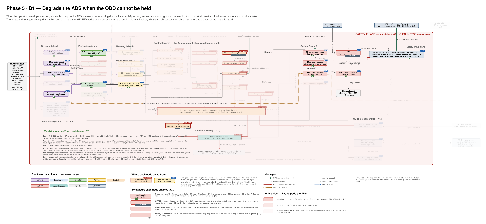

*B1, on the island's node graph. The nodes of the B1 row of §3.3 are in full colour <mark>(the optional N13 half-tone, where fitted)</mark>; the gate and the actuator path are half-tone because the HPC's own commands still pass through them, and so is I7, since requesting the MRM is B1's last rung. The fallback tier and the MRM operators stay faded: the island does not take control. Full size: [layers/L4SafetyIsland-Layer6-B1-DegradeADS.pdf](layers/L4SafetyIsland-Layer6-B1-DegradeADS.pdf); all <mark>six</mark> behaviours on one handout: [layers/L4SafetyIsland-Behaviours.pdf](layers/L4SafetyIsland-Behaviours.pdf).*


---

#### B2 — Keep the vehicle in its lane after loss of the HPC

[B2](#b2--keep-the-vehicle-in-its-lane-after-loss-of-the-hpc) is the island's **autonomous holding behaviour**, and it exists for exactly one situation: the HPC
is unavailable, so [B1](#b1--degrade-the-ads-when-the-odd-cannot-be-held) cannot be used — every rung of [B1](#b1--degrade-the-ads-when-the-odd-cannot-be-held) is executed by the HPC — while [B3](#b3--pull-over-if-the-odd-continues-to-fail) is not yet
warranted, because the loss may still be transient and a pull-over is the more dangerous manoeuvre.
Rather than commit immediately to a terminal manoeuvre, the island takes lateral and longitudinal
authority, holds the vehicle in its current lane at a speed it <mark>continuously reduces</mark>, and waits, for
a bounded window, to see whether the HPC comes back.

<mark>Two things about that window are now fixed rather than open. **Its first act is to bring the vehicle
down to the safe speed of the ODD it is in** — the speed at which a fallback controller on the island's
reduced sensor set may hold a lane of that road class: of the order of **60 km/h on a highway and
30 km/h on a city road**. The HPC was entitled to drive faster because it had the full sensor suite, the
map and the planner; the island has none of them, and the first thing it does on taking authority is to
stop driving at a speed only the HPC could justify. **And its length is of the order of 8–15 s**, not a
few seconds: long enough to ride out a restart of the HPC's planning stack, short enough that the
vehicle does not loiter under a fallback controller. When it closes with the HPC still lost, [B2](#b2--keep-the-vehicle-in-its-lane-after-loss-of-the-hpc)
hands over to exactly one of two behaviours — [B3](#b3--pull-over-if-the-odd-continues-to-fail) if the island can still see the lane, [B4](#b4--emergency-stop-when-the-island-is-blind) if it
cannot.</mark>

<mark>The hold is not a plateau. Throughout the window the island is doing two things at once: waiting for
the HPC, and **preparing to stop without it** — shedding speed onto the ramp defined below and keeping
[`N18`](#63-pull-over-mrm-after-hpc-loss)'s refuge evaluation live, so that when the window closes the exit manoeuvre is already
staged. A hold that merely maintains a constant speed and then discovers, at `T_hold`, that it must
begin decelerating from that speed has spent the whole window buying nothing.</mark>

The behaviour is only enterable while the **lane is still observable** — <mark>by the island's own camera,
which is the one sensor [D8](#1-inputs-already-fixed-by-the-wg) makes mandatory. The buffered map corridor refines what the camera sees
while it is fresh, but it does not substitute for it: a map corridor with no live camera behind it is a
remembered lane, not an observed one.</mark> That precondition is
what distinguishes [B2](#b2--keep-the-vehicle-in-its-lane-after-loss-of-the-hpc) from a blind stop, and it is checked continuously, not only on entry.

| | |
| :-- | :-- |
| **Trigger** | [`N2`](#61-supervision-state-and-fallback) declares the HPC unavailable — heartbeat timeout, per-topic rate violation, or latency beyond the declared budget — and [`N8`](#61-supervision-state-and-fallback) raises `HPC_LIVENESS_LOST` (or `HPC_COMMAND_INVALID`) while the ADS is engaged. Stated behaviourally: **[B1](#b1--degrade-the-ads-when-the-odd-cannot-be-held) is unavailable because its executor is gone** |
| **Precondition** | A **valid corridor** exists — <mark>[`N17`](#62-island-safety-sensing) holds the camera valid and [`N14`](#62-island-safety-sensing) reports lane boundaries with sufficient confidence. [`H3`](#7-new-nodes-to-add-on-the-hpc)'s buffered map corridor, while within its age limit, is fused with them but cannot stand in for them.</mark> Without one, [B2](#b2--keep-the-vehicle-in-its-lane-after-loss-of-the-hpc) is not entered: <mark>the island cannot see the lane, and goes directly to [B4](#b4--emergency-stop-when-the-island-is-blind)</mark> |
| **Corridor source, in priority order** | <mark>1. [`N14`](#62-island-safety-sensing) camera lane boundaries — live, and required · 2. [`H3`](#7-new-nodes-to-add-on-the-hpc) map-derived corridor while fresh — fused with 1 to refine its geometry, and to bridge a camera dropout no longer than [`N17`](#62-island-safety-sensing)'s debounce (open decision 15). There is no third source: the heading / yaw-rate tube of earlier revisions is withdrawn, because a lane the island cannot see is one it hands to [B4](#b4--emergency-stop-when-the-island-is-blind)</mark> |
| **Authority** | **The island steers and brakes.** [`I9`](#41-migration-list)–[`I11`](#41-migration-list) are deselected; no HPC command is in the loop |
| **Response** | Take authority → `I13 pure_pursuit` tracks the corridor centreline → <mark>**decelerate to the safe speed of the current ODD, `v_odd`**, then continue down the `v_hold` ramp defined in the next row — not to a constant hold speed</mark> → maintain lane, obstacle-aware against [`N16`](#62-island-safety-sensing) → hazard lamps on → <mark>keep [`N18`](#63-pull-over-mrm-after-hpc-loss)'s refuge evaluation running throughout — the camera searching the road edge for pull-over space while it holds the lane lines — so [B3](#b3--pull-over-if-the-odd-continues-to-fail) inherits a staged manoeuvre rather than starting one</mark> → hold for at most `T_hold` |
| <mark>**Speed — `v_odd`**</mark> | <mark>**The safe speed of the ODD the vehicle is in**, by road class: of the order of **60 km/h on a highway** and **30 km/h on a city road** (the table of classes and values is open decision 13). The class is the one carried by the `active_odd` [`H4`](#7-new-nodes-to-add-on-the-hpc) last declared, buffered by [`N3`](#61-supervision-state-and-fallback) at [B2](#b2--keep-the-vehicle-in-its-lane-after-loss-of-the-hpc) entry. A declaration that is stale or missing selects the **most restrictive class**; rung-C GNSS may corroborate the class against a coarse road-class geofence, and may only lower it. `v_odd` is a ceiling, never a target to accelerate to: a vehicle already below it stays below it</mark> |
| <mark>**Speed — `v_hold`**</mark> | <mark>**Not a constant, and not `v_max`.** `v_hold` is the running minimum of five bounds, re-evaluated every cycle, and it *decays across the hold window* — the full definition is below the table. `v_odd` is the term that dominates first; the others take over as the window runs. The island is driving on its own reduced sensor set, under a fallback controller, inside the island's own narrower ODD (open decision 13); every one of those is a reason `v_hold` sits below the speed the HPC was holding</mark> |
| **Deadlines** | Authority transfer complete within the §9.2 fault-reaction budget (≤ 70 ms from first heartbeat miss); <mark>`v_odd` reached at the declared fallback deceleration (≤ 2 m/s², open decision 14)</mark>, `v_hold` <mark>tracked continuously thereafter as it decays</mark>; `T_hold` is declared and finite — <mark>**8–15 s**, set per ODD class (open decision 14)</mark> — the hold is never open-ended <mark>— and at `T_hold` the vehicle must already be at `v_entry`, so that escalation to [B3](#b3--pull-over-if-the-odd-continues-to-fail) costs no further deceleration time</mark> |
| **Observable output** | `MrmState` = `MRM_OPERATING`; [`N3`](#61-supervision-state-and-fallback) mode = `LANE_KEEP_HOLD`; `/si/out/state` carries the authority holder, the corridor source in use, lateral deviation and the remaining hold budget |
| **Bound** | Lateral deviation from corridor centre within the declared threshold; corridor validity age-checked per source; [`N7`](#61-supervision-state-and-fallback) bounds lateral acceleration, steering rate and jerk <mark>; `v_hold` is monotone non-increasing for the whole episode</mark> |
| **Success criterion** | Lateral deviation stays inside the threshold for the whole episode, <mark>measured speed stays at or below `v_hold` throughout</mark>, **and** the episode ends in one of the two authorised exits below — never by `T_hold` simply lapsing into an undefined state |
| **Exit — upward: the HPC resumes** | [`N2`](#61-supervision-state-and-fallback) observes the heartbeat restored **and** valid, in-envelope trajectories for a declared confirmation window. [`N3`](#61-supervision-state-and-fallback) then hands authority back through [`I3`](#41-migration-list)'s smooth-transition path and the island returns to supervision under [**B1**](#b1--degrade-the-ads-when-the-odd-cannot-be-held) — entering at `CONSTRAIN`, not `ALLOW`, and releasing only under the §6.4 hysteresis. **This is the only reversible *authority transfer* in the ladder** <mark>— the other edge back up, [B1](#b1--degrade-the-ads-when-the-odd-cannot-be-held) → `ADS_ACTIVE`, moves no authority, because the HPC drives throughout it</mark> |
| **Exit — downward: the HPC stays lost** | `T_hold` expires with no confirmed recovery → <mark>**exactly one of two successors**, decided by what the island can still see, tested in this order: **[B4](#b4--emergency-stop-when-the-island-is-blind)** if [`N17`](#62-island-safety-sensing) no longer holds the camera valid, or [`N14`](#62-island-safety-sensing) no longer sees the lane lines; otherwise **[B3](#b3--pull-over-if-the-odd-continues-to-fail)**, entered at `v_entry` with a refuge already under evaluation rather than at the hold speed with nothing staged.</mark> If [`N18`](#63-pull-over-mrm-after-hpc-loss) <mark>then concludes that no refuge exists</mark>, [B3](#b3--pull-over-if-the-odd-continues-to-fail) degenerates to an in-lane stop, executed under [B2](#b2--keep-the-vehicle-in-its-lane-after-loss-of-the-hpc)'s own authority and control law <mark>— an outcome of [B3](#b3--pull-over-if-the-odd-continues-to-fail)'s search, not a third exit from [B2](#b2--keep-the-vehicle-in-its-lane-after-loss-of-the-hpc)</mark> |
| **Failure** | <mark>Camera lost, or lane lines lost beyond the bridging budget, mid-episode → **[B4](#b4--emergency-stop-when-the-island-is-blind) at once**, no waiting for `T_hold`: it is the downward exit's own first test, applied early.</mark> [`I19`](#41-migration-list) AEB fires, or [`N9`](#61-supervision-state-and-fallback) reports the actuators not tracking → <mark>emergency stop ([B4](#b4--emergency-stop-when-the-island-is-blind))</mark> |
| **Optional enrichment** ([§3.5](#35-optional-enrichment-the-hpc-object-list)) | The last HPC object digest inside its carry-over budget, to lower `v_hold` or shorten [`N7`](#61-supervision-state-and-fallback)'s ramp. Never extends `T_hold` and never substitutes for the corridor <mark>— and the same holds for every sensor below the camera: an ultrasonic or 2D lidar return may add a hazard, never a corridor</mark> |
| **Minimum sensor rung** (§9.4) | <mark>**A** — the forward camera plus the chassis signals. [B2](#b2--keep-the-vehicle-in-its-lane-after-loss-of-the-hpc) is the behaviour that must survive on the smallest sensor set. At rung A `v_max` is computed on the camera's range alone and will usually sit below the highway class's 60 km/h, so the highway `v_odd` is in practice reached only at rung **B**, where forward radar supplies the range</mark> |

##### The `v_hold` ramp

<mark>`v_hold` is the running minimum of five bounds, re-evaluated every cycle. Four of them are static
ceilings; the fifth is what makes the hold a ramp:</mark>

```text
v_hold(t) = min( v_max,         §6.4 speed law, on island sensing alone — stop within what you see   (N19)
                 v_odd,         safe speed of the current ODD class — ~60 km/h highway, ~30 km/h city
                                road; class latched from H4's last active_odd (N3), open decision 13
                 v_corridor,    the ceiling the corridor source currently in use can support         (N5)
                 v_track,       speed at which I13 holds the corridor curvature inside N7's bounds
                 v_exit(t) )    speed from which the staged exit manoeuvre is still executable       (N18)

v_exit(t)  =  the profile that arrives at v_entry when t reaches T_hold
v_entry    =  the speed at which B3 enters the pull-over, or at which the in-lane stop begins
```

<mark>Two rules govern it, and both are normative.</mark>

<mark>**`v_hold` is monotone non-increasing within an episode.** It never rises. A corridor source that
degrades mid-episode — the map corridor ageing out, the markings fading, the camera's lane confidence
falling — lowers `v_corridor` and therefore `v_hold`, and nothing raises it again. The only release is the
authority hand-back, and that leaves [B2](#b2--keep-the-vehicle-in-its-lane-after-loss-of-the-hpc) altogether. An island that recovers speed on its own
evidence, while the HPC is still gone, has quietly promoted itself from *holding* to *driving*.</mark>

<mark>**The ramp lands on `v_entry`, not on the hold speed.** `v_exit(t)` is what converts the hold window
from dead time into preparation. At `t = T_hold` the vehicle is already at the speed [B3](#b3--pull-over-if-the-odd-continues-to-fail) needs, so
the downward exit is a *continuation* of a deceleration already underway rather than the start of a new
one. This is the same bounding argument [B1](#b1--degrade-the-ads-when-the-odd-cannot-be-held)'s `T_odd` makes: the window a behaviour spends waiting
must not consume the budget the behaviour underneath it needs.</mark>

<mark>**`v_odd` is where the window's budget goes first, and it is why the window is 8–15 s.** The
deceleration to the ODD's safe speed is not free, and it is the largest single item in the hold:</mark>

| <mark>Road class</mark> | <mark>Typical entry speed</mark> | <mark>`v_odd`</mark> | <mark>Time to `v_odd` at 2 m/s²</mark> | <mark>Distance</mark> | <mark>Left of an 8 s / 15 s window</mark> |
| :-- | :-- | :-- | :-- | :-- | :-- |
| <mark>Highway</mark> | <mark>100 km/h</mark> | <mark>60 km/h</mark> | <mark>5.6 s</mark> | <mark>124 m</mark> | <mark>2.4 s / 9.4 s</mark> |
| <mark>City road</mark> | <mark>50 km/h</mark> | <mark>30 km/h</mark> | <mark>2.8 s</mark> | <mark>31 m</mark> | <mark>5.2 s / 12.2 s</mark> |

<mark>A window of 2–5 s, which earlier revisions proposed, would spend itself entirely on the first row and
leave nothing for the HPC to come back in — every transient loss on a highway would become a
pull-over. The window therefore has to be long enough to *contain* the descent to `v_odd` and still
leave the HPC a real chance to recover, and that is what sets its floor near 8 s. Its ceiling near 15 s
is set by the other side: the time a fallback controller on a camera-held corridor should be trusted to
keep a lane at all. Within those bounds `T_hold` is declared per road class (open decision 14).</mark>

<mark>Note what this rules out. `v_hold` is **not** the HPC's last commanded speed, **not** the posted limit,
and **not** `v_max` alone — `v_max` answers only *can I stop within what I can see*, which is necessary
and nowhere near sufficient for a fallback controller tracking a corridor it may be inferring from
camera boundaries. Every term above is measured or declared on the island, so `v_hold` remains
defensible after the HPC is gone — which is the only condition under which it is ever used.</mark>

<mark>The two corridor sources degrade differently, and [B2](#b2--keep-the-vehicle-in-its-lane-after-loss-of-the-hpc)'s ceiling degrades with them: the buffered map
corridor is exact but ages out within seconds of the HPC's loss, while the camera's lane boundaries
hold for as long as the markings are visible. For most of an 8–15 s window the camera is therefore
the corridor, and `v_corridor` is set by its lane-detection confidence and range. When the camera can no
longer hold the lane there is nothing below it to fall to — the heading tube is not a lane-keeping
source — and the episode leaves for [B4](#b4--emergency-stop-when-the-island-is-blind).</mark>

**Lateral containment supervision is not [B2](#b2--keep-the-vehicle-in-its-lane-after-loss-of-the-hpc).** The continuous check — [`N5`](#61-supervision-state-and-fallback) against the corridor, with
[`I8`](#41-migration-list) and [`N10`](#61-supervision-state-and-fallback) bounding commanded curvature and steering rate *while the HPC steers* — runs whenever the
ADS is engaged, including throughout [B1](#b1--degrade-the-ads-when-the-odd-cannot-be-held) and [B3](#b3--pull-over-if-the-odd-continues-to-fail). It is a **supervisory function**, the *Validate* block
of §3.4, and its output is a veto and a fault, not a behaviour. [B2](#b2--keep-the-vehicle-in-its-lane-after-loss-of-the-hpc) is what the island does when it must
produce the steering itself. The distinction is worth holding because the two differ in every property
that matters for the safety argument:

| | Containment supervision (always on) | [B2](#b2--keep-the-vehicle-in-its-lane-after-loss-of-the-hpc) (episode) |
| :-- | :-- | :-- |
| **When** | Whenever the ADS is engaged, HPC steering | HPC lost, corridor still valid |
| **Authority** | Island **vetoes**; the HPC steers | Island **steers** |
| **Mechanism** | [`N5`](#61-supervision-state-and-fallback) corridor check; [`I8`](#41-migration-list) + [`N10`](#61-supervision-state-and-fallback) bound commanded curvature and steering rate | `I13 pure_pursuit` on the corridor centreline; [`N7`](#61-supervision-state-and-fallback) bounds lateral acceleration, steering rate and jerk |
| **Failure response** | Constrain → fault to [`N8`](#61-supervision-state-and-fallback) → [B1](#b1--degrade-the-ads-when-the-odd-cannot-be-held), then [B3](#b3--pull-over-if-the-odd-continues-to-fail) | <mark>[B3](#b3--pull-over-if-the-odd-continues-to-fail) while the camera still sees the lane, else emergency stop ([B4](#b4--emergency-stop-when-the-island-is-blind))</mark> |

**Explicit non-goals.** [B2](#b2--keep-the-vehicle-in-its-lane-after-loss-of-the-hpc) is lane *keeping*, not lane *choosing*. The island does not change lane,
negotiate a merge, handle an intersection, or select a route. Those need map and planner semantics
that are deliberately not on the island ([R4](#21-partitioning-rules), [R5](#21-partitioning-rules)). Nor is [B2](#b2--keep-the-vehicle-in-its-lane-after-loss-of-the-hpc) a *continuation of the mission*: it holds
position in the current lane, it does not resume route following, and a returning HPC re-acquires the
mission only through the authority hand-back above.

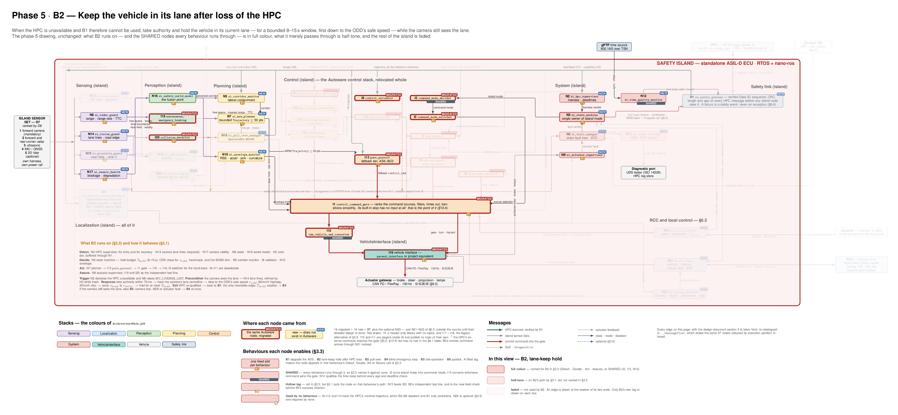

*B2, on the island's node graph. The island steers: I13 with N7's planner, through the gate to I16, <mark>on the lane lines N14's camera holds; N6 radar and N17's camera-validity verdict are lit, the optional N13 is not.</mark> N1 and N8 are half-tone because the hold's entry and recovery verdicts pass through them; the HPC itself is faded. Full size: [layers/L4SafetyIsland-Layer6-B2-LaneKeepHold.pdf](layers/L4SafetyIsland-Layer6-B2-LaneKeepHold.pdf); all <mark>six</mark> behaviours on one handout: [layers/L4SafetyIsland-Behaviours.pdf](layers/L4SafetyIsland-Behaviours.pdf).*


---

#### B3 — Pull over if the ODD continues to fail

| | |
| :-- | :-- |
| **Trigger** | [B1](#b1--degrade-the-ads-when-the-odd-cannot-be-held) escalation exhausted — the HPC did not comply, or the ODD was not restored within the deadline; **or** [B2](#b2--keep-the-vehicle-in-its-lane-after-loss-of-the-hpc)'s hold window `T_hold` expired with the HPC still lost <mark>and the camera still holding the lane — the island can see, so it can search; had it lost the camera, [B2](#b2--keep-the-vehicle-in-its-lane-after-loss-of-the-hpc) would have exited to [B4](#b4--emergency-stop-when-the-island-is-blind) instead</mark> |
| **Precondition** | <mark>A refuge exists that the island can **verify free** and can still reach at the current speed — from either source in the row below.</mark> [`N18`](#63-pull-over-mrm-after-hpc-loss) reports `pull_over_available = true`, and the <mark>candidate</mark> refuge is verified free against [`N16`](#62-island-safety-sensing)'s live free space |
| <mark>**Refuge source, in priority order**</mark> | <mark>1. [`H8`](#7-new-nodes-to-add-on-the-hpc)'s **nominated** refuge — map-validated and law-checked by the HPC, verified free by [`N16`](#62-island-safety-sensing) before use. 2. [`N18`](#63-pull-over-mrm-after-hpc-loss)'s own **island-detected** refuge — a lateral clearance found **by the camera**: [`N14`](#62-island-safety-sensing) tracks the lane lines, finds the outer edge of the running lane and the road edge or kerb beyond it, and measures the drivable space between them; [`N6`](#61-supervision-state-and-fallback) radar confirms the space is unoccupied and that nothing is closing on it. Admitted only under `legality = EMERGENCY_ONLY`. [`N15`](#62-island-safety-sensing) ultrasonics ([D8](#1-inputs-already-fixed-by-the-wg) rank 3), where fitted, guard the final metres and let the stop end tight to the kerb rather than within the shoulder; [`N13`](#62-island-safety-sensing) 2D lidar, where fitted, may confirm the geometry or disqualify the space. Neither is required. 3. Neither — no refuge, and the abort ladder decides what happens next</mark> |
| **Authority** | **The island steers, brakes and signals.** [B2](#b2--keep-the-vehicle-in-its-lane-after-loss-of-the-hpc) steers to stay where the vehicle already is; [B3](#b3--pull-over-if-the-odd-continues-to-fail) is the only behaviour in which the island initiates lateral *displacement* — deliberately leaving the running lane. |
| **Response** | <mark>Open the refuge search across **both** sources the moment [B3](#b3--pull-over-if-the-odd-continues-to-fail) is entered, and keep it open while decelerating — [`N14`](#62-island-safety-sensing) holding the lane lines for the in-lane part of the manoeuvre and scanning the road edge for space</mark> → <mark>**Hazard lamps on the moment the manoeuvre is commanded**</mark> → indicator on → bounded lateral displacement to <mark>the first refuge that passes verification, across the outer lane line [`N14`](#62-island-safety-sensing) is tracking, with containment re-armed against the road edge it has observed</mark> → deceleration → standstill → secure (gear P, <mark>lamps stay on</mark>) |
| <mark>**Deadlines**</mark> | <mark>The refuge search is bounded by `T_refuge` = **5 s** from [B3](#b3--pull-over-if-the-odd-continues-to-fail) entry, and additionally by a distance-travelled-searching cap, for the reason open decision 15 gives about time and distance not being the same constraint at speed (both are open decision 18). Once a refuge is accepted, the §6.4 MRM deadlines apply — begin within **10 s**, complete within **60 s**</mark> |
| **Observable output** | `MrmState` = `MRM_OPERATING`, behaviour = `PULL_OVER` (see open decision 10); [`N18`](#63-pull-over-mrm-after-hpc-loss) `MrmBehaviorStatus` |
| **Success criterion** | Standstill within the <mark>accepted</mark> refuge <mark>— whichever source offered it —</mark>, near field clear, `MrmState` = `MRM_SUCCEEDED` |
| **Abort** | Per the ladder in §6.3 — every rung degrades to an **in-lane stop under [B2](#b2--keep-the-vehicle-in-its-lane-after-loss-of-the-hpc)'s authority and control law**, <mark>then to emergency stop ([B4](#b4--emergency-stop-when-the-island-is-blind))</mark>. <mark>Two of those rungs are now told apart by *what the search concluded*. A search that **positively determines** that no usable refuge exists — neither source offers one — abandons the pull-over to the **in-lane stop**, which still has a corridor to work with. A search that reaches `T_refuge` **without a determination either way** goes to [B4](#b4--emergency-stop-when-the-island-is-blind). An inconclusive search is a statement about the island's capability, not about the road, and capability loss goes to the floor (§3.2)</mark> |
| <mark>**Exit**</mark> | <mark>**`SAFE_STOP`, as [B4](#b4--emergency-stop-when-the-island-is-blind)'s is.** [B3](#b3--pull-over-if-the-odd-continues-to-fail) is terminal for the drive cycle: one successor, the secured standstill, and no edge back up. The two behaviours differ in *where* they leave the vehicle and in what they needed in order to get there, not in whether the drive continues afterwards (§3.2)</mark> |
| **Optional enrichment** ([§3.5](#35-optional-enrichment-the-hpc-object-list)) | The last HPC object digest, to **disqualify** a refuge. It may never qualify one |
| **Minimum sensor rung** (§9.4) | <mark>**A** — the camera alone — at or below ~30 km/h, the city-road `v_odd`, where a long indicator dwell and a very low lateral rate can stand in for rear-corner radar. **B** above ~30 km/h: forward and rear-corner radar, because the manoeuvre then crosses traffic space a forward camera cannot see</mark> |

<mark>**The island may now find a refuge. It still may not choose one.**</mark> <mark>§6.3's split — the HPC nominates,
the island verifies and executes — holds wherever the HPC is there to nominate. Under [B3](#b3--pull-over-if-the-odd-continues-to-fail) it
frequently is not: [B3](#b3--pull-over-if-the-odd-continues-to-fail) is reached from [B2](#b2--keep-the-vehicle-in-its-lane-after-loss-of-the-hpc) precisely when the HPC has been lost, and
[`H8`](#7-new-nodes-to-add-on-the-hpc)'s buffered refuge set ages out like every other buffered input (§8.1). An island with
no second source makes the refuge contract a single point of failure for the one manoeuvre it exists to
enable.</mark>

<mark>So the island gets a second source, and it is deliberately weaker than the first:</mark>

| | <mark>[`H8`](#7-new-nodes-to-add-on-the-hpc) nominated refuge</mark> | <mark>[`N18`](#63-pull-over-mrm-after-hpc-loss) island-detected refuge</mark> |
| :-- | :-- | :-- |
| <mark>**Physically free**</mark> | <mark>verified by [`N16`](#62-island-safety-sensing), before use</mark> | <mark>verified by [`N16`](#62-island-safety-sensing), before use</mark> |
| <mark>**Legal**</mark> | <mark>checked against the map and traffic law by the HPC</mark> | <mark>**unknown** — the island holds neither</mark> |
| <mark>**`legality` value**</mark> | <mark>`LEGAL_STOP` or `EMERGENCY_ONLY`, as nominated</mark> | <mark>`EMERGENCY_ONLY`, always</mark> |
| <mark>**Admissible**</mark> | <mark>whenever offered and within `validity_distance_m`</mark> | <mark>only when no nominated refuge is available</mark> |
| <mark>**Sensors**</mark> | <mark>[`N16`](#62-island-safety-sensing) free space</mark> | <mark>[`N14`](#62-island-safety-sensing) camera — lane lines, road edge, drivable space between them — + [`N6`](#61-supervision-state-and-fallback) radar occupancy, fused in [`N16`](#62-island-safety-sensing); [`N15`](#62-island-safety-sensing) ultrasonic where fitted, for the final metres and a tight-to-kerb end; [`N13`](#62-island-safety-sensing) 2D lidar where fitted, only to confirm or disqualify</mark> |

<mark>The asymmetry is the whole argument. An island-detected refuge is a **physically clear lateral
space** and nothing more — a verge, a hard shoulder, a wide kerb, and equally a cycle lane, a bus stop
or a driveway, which the island cannot tell apart. Admitting one means preferring an unlawful stopping
place to a stop in a live running lane. That trade is defensible, but only under the `EMERGENCY_ONLY`
semantics the refuge contract already carries, and only in that direction: it is the judgement a human
driver makes with a failed engine, and it is why the island-detected refuge sits *second* in the
priority order and never displaces a nominated one.</mark>

<mark>What the island still cannot do is **choose**, in the sense §6.3 rules out. It does not weigh two
candidate refuges against each other for legality, does not reason about bridges or bus stops, and does
not defer a stop in order to reach a better place further on. It takes the first lateral clearance that
passes verification, inside `T_refuge`. **Search, not selection** — the distinction that keeps map and
planner semantics off the island ([R4](#21-partitioning-rules), [R5](#21-partitioning-rules)).</mark>

<mark>**The camera is what [B3](#b3--pull-over-if-the-odd-continues-to-fail) searches with.** With the 2D lidar now optional ([D8](#1-inputs-already-fixed-by-the-wg)), the
island-detected refuge has to be found by the one sensor every island carries. [`N14`](#62-island-safety-sensing) does three
things in [B3](#b3--pull-over-if-the-odd-continues-to-fail), and they are the same three things a driver does with their eyes:</mark>

1. <mark>**Holds the lane lines** — the corridor for the part of the manoeuvre still in the running lane, the
   same source [B2](#b2--keep-the-vehicle-in-its-lane-after-loss-of-the-hpc) used, so the hand-over from [B2](#b2--keep-the-vehicle-in-its-lane-after-loss-of-the-hpc) is seamless.</mark>
2. <mark>**Finds the pull-over space** — the outer lane line, the road edge or kerb beyond it, and the width
   and length of drivable surface between them. That is the clearance [`N18`](#63-pull-over-mrm-after-hpc-loss) tests against open
   decision 18's geometric criteria.</mark>
3. <mark>**Bounds the lateral move** — once the vehicle crosses the outer line, the observed road edge is the
   boundary [`N5`](#61-supervision-state-and-fallback)'s containment check is re-armed against (§3.2).</mark>

<mark>The camera says what is *there*; it is weakest at saying what is *coming*. That is radar's job, and it
is why the radar-dependent half of the manoeuvre — the closing-vehicle check on the pull-over side —
is the half that sets rung **B** above ~30 km/h. A camera finding that is not confirmed by radar where
radar is fitted is not admitted, and a radar or lidar finding can only ever *disqualify* a space the
camera found, never qualify one the camera did not.</mark>

<mark>**Both terminal behaviours raise the hazard lamps on entry, not on arrival.**</mark> <mark>[B3](#b3--pull-over-if-the-odd-continues-to-fail) raises them when
the pull-over is commanded and [B4](#b4--emergency-stop-when-the-island-is-blind) when the blackout is declared, and in both cases they stay on
through the manoeuvre, the standstill and the secure. The lamps exist for the traffic behind, and the
traffic behind needs the warning *while* the vehicle is decelerating — and, under [B3](#b3--pull-over-if-the-odd-continues-to-fail), moving
laterally — not once it has already stopped. [B2](#b2--keep-the-vehicle-in-its-lane-after-loss-of-the-hpc) already behaves this way, so with this the whole of
the island's authority becomes legible from outside within one lamp period of its being taken.</mark>

<mark>One integration conflict has to be decided rather than discovered.</mark> <mark>On most production wiring the
hazard circuit overrides both direction indicators, so a [B3](#b3--pull-over-if-the-odd-continues-to-fail) that raises hazards at entry can no longer
signal *which way* it is leaving the running lane — and the indicator is what the §6.3 ladder leans on
below ~30 km/h, where a long indicator dwell is what buys back the rear-corner radar. The two
candidate resolutions — indicator alone for a fixed dwell with hazards from the start of lateral
motion, or hazards throughout and no directional signal at all — are a vehicle-integration question
rather than a software one, and the WG should settle which. Nothing else in this design depends on
the answer.</mark>

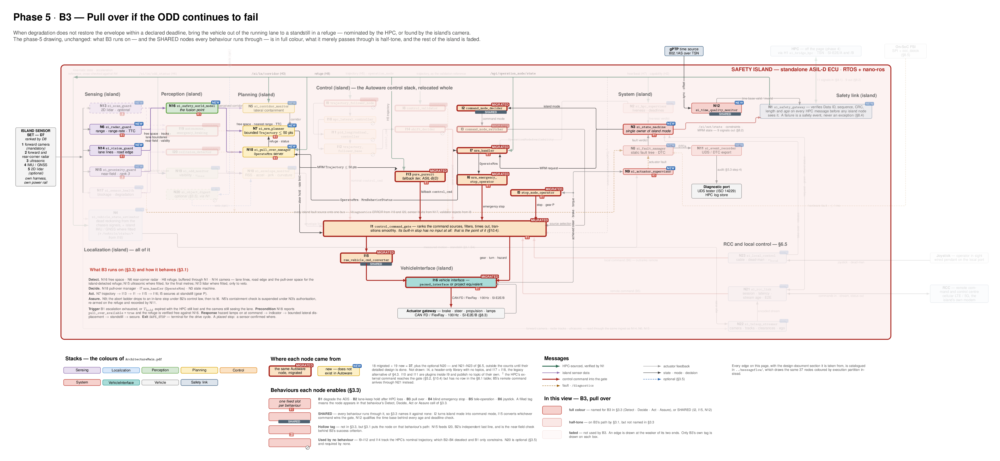

*B3, on the island's node graph. N18 selects the refuge from either source <mark>— the island-detected one found by N14's camera, which is lit —</mark> I7 operates the pull-over slot, N7 plans into it, I13 follows, and I5 secures at standstill; I6 is lit as the abort. Full size: [layers/L4SafetyIsland-Layer6-B3-PullOver.pdf](layers/L4SafetyIsland-Layer6-B3-PullOver.pdf); all <mark>six</mark> behaviours on one handout: [layers/L4SafetyIsland-Behaviours.pdf](layers/L4SafetyIsland-Behaviours.pdf).*


---

#### B4 — Emergency stop when the island is blind

<mark>[B4](#b4--emergency-stop-when-the-island-is-blind) is the **floor of the ladder**, and it exists because [B2](#b2--keep-the-vehicle-in-its-lane-after-loss-of-the-hpc) and [B3](#b3--pull-over-if-the-odd-continues-to-fail) are both
conditional behaviours. [B2](#b2--keep-the-vehicle-in-its-lane-after-loss-of-the-hpc) requires an observable lane; [B3](#b3--pull-over-if-the-odd-continues-to-fail) requires a refuge that can be
verified free. Both rest on the same sensor — the forward camera, the one [D8](#1-inputs-already-fixed-by-the-wg) makes mandatory and
therefore the only one either behaviour is allowed to assume — so both are lost together when it is
lost. When the camera has gone — blocked, failed, saturated, or disagreeing</mark> beyond what
[`N16`](#62-island-safety-sensing)'s arbitration can resolve — neither behaviour has a defensible precondition
left, and the island must not attempt either one on stale evidence. It stops instead, where it is.

<mark>"Blind" is defined against the mandatory sensor, not against all of them. An island whose camera is
gone but whose radar still reports is blind *to the lane*: it can range a target ahead, but it cannot
hold a corridor or verify a refuge, which is everything [B2](#b2--keep-the-vehicle-in-its-lane-after-loss-of-the-hpc) and [B3](#b3--pull-over-if-the-odd-continues-to-fail) need. A sensor the design does
not require cannot be what keeps the island out of [B4](#b4--emergency-stop-when-the-island-is-blind), for the same reason the HPC object digest
cannot (§3.5) — but while it lives it still feeds [`I19`](#41-migration-list) and may steepen [B4](#b4--emergency-stop-when-the-island-is-blind)'s
ramp.</mark>

<mark>Emergency stop is not new machinery. It is already step 3b of the §5.3 graded reaction and the
bottom rung of the §6.3 abort ladder. What [B4](#b4--emergency-stop-when-the-island-is-blind) adds is **declaration**: the rung acquires a
trigger, a deadline, a sensor rung and a traceability row like the other three, instead of being
reached only as the residue of something else failing. A fallback that is only ever arrived at by
accident cannot be argued for in a safety case.</mark>

| | |
| :-- | :-- |
| <mark>**Trigger**</mark> | <mark>[`N17`](#62-island-safety-sensing) declares **sensing blackout** — the **forward camera** is invalid, blocked or stale, or [`N14`](#62-island-safety-sensing) has lost the lane lines beyond the bridging budget, so [`N16`](#62-island-safety-sensing) can publish neither a valid corridor nor valid lateral free space. Radar, ultrasonic, IMU/GNSS or 2D lidar that are still alive do not lift the declaration ([D8](#1-inputs-already-fixed-by-the-wg)). Stated in behavioural terms, which is how [`N3`](#61-supervision-state-and-fallback) evaluates it: **[B2](#b2--keep-the-vehicle-in-its-lane-after-loss-of-the-hpc) has no corridor *and* [B3](#b3--pull-over-if-the-odd-continues-to-fail) has no verifiable refuge.** It is also [B2](#b2--keep-the-vehicle-in-its-lane-after-loss-of-the-hpc)'s downward exit whenever `T_hold` expires with the camera lost. Also entered directly on Also entered directly on [`N9`](#61-supervision-state-and-fallback) (actuators not tracking) or [`I19`](#41-migration-list) (AEB fires), per the §6.3 ladder</mark> |
| <mark>**Precondition**</mark> | <mark>**None, and deliberately none.** A fallback whose entry can be blocked is not a fallback. [B4](#b4--emergency-stop-when-the-island-is-blind) needs only the proprioceptive channels [`N4`](#61-supervision-state-and-fallback) already requires — </mark>the chassis signals: wheel speed, steering report, ESC yaw rate and acceleration, with the island IMU where it is fitted<mark> — and the actuation path to [`I16`](#41-migration-list)</mark> |
| <mark>**Authority**</mark> | <mark>**The island brakes, and declines to steer.** Lateral authority is *surrendered, not exercised*: with no corridor there is nothing to steer against, so the steering command is held at its current angle under [`N7`](#61-supervision-state-and-fallback)'s rate limit and allowed to relax toward straight. [B4](#b4--emergency-stop-when-the-island-is-blind) is the only behaviour in which the island deliberately does not steer</mark> |
| <mark>**Response**</mark> | <mark>**Hazard lamps on the moment the blackout is declared** → [`I6`](#41-migration-list) `mrm_emergency_stop_operator` publishes the control command directly → deceleration at the emergency rate `a_emg` → standstill → [`I5`](#41-migration-list) secures (gear P). No trajectory is planned, and none could be: planning needs a world model</mark> |
| <mark>**Deadlines**</mark> | <mark>Authority transfer within the §9.2 fault-reaction budget (≤ 70 ms from the declaring fault). `a_emg` and the steering-relaxation rate are open decision 15</mark> |
| <mark>**Observable output**</mark> | <mark>`MrmState` = `MRM_OPERATING`, behaviour = `EMERGENCY_STOP` — the one MRM behaviour the existing `MrmState` message can already name without extension (contrast open decision 10). [`N3`](#61-supervision-state-and-fallback) mode = `EMERGENCY_STOP`; `/si/out/state` carries the blackout fault code and which sources were lost</mark> |
| <mark>**Success criterion**</mark> | <mark>Standstill, secured, hazard lamps on. **Nothing is claimed about *where*.** [B4](#b4--emergency-stop-when-the-island-is-blind) stops the vehicle in the running lane, and that is the honest statement of what a blind island can promise</mark> |
| <mark>**Failure**</mark> | <mark>[`N9`](#61-supervision-state-and-fallback) reports the actuators still not tracking → the gate's built-in stop (§5.3 step 3c) and the FSI hardware fault line (§8.5), both of which sit outside the ROS-node path by construction</mark> |
| <mark>**Exit**</mark> | <mark>**`SAFE_STOP`, and nothing else.** [B4](#b4--emergency-stop-when-the-island-is-blind) has exactly one successor — the secured standstill — and no edge back up the ladder. It stays terminal for the drive cycle even if sensing returns mid-stop: a source that has just been declared invalid has not earned authority back inside a stop that is already under way</mark> |
| <mark>**Optional enrichment** ([§3.5](#35-optional-enrichment-the-hpc-object-list))</mark> | <mark>The last HPC object digest, to shape the ramp only. It may not delay entry, offer an exit, or count as a valid source — [`N20`](#62-island-safety-sensing) never contributes to the blackout determination. **A surviving radar is treated the same way:** [`N6`](#61-supervision-state-and-fallback) may keep [`I19`](#41-migration-list) armed and steepen the ramp toward the upper bound of `a_emg` for a target in path, and may do nothing else</mark> |
| <mark>**Minimum sensor rung** (§9.4)</mark> | <mark>**0 — none.** [B4](#b4--emergency-stop-when-the-island-is-blind) is the behaviour that must survive the loss of the entire island sensor set, the camera included, on the chassis signals alone. It is what makes rung A a *design* choice rather than a *safety* floor</mark> |

<mark>**Why stopping in the lane is accepted.** Stopping in a running lane is dangerous, and no design
should reach for it casually. The argument for [B4](#b4--emergency-stop-when-the-island-is-blind) is comparative rather than absolute: the only
other things a blind island can do are continue on stale evidence, or attempt a lateral manoeuvre it
cannot verify. Both are worse, and both fail *unboundedly* — the error grows with every metre
travelled. A stop is bounded: the vehicle's own kinetic energy is the whole of it, and the manoeuvre
is legible to everything around the vehicle through brake lights and hazard lamps. The residual risk
is real, and it belongs in the Part-4 HARA as a **named accepted risk**, not as a gap.</mark>

<mark>**[B4](#b4--emergency-stop-when-the-island-is-blind) is not "AEB fired".** [`I19`](#41-migration-list) autonomous emergency braking is a *reflex* against a specific
detected obstacle, and it presupposes a working forward sensor. [B4](#b4--emergency-stop-when-the-island-is-blind) is a *state*: the island no
longer knows what is ahead of it at all. The two share the actuator path ([`I6`](#41-migration-list)) and nothing else.
An AEB event escalates *into* [B4](#b4--emergency-stop-when-the-island-is-blind) — the §6.3 ladder already says so — but the reverse is
impossible, because a blind island cannot detect the obstacle that would trigger AEB.</mark>

<mark>**[B4](#b4--emergency-stop-when-the-island-is-blind) is not the in-lane stop either.** The in-lane stop that [B3](#b3--pull-over-if-the-odd-continues-to-fail) degrades to when its search
finds no refuge is *obstacle-aware*: it decelerates along the corridor the camera still sees, shortening
the ramp against [`N16`](#62-island-safety-sensing)'s free-space distance. It is a reduced behaviour, not a blind one. [B4](#b4--emergency-stop-when-the-island-is-blind) is what
remains when the camera no longer sees a corridor to stop along, and [`N8`](#61-supervision-state-and-fallback) distinguishes the two by
fault code so the event recorder and the HARA can tell them apart.</mark>

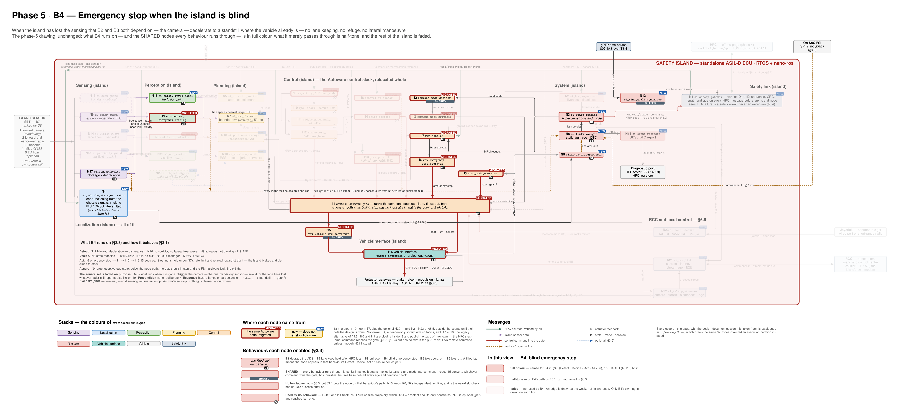

*B4, on the island's node graph. Nothing exteroceptive is lit: N17 declares the blackout, I6 brakes, I5 secures, and N4's dead reckoning — fed by the chassis signals, and the island IMU where fitted — is what N9 confirms the stop against. The sensor set, N6 and N1 are half-tone: the AEB trigger <mark>— now radar's, since the 2D lidar is optional —</mark> and the blackout declaration come through them, and `/si/out/state` still leaves through N1. Full size: [layers/L4SafetyIsland-Layer6-B4-EmergencyStop.pdf](layers/L4SafetyIsland-Layer6-B4-EmergencyStop.pdf); all <mark>six</mark> behaviours on one handout: [layers/L4SafetyIsland-Behaviours.pdf](layers/L4SafetyIsland-Behaviours.pdf).*


#### B5 — Tele-operation from the remote command centre

<mark>*Detailed design in [§6.6](#66-detailed-design-of-b5-and-b6): stage 1, entered from standstill. Open decision 19 holds what remains.*</mark>

<mark>[B5](#b5--tele-operation-from-the-remote-command-centre) hands the driving task to a person at the **remote command and control centre (RCC)**. It is how a
vehicle that has ended its drive in [B3](#b3--pull-over-if-the-odd-continues-to-fail) or [B4](#b4--emergency-stop-when-the-island-is-blind) — or that the ADS can no longer continue — is moved
on without sending someone to it. The remote driver sees the road through **the island's own sensors**,
streamed over **the island's own communication module**, so [B5](#b5--tele-operation-from-the-remote-command-centre) survives the loss of the HPC: nothing
on its path runs there. That is the reason [D9](#1-inputs-already-fixed-by-the-wg) puts the modem on the island and not on the HPC.</mark>

<mark>What the remote driver is shown follows [D8](#1-inputs-already-fixed-by-the-wg)'s ranking, for the same reason the behaviours do: the
camera stream is the one [B5](#b5--tele-operation-from-the-remote-command-centre) may require, and radar tracks and ultrasonic clearances enrich it where
fitted. A remote driver watching a stream the island cannot itself validate would be driving blind with
extra steps, so [B5](#b5--tele-operation-from-the-remote-command-centre) is admissible only while [`N17`](#62-island-safety-sensing) holds the camera valid.</mark>

| | |
| :-- | :-- |
| <mark>**Trigger**</mark> | <mark>The RCC requests control and [`N3`](#61-supervision-state-and-fallback) grants it. Proposed origins: `SAFE_STOP` — recovery after [B3](#b3--pull-over-if-the-odd-continues-to-fail) or [B4](#b4--emergency-stop-when-the-island-is-blind) — and the in-lane stop once at standstill. Taking over a *moving* vehicle, from `ADS_ACTIVE` or from [B1](#b1--degrade-the-ads-when-the-odd-cannot-be-held)–[B3](#b3--pull-over-if-the-odd-continues-to-fail), is left for stage 2 (open decision 19(a)). The session handshake is in [§6.6](#66-detailed-design-of-b5-and-b6)</mark> |
| <mark>**Precondition**</mark> | <mark>An authenticated RCC session on [`N21`](#65-remote-command-and-control-link-and-local-control-port), with measured round-trip latency and stream age inside their bounds · the camera valid ([`N17`](#62-island-safety-sensing)) · no [B6](#b6--manual-joystick-control-without-streamed-sensing) active</mark> |
| <mark>**Authority**</mark> | <mark>The remote driver commands; the island executes and bounds. Commands arrive on [`N21`](#65-remote-command-and-control-link-and-local-control-port) and enter [`I1`](#41-migration-list) as the **remote** command source, validated by [`I8`](#41-migration-list) and [`N10`](#61-supervision-state-and-fallback) like any other (§10.4)</mark> |
| <mark>**Streamed to the RCC**</mark> | <mark>[`N22`](#65-remote-command-and-control-link-and-local-control-port): forward camera, compressed to a bounded bit rate — required · radar tracks — rung B up · ultrasonic near-field clearance — rung C up · [`N4`](#61-supervision-state-and-fallback) ego state · the island's state and fault summary</mark> |
| <mark>**Speed**</mark> | <mark>`v_teleop`, bounded by the measured end-to-end latency — camera to RCC screen, and command back to the actuator — and by the range the stream shows: the vehicle must be able to stop inside what the remote driver could see, *after* the latency has elapsed: `v_teleop` = min(20 km/h, `v_vis`), recomputed at 10 Hz from the measured command age ([§6.6](#66-detailed-design-of-b5-and-b6)). The values are for ratification in open decision 19(b)</mark> |
| <mark>**Guards that stay armed**</mark> | <mark>[`I19`](#41-migration-list) AEB · [`I20`](#41-migration-list) near-field, rung C up · [`N10`](#61-supervision-state-and-fallback) envelope · [`N9`](#61-supervision-state-and-fallback) actuator supervision. The remote driver cannot override them</mark> |
| <mark>**Link loss**</mark> | <mark>No valid command or heartbeat for `T_link` = 300 ms, or a command more than 1.0 s old by the frame-stamp echo → the island takes authority back and stops: the **in-lane stop** under [B2](#b2--keep-the-vehicle-in-its-lane-after-loss-of-the-hpc)'s control law if the camera still sees the lane, **[B4](#b4--emergency-stop-when-the-island-is-blind)** if it does not — the same capability-first test as every other downward edge. Never "continue on the last command"</mark> |
| <mark>**Exit**</mark> | <mark>The RCC releases control at standstill → `SAFE_STOP`. From there the RCC may also re-engage the ADS, once the HPC is re-qualified and the ODD is satisfiable ([§6.6](#66-detailed-design-of-b5-and-b6), open decision 19(c))</mark> |
| <mark>**Observable output**</mark> | <mark>`OperationModeState` = `REMOTE` — a mode Autoware already defines</mark> |
| <mark>**Minimum sensor rung** (§9.4)</mark> | <mark>**A** — the camera, which is what the remote driver watches. Radar and ultrasonic are streamed where fitted</mark> |
| <mark>**Still open**</mark> | <mark>Link technology and redundancy; who owns the keys and certificates; stage 2 — taking over a moving vehicle, and a path-based remote-assistance mode; the RCC's human-factors requirements (open decision 19)</mark> |

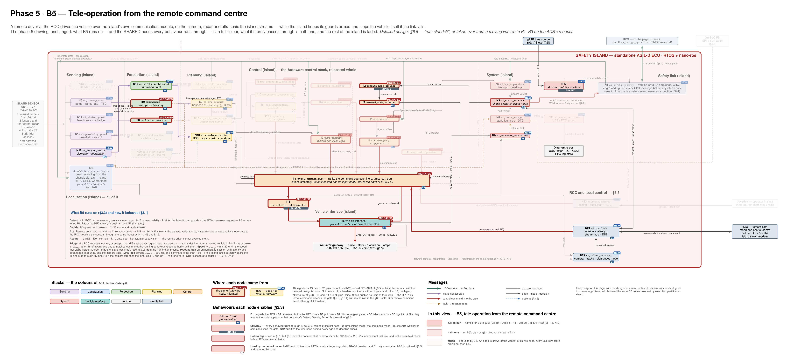

<mark>*B5, on the island's node graph. The RCC, outside the boundary, talks to N21 over the island's own modem; the remote command enters the gate as its remote source, and N3 grants and revokes it. N22 packs the stream from the island sensors (read through the same ingest as N14, N6 and N15) and N4's ego state. I19, I20, N10 and N9 stay lit as the guards the remote driver cannot override; N7, I13 and I6 are half-tone, the link-loss stop. Full size: [layers/L4SafetyIsland-Layer6-B5-TeleOperation.pdf](layers/L4SafetyIsland-Layer6-B5-TeleOperation.pdf).*</mark>

#### B6 — Manual joystick control without streamed sensing

<mark>*Detailed design in [§6.6](#66-detailed-design-of-b5-and-b6): stage 1, entered from standstill. Open decision 20 holds what remains.*</mark>

<mark>[B6](#b6--manual-joystick-control-without-streamed-sensing) is the manual fallback for when there is no stream to watch. An operator **within sight of the
vehicle** drives it with a joystick connected to the island's **local control port** — by cable, or over a
**short-range radio** link. The operator's own eyes are the sensing, so [B6](#b6--manual-joystick-control-without-streamed-sensing) needs no exteroceptive
sensor and no RCC link: with [B4](#b4--emergency-stop-when-the-island-is-blind), it is one of only two behaviours that run at rung 0. It is how a
vehicle is moved off a carriageway, onto a recovery truck or into a depot when automation and
tele-operation are both unavailable.</mark>

| | |
| :-- | :-- |
| <mark>**Trigger**</mark> | <mark>The local operator takes control on [`N23`](#65-remote-command-and-control-link-and-local-control-port) — device paired, dead-man held. Proposed origins: `SAFE_STOP`, and [B5](#b5--tele-operation-from-the-remote-command-centre) — **local presence pre-empts the remote driver**. A moving vehicle is never taken over: a moving [B5](#b5--tele-operation-from-the-remote-command-centre) is stopped first ([§6.6](#66-detailed-design-of-b5-and-b6), open decision 20(a))</mark> |
| <mark>**Precondition**</mark> | <mark>A paired local device on [`N23`](#65-remote-command-and-control-link-and-local-control-port) with its link heartbeat inside `T_local` · the vehicle at standstill on entry</mark> |
| <mark>**Authority**</mark> | <mark>The operator commands through [`I1`](#41-migration-list)'s **local** command source, which outranks the remote one. [`I8`](#41-migration-list) and [`N10`](#61-supervision-state-and-fallback) still validate</mark> |
| <mark>**Sensing**</mark> | <mark>None required and none streamed. Island sensors that are still valid keep guarding — [`I19`](#41-migration-list), and [`I20`](#41-migration-list) on [`N15`](#62-island-safety-sensing)'s near-field clearance</mark> |
| <mark>**Speed**</mark> | <mark>Creep only: `v_local`, proposed at walking pace (~5 km/h), so that the vehicle stays inside the operator's sight and the radio's range: 5 km/h forward, 3 km/h in reverse, 0.5 m/s² ([§6.6](#66-detailed-design-of-b5-and-b6), open decision 20(b))</mark> |
| <mark>**Release or link loss**</mark> | <mark>Dead-man released, the joystick's stop pressed, or the local link silent beyond `T_local` = 200 ms → immediate stop at the emergency rate on [B4](#b4--emergency-stop-when-the-island-is-blind)'s actuator path ([`I6`](#41-migration-list), then [`I5`](#41-migration-list)). From 5 km/h the stop is about 0.85 m, all latencies included</mark> |
| <mark>**Exit**</mark> | <mark>The operator releases control at standstill → `SAFE_STOP`</mark> |
| <mark>**Observable output**</mark> | <mark>`OperationModeState` = `LOCAL` — a mode Autoware already defines</mark> |
| <mark>**Minimum sensor rung** (§9.4)</mark> | <mark>**0** — no island sensor is required</mark> |
| <mark>**Still open**</mark> | <mark>The radio band and range; where the wired port sits on the vehicle; certifying the device to IEC 62745 at PL d; the hardwired emergency-stop line (open decision 20)</mark> |

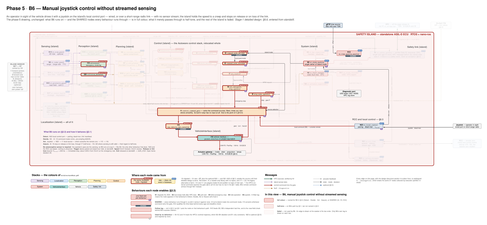

<mark>*B6, on the island's node graph. The joystick, outside the boundary, reaches N23 on the local control port; the local command enters the gate as its local source, which outranks the remote one, and N3 holds the mode. Nothing is streamed, so N22, N21 and the RCC are faded. I6 and I5 stop the vehicle on release or link loss; I19 and I20 stay armed where sensing is still valid. Full size: [layers/L4SafetyIsland-Layer6-B6-Joystick.pdf](layers/L4SafetyIsland-Layer6-B6-Joystick.pdf).*</mark>

---

### 3.2 Precedence: four automated episodes, two edges back up, two human-driven exits

The four are episodes on a ladder, and what distinguishes them is **who holds authority** and
**whether the situation is still recoverable**.

- **[B1](#b1--degrade-the-ads-when-the-odd-cannot-be-held) is the first response** to a degrading ODD, and it is cooperative: the HPC stays in control and
  the island only constrains it. [B1](#b1--degrade-the-ads-when-the-odd-cannot-be-held) therefore *requires a working HPC*. <mark>Its object is an
  **operating domain**, not a speed: the island declares the current domain unsatisfiable and the HPC
  moves to one it can meet. [B1](#b1--degrade-the-ads-when-the-odd-cannot-be-held) is also the only behaviour with an **upward** exit — the drive
  continues, in a narrower domain — and the only one whose downward exit can land on any of the other
  three.</mark>
- **[B2](#b2--keep-the-vehicle-in-its-lane-after-loss-of-the-hpc) is what replaces [B1](#b1--degrade-the-ads-when-the-odd-cannot-be-held) when that requirement fails.** The intent is the same — buy time in a safe
  state rather than commit to a terminal manoeuvre — but the authority is inverted: the island now
  steers. [B2](#b2--keep-the-vehicle-in-its-lane-after-loss-of-the-hpc) is admissible only while the lane remains observable <mark>by the camera. It first brings
  the vehicle down to the safe speed of the current ODD, and it is bounded: after 8–15 s without the
  HPC it hands over to [B3](#b3--pull-over-if-the-odd-continues-to-fail) if the camera still sees the lane and to [B4](#b4--emergency-stop-when-the-island-is-blind) if it does not — never to
  anything else.</mark>
- **[B3](#b3--pull-over-if-the-odd-continues-to-fail) is the terminal response to a worsening *situation***, taken when the envelope cannot be
  restored: either [B1](#b1--degrade-the-ads-when-the-odd-cannot-be-held) exhausted its deadlines with the HPC alive but non-compliant, or [B2](#b2--keep-the-vehicle-in-its-lane-after-loss-of-the-hpc)'s hold
  window expired with the HPC still gone. <mark>It brings the vehicle to a standstill and does not give
  it back.</mark>
- **[B4](#b4--emergency-stop-when-the-island-is-blind) is the floor**, taken when the island can no longer *see*. [B2](#b2--keep-the-vehicle-in-its-lane-after-loss-of-the-hpc) needs a lane and [B3](#b3--pull-over-if-the-odd-continues-to-fail)
  needs a verifiable refuge; both are served by the same <mark>mandatory sensor, the camera</mark>, so both are
  lost together when it fails. [B4](#b4--emergency-stop-when-the-island-is-blind) is what is left, <mark>and it too brings the vehicle to a standstill and does not give it
  back</mark>; it claims nothing about where the vehicle comes to rest.

<mark>**Two behaviours end the drive, not one.**</mark> <mark>[B3](#b3--pull-over-if-the-odd-continues-to-fail) and [B4](#b4--emergency-stop-when-the-island-is-blind) are *both* terminal. Neither has an edge
back up, and in the state diagram below each has exactly one successor, `SAFE_STOP`. What separates
them is not *whether* the vehicle stops but **where it stops, and on what evidence it chose the
place**:</mark>

- <mark>[B3](#b3--pull-over-if-the-odd-continues-to-fail) is a **placed** stop. The island can still see, so it nominates a refuge, verifies it free
  against [`N16`](#62-island-safety-sensing)'s live free space, leaves the running lane, and stops there. `MRM_SUCCEEDED` under [B3](#b3--pull-over-if-the-odd-continues-to-fail)
  therefore asserts a *location*, and the claim is defensible because a sensor confirmed it.</mark>
- <mark>[B4](#b4--emergency-stop-when-the-island-is-blind) is an **unplaced** stop. The island cannot see, so the only thing it is entitled to promise is
  a standstill — in whichever lane the vehicle already occupies. §3.1's success criterion says exactly
  that, and says nothing more.</mark>

<mark>Reading [B3](#b3--pull-over-if-the-odd-continues-to-fail) as "the" terminal behaviour, and [B4](#b4--emergency-stop-when-the-island-is-blind) as an abort path that merely fell out of it, is the
misreading this subsection exists to prevent. The island has **two** ways to end a drive, and they
differ in precondition (a verified refuge against none), in minimum sensor rung (§9.4: **B** against
**0**), and in residual risk — a stop in a refuge and a stop in a running lane are not the same event,
and the Part-4 HARA must carry them as two.</mark>

<mark>**What takes over when [B1](#b1--degrade-the-ads-when-the-odd-cannot-be-held) runs out of time.**</mark> <mark>`T_odd` expiring is the most common way the
island leaves [B1](#b1--degrade-the-ads-when-the-odd-cannot-be-held) downward, and the successor is **not** fixed. Which behaviour takes over is
decided by what the island still *has* — never by what the HPC did wrong, because the island cannot
always tell a non-compliant HPC from a dead one, and does not need to:</mark>

| <mark>Condition at `T_odd` expiry</mark> | <mark>Takes over</mark> | <mark>Why</mark> |
| :-- | :-- | :-- |
| <mark>Sensing blackout — [`N17`](#62-island-safety-sensing) reports the camera invalid, or the lane lines lost</mark> | <mark>**[B4](#b4--emergency-stop-when-the-island-is-blind)**</mark> | <mark>Capability, not situation. Neither [B2](#b2--keep-the-vehicle-in-its-lane-after-loss-of-the-hpc) nor [B3](#b3--pull-over-if-the-odd-continues-to-fail) has a precondition left</mark> |
| <mark>HPC unavailable — [`N2`](#61-supervision-state-and-fallback) reports liveness lost</mark> | <mark>**[B2](#b2--keep-the-vehicle-in-its-lane-after-loss-of-the-hpc)**</mark> | <mark>The executor of every [B1](#b1--degrade-the-ads-when-the-odd-cannot-be-held) rung is gone, and the corridor is still observable</mark> |
| <mark>HPC alive, and either non-compliant or out of satisfiable domains</mark> | <mark>**[B3](#b3--pull-over-if-the-odd-continues-to-fail)**</mark> | <mark>The situation has not been recovered and will not be. The drive ends in a refuge</mark> |

<mark>The tests are applied **in that order**, and the order is not arbitrary: it runs from capability loss
to executor loss to situation loss, which is the order in which each removes the preconditions of the
options below it. Applying them in any other order can select a behaviour whose precondition has
already failed — choosing [B3](#b3--pull-over-if-the-odd-continues-to-fail) on a blackout, for instance, commits the island to a refuge it cannot
verify.</mark>

**The ladder is one-way, with two exceptions.** [B1](#b1--degrade-the-ads-when-the-odd-cannot-be-held) → [B2](#b2--keep-the-vehicle-in-its-lane-after-loss-of-the-hpc) → [B3](#b3--pull-over-if-the-odd-continues-to-fail) are entered on worsening evidence and
are not undone by wishful thinking. <mark>[B2](#b2--keep-the-vehicle-in-its-lane-after-loss-of-the-hpc)'s downward exit is a fork, not a step: at `T_hold` it goes
to [B3](#b3--pull-over-if-the-odd-continues-to-fail) or to [B4](#b4--emergency-stop-when-the-island-is-blind), applying the same capability-first test as the `T_odd` table above, and it has no
third downward edge — the in-lane stop is reached only through [B3](#b3--pull-over-if-the-odd-continues-to-fail)'s search, never straight from
[B2](#b2--keep-the-vehicle-in-its-lane-after-loss-of-the-hpc).</mark> <mark>Two edges climb back up, and they are different in kind.</mark> The reversible *authority* edge is **[B2](#b2--keep-the-vehicle-in-its-lane-after-loss-of-the-hpc) → [B1](#b1--degrade-the-ads-when-the-odd-cannot-be-held)**: if the HPC comes back and
proves itself over a confirmation window, the island hands authority back and returns to supervising
rather than driving. <mark>The other is **[B1](#b1--degrade-the-ads-when-the-odd-cannot-be-held) → `ADS_ACTIVE`**: the domain the HPC declared through [`H4`](#7-new-nodes-to-add-on-the-hpc) has passed both acceptance tests and held for the §6.4 recovery window, so the HPC is driving normally again in the narrower domain and the island releases its cap. No authority moves on that edge — the HPC was driving throughout.</mark> Nothing else climbs back up — in particular, [B3](#b3--pull-over-if-the-odd-continues-to-fail) never returns to [B2](#b2--keep-the-vehicle-in-its-lane-after-loss-of-the-hpc) or [B1](#b1--degrade-the-ads-when-the-odd-cannot-be-held), because
a pull-over commits the vehicle to leaving the running lane.

<mark>**[B4](#b4--emergency-stop-when-the-island-is-blind) is not a fourth rung of that ladder; it is underneath all of them.** [B1](#b1--degrade-the-ads-when-the-odd-cannot-be-held)–[B3](#b3--pull-over-if-the-odd-continues-to-fail) escalate on a
worsening *situation* — the envelope is not held, the HPC is gone, the deadline has run out. [B4](#b4--emergency-stop-when-the-island-is-blind) is
entered on a loss of *capability*, and capability can be lost at any rung. The two axes are
independent, and the design is easier to argue once they are drawn that way: every state in the
island has an edge into [B4](#b4--emergency-stop-when-the-island-is-blind), including the in-lane stop, and [B4](#b4--emergency-stop-when-the-island-is-blind)'s **only** edge out is to
`SAFE_STOP` — the secured standstill, which is a terminal *state*, not another behaviour. Nothing
climbs back up out of it. That is why it carries no precondition. A floor with an entry condition is
a trapdoor.</mark>

<mark>**[B5](#b5--tele-operation-from-the-remote-command-centre) and [B6](#b6--manual-joystick-control-without-streamed-sensing) sit outside the ladder: they are how a person takes the vehicle back.** Every
automated behaviour ends at `SAFE_STOP`, and none of them leaves it. [B5](#b5--tele-operation-from-the-remote-command-centre) and [B6](#b6--manual-joystick-control-without-streamed-sensing) are the only edges out
of `SAFE_STOP` short of the end of the drive cycle, and each needs a person to take it — the remote driver
over the RCC link, or the operator at the vehicle. Both return to `SAFE_STOP` when released, and both
fall back onto the automated floor when their link fails: [B5](#b5--tele-operation-from-the-remote-command-centre) to the in-lane stop or to [B4](#b4--emergency-stop-when-the-island-is-blind), by the
same capability-first test; [B6](#b6--manual-joystick-control-without-streamed-sensing) straight to a stop. [B6](#b6--manual-joystick-control-without-streamed-sensing) pre-empts [B5](#b5--tele-operation-from-the-remote-command-centre). Stage 1 enters both from standstill only
([§6.6](#66-detailed-design-of-b5-and-b6)); taking over a *moving* vehicle is stage 2. [B5](#b5--tele-operation-from-the-remote-command-centre) also carries the one edge from `SAFE_STOP` back to
automated driving: once the HPC is re-qualified and the ODD is satisfiable, the RCC may re-engage the ADS.</mark>

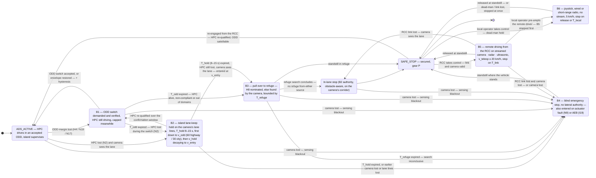

Two consequences must be written down rather than discovered during integration.

> **[B2](#b2--keep-the-vehicle-in-its-lane-after-loss-of-the-hpc) must be able to give authority back.** A behaviour that can only be entered is not a hold, it is
> a one-way MRM with extra steps. The hand-back path is [`I3`](#41-migration-list)'s smooth-transition mechanism, it re-enters
> [B1](#b1--degrade-the-ads-when-the-odd-cannot-be-held) at `CONSTRAIN` rather than `ALLOW`, and it is gated on evidence of the HPC's health, not merely on
> its heartbeat returning. The confirmation window and the acceptance criteria are open decision 14.

> **[B3](#b3--pull-over-if-the-odd-continues-to-fail) deliberately and temporarily violates lateral containment.** A pull-over leaves the running lane
> on purpose. The containment check ([`N5`](#61-supervision-state-and-fallback)) must therefore be *suspended under authorisation* for the
> duration of the manoeuvre, and re-armed against the refuge boundary instead. An unsuppressed
> containment check would abort every pull-over it was asked to protect.

Authorisation for that suspension is granted by [`N3`](#61-supervision-state-and-fallback) and by nothing else, is bounded in time and in
lateral extent by [`N7`](#61-supervision-state-and-fallback), and is recorded by [`N11`](#61-supervision-state-and-fallback).

### 3.3 Behaviour-to-node traceability

Every island node exists to serve at least one declared behaviour. Nodes that serve none do not
belong on the island.

| Behaviour | Detect | Decide | Act | Assure |
| :-- | :-- | :-- | :-- | :-- |
| **B1** | [`N19`](#64-odd-degradation-on-weather-and-visibility) ODD monitor · [`N17`](#62-island-safety-sensing) sensor health · [`N6`](#61-supervision-state-and-fallback)/[`N14`](#62-island-safety-sensing) ingest <mark>([`N13`](#62-island-safety-sensing) where fitted)</mark> · [`N16`](#62-island-safety-sensing) world model <mark>· [`H4`](#7-new-nodes-to-add-on-the-hpc) declared active domain</mark> | [`N10`](#61-supervision-state-and-fallback) envelope · [`N3`](#61-supervision-state-and-fallback) state machine <mark>(demand, `T_ack`/`T_odd`, takeover selection)</mark> · [`N8`](#61-supervision-state-and-fallback) fault manager | [`N1`](#61-supervision-state-and-fallback)/[`H1`](#7-new-nodes-to-add-on-the-hpc) constraint egress → <mark>HPC switches domain and re-plans</mark> | Compliance supervision in [`N2`](#61-supervision-state-and-fallback) <mark>and the two-part acceptance test in [`N19`](#64-odd-degradation-on-weather-and-visibility)</mark>; [`N11`](#61-supervision-state-and-fallback) records the SOTIF event |
| **B2** | [`N2`](#61-supervision-state-and-fallback) HPC supervisor (entry and recovery) · <mark>[`N14`](#62-island-safety-sensing) camera lane lines (required) · [`N17`](#62-island-safety-sensing) camera validity · [`N6`](#61-supervision-state-and-fallback) radar</mark> · [`N16`](#62-island-safety-sensing) world model · [`H3`](#7-new-nodes-to-add-on-the-hpc) corridor <mark>· [`N19`](#64-odd-degradation-on-weather-and-visibility) for the `v_max` term of `v_hold` · [`H4`](#7-new-nodes-to-add-on-the-hpc)'s last `active_odd` for the `v_odd` term</mark> | [`N3`](#61-supervision-state-and-fallback) state machine (hold budget, hand-back) · [`N5`](#61-supervision-state-and-fallback) corridor monitor · [`I8`](#41-migration-list) validator · [`N10`](#61-supervision-state-and-fallback) envelope <mark>· [`N7`](#61-supervision-state-and-fallback) owns the `v_odd` descent and the `v_hold` ramp · [`N3`](#61-supervision-state-and-fallback) forks the exit to B3 or B4</mark> | [`I13`](#41-migration-list) pure_pursuit + [`N7`](#61-supervision-state-and-fallback) planner → [`I1`](#41-migration-list) gate → [`I16`](#41-migration-list); [`I3`](#41-migration-list) switcher for hand-back | [`N9`](#61-supervision-state-and-fallback) actuator supervisor; [`I19`](#41-migration-list)/[`I20`](#41-migration-list) as independent last line |
| **B3** | [`N16`](#62-island-safety-sensing) free space · [`N6`](#61-supervision-state-and-fallback) rear-corner radar · [`H8`](#7-new-nodes-to-add-on-the-hpc) refuge <mark>· [`N14`](#62-island-safety-sensing) camera — lane lines, road edge and pull-over space for the island-detected refuge · [`N15`](#62-island-safety-sensing) near-field, where fitted · [`N13`](#62-island-safety-sensing) only where fitted</mark> | [`N18`](#63-pull-over-mrm-after-hpc-loss) pull-over manager <mark>(both refuge sources, `T_refuge`)</mark> · [`I7`](#41-migration-list) mrm_handler · [`N3`](#61-supervision-state-and-fallback) | [`N7`](#61-supervision-state-and-fallback) trajectory → [`I13`](#41-migration-list) → [`I1`](#41-migration-list) → [`I16`](#41-migration-list); [`I5`](#41-migration-list) secures at standstill | [`N9`](#61-supervision-state-and-fallback); abort ladder to <mark>the in-lane stop under</mark> [B2](#b2--keep-the-vehicle-in-its-lane-after-loss-of-the-hpc)<mark>'s control law</mark>, then [`I6`](#41-migration-list) |
| <mark>**B4**</mark> | <mark>[`N17`](#62-island-safety-sensing) blackout declaration — camera invalid · [`N16`](#62-island-safety-sensing) no corridor, no lateral free space · [`N9`](#61-supervision-state-and-fallback) actuator supervisor · [`I19`](#41-migration-list) AEB</mark> | <mark>[`N3`](#61-supervision-state-and-fallback) state machine (`EMERGENCY_STOP`, no exit) · [`N8`](#61-supervision-state-and-fallback) fault manager · [`I7`](#41-migration-list) mrm_handler</mark> | <mark>[`I6`](#41-migration-list) emergency stop → [`I1`](#41-migration-list) gate → [`I16`](#41-migration-list); [`I5`](#41-migration-list) secures</mark> | <mark>[`N4`](#61-supervision-state-and-fallback) proprioceptive ego state — the only assurance left; below the node path, the gate's built-in stop and the §8.5 FSI fault line</mark> |
| <mark>**B5**</mark> | <mark>[`N21`](#65-remote-command-and-control-link-and-local-control-port) RCC link — session, latency, stream age · [`N17`](#62-island-safety-sensing) camera validity · [`N16`](#62-island-safety-sensing) for the island's own guards</mark> | <mark>[`N3`](#61-supervision-state-and-fallback) grants and revokes · [`I2`](#41-migration-list)/[`I3`](#41-migration-list) mode `REMOTE`</mark> | <mark>remote command → [`N21`](#65-remote-command-and-control-link-and-local-control-port) → [`I1`](#41-migration-list) remote source → [`I16`](#41-migration-list); [`N22`](#65-remote-command-and-control-link-and-local-control-port) streams camera, radar and ultrasonic to the RCC</mark> | <mark>[`I19`](#41-migration-list) · [`I20`](#41-migration-list) · [`N10`](#61-supervision-state-and-fallback) · [`N9`](#61-supervision-state-and-fallback); link-loss stop through [`N7`](#61-supervision-state-and-fallback) or [`I6`](#41-migration-list) — *pending the detailed design*</mark> |
| <mark>**B6**</mark> | <mark>[`N23`](#65-remote-command-and-control-link-and-local-control-port) local control port — pairing, dead-man, link heartbeat</mark> | <mark>[`N3`](#61-supervision-state-and-fallback) · [`I2`](#41-migration-list)/[`I3`](#41-migration-list) mode `LOCAL`, pre-empting `REMOTE`</mark> | <mark>joystick → [`N23`](#65-remote-command-and-control-link-and-local-control-port) → [`I1`](#41-migration-list) local source → [`I16`](#41-migration-list)</mark> | <mark>[`I6`](#41-migration-list)/[`I5`](#41-migration-list) stop on release or link loss · [`I19`](#41-migration-list), [`I20`](#41-migration-list) where sensing is valid — *pending the detailed design*</mark> |

Every **Detect** cell above may additionally carry the optional [§3.5](#35-optional-enrichment-the-hpc-object-list) object digest from [`N20`](#62-island-safety-sensing).
It is left out of the table deliberately: a table that traces behaviours to the nodes they *require*
must not list a node that no behaviour requires.

### 3.4 The four internal functions

[B1](#b1--degrade-the-ads-when-the-odd-cannot-be-held)–[B4](#b4--emergency-stop-when-the-island-is-blind) are what the island does as seen from outside <mark>— and [B5](#b5--tele-operation-from-the-remote-command-centre), [B6](#b6--manual-joystick-control-without-streamed-sensing) what it lets a person do through it</mark>. Internally, deck p.19's features expand into
four functional blocks:

1. **Supervise** — is the HPC alive, on time, in-ODD, and internally healthy?
2. **Validate** — is the command it just sent physically plausible and inside the safety envelope?
3. **Control** — turn the accepted trajectory into actuator commands, at cadence, without the HPC in
   the loop for a single control period.
4. **Fall back** — when 1 or 2 fail, take authority and execute a minimal risk manoeuvre.

Everything else — how the trajectory was produced, what the world looks like, where the vehicle is on
the map — belongs to the HPC.

---

### 3.5 Optional enrichment: the HPC object list

Everything above is written so that the island delivers [B1](#b1--degrade-the-ads-when-the-odd-cannot-be-held)–[B4](#b4--emergency-stop-when-the-island-is-blind) with no help from the HPC. That is the
floor, and it does not move. Above the floor there is one HPC-produced input worth taking, because it
is the only one that tells the island what the HPC *believes about the world* rather than what it
*intends to do*: `/perception/object_recognition/objects`, the output of the HPC's object-recognition
and prediction stack.

**While the HPC is functioning the island may subscribe to it, and when the message is available all
four behaviours may use it. It is an option, never a dependency.**

#### The rule that makes it admissible

> **Monotone conservatism.** An optional input may only *narrow* what the island permits. It may
> shorten a deadline, lower a speed ceiling, tighten an envelope, disqualify a refuge or steepen a
> deceleration ramp. It may never widen a bound, extend a hold, qualify a manoeuvre, hand back
> authority, or serve as the precondition of any behaviour. **Remove the input entirely and every
> behaviour must remain reachable and correct — only less well informed.**

Three consequences follow at once, and they are what keep the rest of this document true:

1. **No behaviour acquires a precondition.** [B4](#b4--emergency-stop-when-the-island-is-blind) in particular keeps its defining property — no
   precondition, no guard, no exit. A fresh object list may not delay it, and no object list is ever
   consulted to decide whether the island is blind (§6.2).
2. **No integrity is inherited.** The list comes from a QM-to-ASIL-B pipeline on the far side of the
   link. It cannot raise the integrity of an island decision; it can only add a conservative term to a
   decision the island was already entitled to make on its own evidence.
3. **Its failure mode is nuisance, not collision.** Because the input can only make the island *more*
   cautious, a corrupted, phantom or persistent object list produces unnecessary braking — an
   availability problem, to be argued as such in the Part-4 HARA — rather than a missed hazard. That
   is the whole reason a QM-sourced input is admissible at all.

#### Why this input, when R5 excludes the others

[R5](#21-partitioning-rules) keeps HD maps, point clouds and images off the link, and the reasoning applies to a *raw* object
list as well: `PredictedObjects` is variable-length, and a variable-length message on the safety link
offends [R4](#21-partitioning-rules) as surely as it offends [R5](#21-partitioning-rules). So the island does not consume it raw.
[`N20`](#62-island-safety-sensing) `si_object_digest` truncates it at the boundary into a **bounded digest** — a fixed maximum
object count ordered by threat, a fixed prediction horizon, a fixed field set — and everything
downstream sees only the digest. What crosses the link is an Autoware topic; what enters the island is
a bounded one. [R5](#21-partitioning-rules)'s consequence line is amended accordingly in §2.1.

The reason to take it at all is that it is **diverse in the useful direction**. [R7](#21-partitioning-rules) prefers a different
channel to a copy of the HPC's, and this is not a copy: it is the HPC's own conclusion, which lets the
island check the HPC *against itself*. The island does not have to out-perceive the HPC in order to
catch it planning through an object it has just published.

#### What each behaviour may do with it

| Behaviour | What the digest may do | What it may never do |
| :-- | :-- | :-- |
| **[B1](#b1--degrade-the-ads-when-the-odd-cannot-be-held)** | **The self-consistency veto** — [`N10`](#61-supervision-state-and-fallback) and [`I8`](#41-migration-list) may raise `CONSTRAIN`, or escalate to `MRM`, when the HPC's trajectory is inconsistent with the HPC's *own* object list: the planned path passes through a published object, or the commanded speed leaves no safe following distance to one. Separately, [`N10`](#61-supervision-state-and-fallback)'s RSS longitudinal envelope takes the *smaller* of the island-perceived and digest-derived safe speeds | Relax any envelope, raise `v_max`, or satisfy a compliance deadline. **A quiet object list is never evidence that the road is clear** |
| **[B2](#b2--keep-the-vehicle-in-its-lane-after-loss-of-the-hpc)** | Within the carry-over budget below, lower `v_hold` or shorten [`N7`](#61-supervision-state-and-fallback)'s deceleration ramp when a digest object was predicted to enter the corridor | Extend `T_hold`, substitute for a lost corridor, or keep the hold alive when [`N5`](#61-supervision-state-and-fallback) has no corridor source. [B2](#b2--keep-the-vehicle-in-its-lane-after-loss-of-the-hpc)'s corridor precondition is unchanged |
| **[B3](#b3--pull-over-if-the-odd-continues-to-fail)** | **Disqualify** a refuge — an object predicted to occupy it, or a vehicle predicted to close on the pull-over side — and abort to the in-lane stop | Qualify a refuge. `pull_over_available` remains a function of [`N16`](#62-island-safety-sensing) free space, rear-corner radar and [`N18`](#63-pull-over-mrm-after-hpc-loss) alone |
| **[B4](#b4--emergency-stop-when-the-island-is-blind)** | Shape the ramp only: permit deceleration up to the upper bound of `a_emg` when a digest object was last seen in path | Delay entry, offer an exit, or count as a valid source. [B4](#b4--emergency-stop-when-the-island-is-blind) keeps no precondition |

#### Freshness, and what survives the HPC

Two budgets, not one. **While the HPC is alive** the digest is age-checked like every other §8.1 row
(300 ms). **After the HPC goes silent** the last valid digest is carried forward under a **carry-over
budget bounded in both time and distance**; past either bound [`N20`](#62-island-safety-sensing) marks it invalid and it leaves the
fusion entirely. Both numbers are open decision 16.

The carry-over is deliberately short and deliberately double-bounded, for the same reason decision 15
bounds blindness by distance as well as by time: at 60 km/h a "small" 500 ms is 8 m of road, and a
predicted path that was right when it was published is not right after the vehicle has travelled past
the geometry it was predicted against.

**Where the digest matters least is exactly where one might hope for most.** [B2](#b2--keep-the-vehicle-in-its-lane-after-loss-of-the-hpc), [B3](#b3--pull-over-if-the-odd-continues-to-fail) and [B4](#b4--emergency-stop-when-the-island-is-blind) are all
entered *after* the HPC has failed, so in the ordinary case the digest is already stale or gone by the
time they execute. Its real value is in [B1](#b1--degrade-the-ads-when-the-odd-cannot-be-held), where the HPC is alive by definition and the list is
fresh. The [B2](#b2--keep-the-vehicle-in-its-lane-after-loss-of-the-hpc)–[B4](#b4--emergency-stop-when-the-island-is-blind) uses are worth specifying anyway, because the boundary case — the HPC has just
gone silent and the last digest is 200 ms old — is exactly the moment the island is deciding how hard
to brake, and a 200 ms-old prediction is genuinely informative about the next two seconds. What it is
not, ever, is a reason to wait.

---

## 4. Autoware nodes allocated to the Safety Island

**The allocation, in five phases.** The tables in this section answer *which* nodes move and *why*.
The five figures below answer *what the graph looks like while it happens*: the same picture, redrawn
five times, each step one further than the last. They are worth reading before §4.1, because a
migration list is far easier to check against a picture than against a table alone.

| Phase | What it shows | What to take from it |
| :-- | :-- | :-- |
| **1** | Autoware today, every node | The starting point. Nothing on it is changed by this design |
| **2** | The same graph, one box per stack | The picture the island modifies, with the detail folded away |
| **3** | The same boxes, after the island | **The change itself**: Control and the Vehicle Interface migrate bodily; the island grows reduced versions of the other stacks; one narrow link joins the two |
| **4** | Only what changed, at node level | The delta, opened up: removed, re-sourced and new on the HPC; migrated on the island |
| **5** | The Safety Island alone | All 37 island nodes — the 18 of §4.1 and the 19 of §6 — each tagged **▶ B1–B4** with the behaviours it enables, per the §3.3 traceability table — **▶ SHARED** where every behaviour runs through it, **⊘** where none uses it. [layers/](layers/) also redraws it once per behaviour (B1–B4) |

The progression is the argument of this section in visual form. Phase 3 is where the allocation is
decided; phase 4 is where it is justified node by node; phase 5 is what the island then contains.

Each phase is reproduced **whole, sideways, on its own page**, so that nothing is cropped and each
step of the argument is a single picture rather than a pair to be assembled by eye. Every phase is
also available at full size in [layers/L4SafetyIsland-Layers.pdf](layers/L4SafetyIsland-Layers.pdf).

Colour is the **Autoware stack** a node belongs to, taken from the legend of [ArchitectureMain.pdf](ArchitectureMain.pdf),
and it means the same thing on all five. What changes between phases is only how far the picture is
zoomed and — from phase 3 onward — which ECU each box runs on. The five diagrams follow in the order
of the table above.

```mermaid
flowchart LR
    SENSORS["Sensors<br/>lidar · camera · radar · GNSS · IMU"]

    subgraph SEN["Sensing"]
        direction TB
        s1["lidar_driver"]
        s2["packets_to_pointcloud"]
        s3["crop_box_filter_self"]
        s4["crop_box_filter_mirror"]
        s5["fix_distortion"]
        s6["ring_outlier_filter"]
        s7["concat_filter"]
        s8["imu_driver"]
        s9["imu_corrector"]
        s10["gnss_driver"]
        s11["gnss_poser"]
        s12["camera_driver"]
        s13["image_transport"]
    end

    subgraph MAP["Map"]
        direction TB
        m1["lanelet2_map_loader"]
        m2["pointcloud_map_loader"]
    end

    subgraph LOC["Localization"]
        direction TB
        l1["voxel_grid_filter"]
        l2["random_filter"]
        l3["ndt_scan_matcher"]
        l4["gyro_odometer"]
        l5["ekf_localizer"]
        l6["pose_initializer"]
    end

    subgraph PER["Perception"]
        direction TB
        p1["lidar_centerpoint"]
        p2["yolov4"]
        p3["roi_cluster_fusion"]
        p4["shape_estimation"]
        p5["object_merger"]
        p6["multi_object_tracker"]
        p7["map_based_prediction"]
        p8["traffic_light_ssd_fine_detector"]
        p9["traffic_light_classifier"]
        p10["laserscan_to_occupancy_grid_map"]
        p11["occupancy_grid_map"]
    end

    subgraph PLN["Planning"]
        direction TB
        q0["mission_planner"]
        q1["behavior_path_planner<br/>lane_following · lane_change<br/>obstacle_avoidance · pull_over · side_shift"]
        q2["behavior_velocity_planner<br/>detection_area · blind_spot · crosswalk<br/>traffic_light · intersection · stop_line"]
        q3["obstacle_avoidance_planner"]
        q4["surround_obstacle_checker"]
        q5["obstacle_stop_planner"]
        q6["turn_signal_decider"]
        q7["freespace_planner"]
        q8["costmap_generator"]
        q9["scenario_selector"]
        q10["motion_velocity_optimizer"]
    end

    subgraph CTL["Control"]
        direction TB
        c1["mpc_follower"]
        c2["velocity_controller"]
        c3["latlon_muxer"]
        c4["shift_decider"]
        c5["lane_departure_checker"]
        c6["external_cmd_selector"]
        c7["remote_cmd_converter"]
        c8["vehicle_cmd_gate — the arbitration point today"]
        c9["raw_vehicle_cmd_converter"]
    end

    subgraph SYS["System"]
        direction TB
        y1["autoware_state_monitor"]
        y2["state_timeout_checker"]
        y3["autoware_error_monitor"]
        y4["emergency_handler"]
        y5["system_monitor<br/>process · gpu · mem · hdd · net · ntp"]
    end

    subgraph VIF["VehicleInterface"]
        direction TB
        v1["vehicle_interface<br/>pacmod_interface · g30_interface"]
    end

    VEH["Vehicle<br/>pacmod3 · CAN — JapanTaxi · YMC GolfCart"]

    SENSORS --> s1
    SENSORS --> s8
    SENSORS --> s10
    SENSORS --> s12
    s1 --> s2
    s2 --> s3
    s3 --> s4
    s4 --> s5
    s5 --> s6
    s6 --> s7
    s8 --> s9
    s10 --> s11
    s12 --> s13
    s7 --> l1
    s9 --> l4
    s11 --> l6
    l1 --> l2
    l2 -->|"downsample/pointcloud"| l3
    l3 --> l4
    l4 -->|"twist_with_covariance"| l5
    l6 --> l3
    m2 --> l3
    s7 --> p1
    s13 --> p2
    p1 --> p3
    p2 --> p3
    p3 --> p4
    p4 --> p5
    p5 -->|"detection/objects"| p6
    p6 -->|"tracking/objects"| p7
    m1 --> p8
    p8 --> p9
    p10 --> p11
    m1 -->|"vector_map · route"| q0
    p7 --> q1
    p9 --> q2
    p11 --> q3
    q0 -->|"route"| q1
    q1 -->|"path_with_lane_id"| q2
    q2 -->|"path"| q3
    q3 --> q4
    q4 --> q5
    q5 --> q9
    q1 -->|"path_with_lane_id"| q6
    q8 -->|"occupancy_grid"| q7
    q7 --> q9
    l5 -->|"kinematic state"| q9
    q9 -->|"trajectory"| q10
    q10 --> c1
    q10 --> c2
    c1 --> c2
    c2 -->|"control_cmd"| c3
    c3 -->|"shift_cmd"| c4
    c1 --> c5
    c6 --> c7
    c4 --> c8
    c7 --> c8
    c5 --> c8
    c8 --> c9
    c9 --> v1
    c8 --> v1
    v1 -->|"/pacmod/**"| VEH
    v1 -.->|"vehicle status"| y5
    y1 --> y2
    y2 -->|"is_state_timeout"| y3
    y3 -->|"driving_capacity"| y4
    y5 --> y4
    y4 -->|"emergency"| c8

    classDef sensing fill:#E8DFF0,stroke:#8E6FAF,stroke-width:2px,color:#101010;
    classDef locz fill:#D9E8FA,stroke:#5B9BD5,stroke-width:2px,color:#101010;
    classDef percep fill:#D6E8D5,stroke:#6AA84F,stroke-width:2px,color:#101010;
    classDef mapc fill:#E7E9D0,stroke:#8A9A3E,stroke-width:2px,color:#101010;
    classDef planc fill:#FDF0C6,stroke:#D6A000,stroke-width:2px,color:#101010;
    classDef ctrlc fill:#FBE2C4,stroke:#E08A1E,stroke-width:2px,color:#101010;
    classDef sysc fill:#F6D2CE,stroke:#C1453C,stroke-width:2px,color:#101010;
    classDef vifc fill:#A9DCD8,stroke:#2E9E96,stroke-width:2px,color:#101010;
    classDef vehc fill:#F4F4F4,stroke:#999999,stroke-width:1px,color:#101010;

    class s1,s2,s3,s4,s5,s6,s7,s8,s9,s10,s11,s12,s13 sensing;
    class m1,m2 mapc;
    class l1,l2,l3,l4,l5,l6 locz;
    class p1,p2,p3,p4,p5,p6,p7,p8,p9,p10,p11 percep;
    class q0,q1,q2,q3,q4,q5,q6,q7,q8,q9,q10 planc;
    class c1,c2,c3,c4,c5,c6,c7,c8,c9 ctrlc;
    class y1,y2,y3,y4,y5 sysc;
    class v1 vifc;
    class SENSORS,VEH vehc;
```

```mermaid
flowchart LR
    SEN0["Sensors<br/>lidar · camera · radar · GNSS · IMU"]
    SENSING["Sensing<br/>13 nodes"]
    MAPB["Map<br/>2 nodes"]
    LOCB["Localization<br/>6 nodes"]
    PERB["Perception<br/>11 nodes"]
    PLNB["Planning<br/>11 nodes"]
    CTLB["Control<br/>9 nodes"]
    VIFB["VehicleInterface"]
    VEHB["Vehicle"]
    SYSB["System<br/>5 nodes"]
    ACTOR["Operator / mission"]

    SEN0 -->|"raw sensor data"| SENSING
    SENSING --> LOCB
    SENSING --> PERB
    MAPB -->|"point cloud map"| LOCB
    MAPB --> PERB
    MAPB -->|"vector map"| PLNB
    LOCB -->|"ego pose"| PERB
    LOCB -->|"kinematic state"| PLNB
    PERB -->|"objects · occupancy"| PLNB
    PLNB -->|"trajectory"| CTLB
    CTLB -->|"control command"| VIFB
    VIFB -->|"CAN / drive-by-wire"| VEHB
    VEHB -.->|"vehicle status"| VIFB
    VIFB -.->|"status"| SENSING
    SYSB -->|"MRM · mode · emergency"| CTLB
    SENSING -.->|"/diagnostics — every stack publishes to this bus"| SYSB
    ACTOR -->|"goal · route"| PLNB
    ACTOR --> SYSB

    classDef sensing fill:#E8DFF0,stroke:#8E6FAF,stroke-width:2px,color:#101010;
    classDef locz fill:#D9E8FA,stroke:#5B9BD5,stroke-width:2px,color:#101010;
    classDef percep fill:#D6E8D5,stroke:#6AA84F,stroke-width:2px,color:#101010;
    classDef mapc fill:#E7E9D0,stroke:#8A9A3E,stroke-width:2px,color:#101010;
    classDef planc fill:#FDF0C6,stroke:#D6A000,stroke-width:2px,color:#101010;
    classDef ctrlc fill:#FBE2C4,stroke:#E08A1E,stroke-width:2px,color:#101010;
    classDef sysc fill:#F6D2CE,stroke:#C1453C,stroke-width:2px,color:#101010;
    classDef vifc fill:#A9DCD8,stroke:#2E9E96,stroke-width:2px,color:#101010;
    classDef vehc fill:#F4F4F4,stroke:#999999,stroke-width:1px,color:#101010;

    class SENSING sensing;
    class MAPB mapc;
    class LOCB locz;
    class PERB percep;
    class PLNB planc;
    class CTLB ctrlc;
    class SYSB sysc;
    class VIFB vifc;
    class SEN0,VEHB,ACTOR vehc;
```

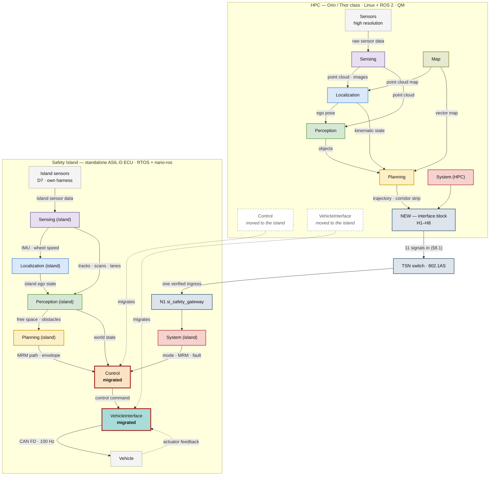

```mermaid
flowchart TB
    subgraph HPCD["HPC — Orin / Thor class · Linux + ROS 2 · QM"]
        direction LR
        HSEN["Sensors"]
        BSENS["Sensing<br/><i>unchanged</i>"]
        BLOC["Localization<br/><i>unchanged</i>"]
        BPERC["Perception<br/><i>unchanged</i>"]
        BMAP["Map<br/><i>unchanged</i>"]
        BPLAN["Planning<br/><i>unchanged</i>"]
        BSYS["System<br/><i>unchanged</i>"]
        HQ9["motion_velocity_optimizer<br/><b>re-sourced</b> — trajectory now via H5"]
        HC1["external_cmd_selector<br/><b>re-sourced</b>"]
        HK5["mrm_comfortable_stop_operator"]
        HY1["diagnostic_graph_aggregator"]
        HY5["default_adapi_universe"]
        GHO["REMOVED FROM THE HPC<br/>the whole control stack and the vehicle interface<br/><i>they run on the island below</i>"]
        H1N["H1 si_bridge_hpc<br/><b>new</b>"]
        H2N["H2 hpc_capability_reporter<br/><b>new</b>"]
        H3N["H3 hpc_corridor_publisher<br/><b>new</b>"]
        H4N["H4 hpc_odd_reporter<br/><b>new</b>"]
        H5N["H5 hpc_trajectory_conditioner<br/><b>new</b>"]
        H6N["H6 hpc_island_state_client<br/><b>new</b>"]
        H7N["H7 hpc_heartbeat<br/><b>new</b>"]
        H8N["H8 hpc_refuge_publisher<br/><b>new</b>"]
    end

    FSI["On-SoC FSI<br/>Cortex-R52 lockstep"]
    TSN2["TSN switch · 802.1AS"]

    subgraph ISLD["SAFETY ISLAND — standalone ASIL-D ECU · RTOS + nano-ros"]
        direction LR
        N1C["N1 si_safety_gateway<br/><b>new</b> — one verified ingress"]
        ISEN2["Island sensors — D7"]
        BISENS["Sensing (island)<br/><i>new stack, phase 5 opens it</i>"]
        BILOC["Localization (island)<br/><i>new stack</i>"]
        BIPERC["Perception (island)<br/><i>new stack</i>"]
        BIPLAN["Planning (island)<br/><i>new stack</i>"]
        BISYS["System (island)<br/><i>new stack</i>"]
        I19M["I19 autonomous_emergency_braking<br/><b>migrated</b>"]
        I20M["I20 collision_detector<br/><b>migrated</b>"]
        I9M["I9 trajectory_follower_node<br/><b>migrated</b>"]
        I10M["I10 mpc_lateral_controller"]
        I11M["I11 pid_longitudinal_controller"]
        I12M["I12 trajectory_follower_base"]
        I8M["I8 control_validator<br/><b>migrated</b>"]
        I14M["I14 shift_decider<br/><b>migrated</b>"]
        I13M["I13 pure_pursuit<br/><b>migrated</b> — fallback tier"]
        I2M["I2 command_mode_decider<br/><b>migrated</b>"]
        I3M["I3 command_mode_switcher<br/><b>migrated</b>"]
        I7M["I7 mrm_handler<br/><b>migrated</b>"]
        I6M["I6 mrm_emergency_stop_operator<br/><b>migrated</b>"]
        I5M["I5 stop_mode_operator<br/><b>migrated</b>"]
        I1M["I1 control_command_gate — the arbiter<br/><b>migrated</b>"]
        I15M["I15 raw_vehicle_cmd_converter<br/><b>migrated</b>"]
        I16M["I16 vehicle interface — pacmod / project equivalent<br/><b>migrated</b>"]
        ACT2["Actuator gateway<br/>brake · steer · propulsion · lamps"]
    end

    HSEN --> BSENS
    BSENS --> BLOC
    BSENS --> BPERC
    BMAP -->|"pointcloud_map"| BLOC
    BMAP -->|"vector_map"| BPLAN
    BLOC --> BPLAN
    BPERC -->|"objects"| BPLAN
    BPLAN -->|"trajectory"| HQ9
    HK5 -->|"VelocityLimit"| HQ9
    BSYS -->|"/diagnostics"| HY1
    HY1 -->|"capability"| H2N
    HQ9 --> H5N
    H6N -->|"island state → AD API"| HY5
    H1N --> TSN2
    H2N --> H1N
    H3N --> H1N
    H4N --> H1N
    H5N --> H1N
    H7N --> H1N
    H8N --> H1N
    GHO -.->|"no longer runs here"| ISLD
    TSN2 -->|"11 signals in (§8.1)"| N1C
    N1C -->|"/api/operation_mode/state"| I7M
    BISYS -->|"OperationModeAvailability (N2)"| I7M
    N1C --> BISYS
    FSI -.->|"SPI + SOC_ERROR · bypasses Linux"| BISYS
    ISEN2 --> BISENS
    BISENS --> I19M
    BISENS --> I20M
    BISENS --> BIPERC
    BISENS -->|"IMU · wheel speed"| BILOC
    BILOC --> BIPERC
    BIPERC --> BIPLAN
    BIPLAN -->|"MRM Trajectory"| I13M
    BIPLAN -->|"envelope limits"| I1M
    I9M --> I10M
    I9M --> I11M
    I10M --> I12M
    I11M --> I12M
    I12M --> I14M
    I12M -->|"nominal control_cmd"| I1M
    I13M -->|"fallback control_cmd"| I1M
    I14M --> I1M
    I6M -->|"emergency stop"| I1M
    I5M -->|"stop · gear P"| I1M
    I19M -.->|"/diagnostics ERROR"| BISYS
    I20M -.-> BISYS
    I8M -.-> BISYS
    BISYS -->|"island mode"| I2M
    I2M -->|"command mode"| I3M
    I3M -->|"source selection"| I1M
    I7M --> BIPLAN
    BISYS --> N1C
    I1M --> I15M
    I15M --> I16M
    I16M -->|"CAN FD · 100 Hz"| ACT2
    ACT2 -.->|"actuator feedback"| I16M
    I16M -.-> BISYS

    classDef sensing fill:#E8DFF0,stroke:#8E6FAF,stroke-width:3px,color:#101010;
    classDef locz fill:#D9E8FA,stroke:#5B9BD5,stroke-width:3px,color:#101010;
    classDef percep fill:#D6E8D5,stroke:#6AA84F,stroke-width:3px,color:#101010;
    classDef mapc fill:#E7E9D0,stroke:#8A9A3E,stroke-width:3px,color:#101010;
    classDef planc fill:#FDF0C6,stroke:#D6A000,stroke-width:3px,color:#101010;
    classDef sysc fill:#F6D2CE,stroke:#C1453C,stroke-width:3px,color:#101010;
    classDef resrc fill:#FDF0C6,stroke:#9A5B00,stroke-width:1.5px,color:#101010;
    classDef sysnode fill:#F6D2CE,stroke:#C1453C,stroke-width:1.5px,color:#101010;
    classDef newn fill:#DDE4EC,stroke:#1F5FAE,stroke-width:1.5px,color:#101010;
    classDef ghost fill:#FFFFFF,stroke:#8A8A8A,stroke-width:1px,stroke-dasharray: 5 4,color:#555555;
    classDef movedp fill:#D6E8D5,stroke:#A8231C,stroke-width:1.5px,color:#101010;
    classDef movedc fill:#FBE2C4,stroke:#A8231C,stroke-width:1.5px,color:#101010;
    classDef plainc fill:#FBE2C4,stroke:#E08A1E,stroke-width:1.5px,color:#101010;
    classDef movedv fill:#A9DCD8,stroke:#A8231C,stroke-width:1.5px,color:#101010;
    classDef vehc fill:#F4F4F4,stroke:#999999,stroke-width:1px,color:#101010;
    classDef linkc fill:#DDE4EC,stroke:#4A6B8A,stroke-width:2px,color:#101010;

    class BSENS,BISENS sensing;
    class BLOC,BILOC locz;
    class BPERC,BIPERC percep;
    class BMAP mapc;
    class BPLAN,BIPLAN planc;
    class BSYS,BISYS sysc;
    class HQ9,HC1 resrc;
    class HK5,HY1,HY5 sysnode;
    class H1N,H2N,H3N,H4N,H5N,H6N,H7N,H8N newn;
    class GHO ghost;
    class I19M,I20M movedp;
    class I9M,I8M,I14M,I13M,I2M,I3M,I7M,I6M,I5M,I1M,I15M movedc;
    class I10M,I11M,I12M plainc;
    class I16M movedv;
    class N1C,TSN2 linkc;
    class HSEN,ISEN2,ACT2,FSI vehc;
```

```mermaid
flowchart LR
    HPCOFF["HPC — off the page<br/>via N1 only · 11 signals in (§8.1)"]
    FSI2["On-SoC FSI<br/>SPI + SOC_ERROR"]
    ISEN3["ISLAND SENSOR SET — D7, ranked by D8<br/>① forward camera — mandatory · ② radar<br/>③ ultrasonic · ④ IMU / GNSS · ⑤ 2D lidar — optional<br/><i>own harness and power rail</i>"]

    subgraph JSEN["Sensing (island)"]
        direction TB
        N13["N13 si_scan_guard<br/>2D lidar · free space<br/><i>optional — only where fitted</i><br/><b>▷ confirms or vetoes only</b>"]
        N6["N6 si_radar_guard<br/>range · range-rate · TTC<br/><b>▶ B1 · B3</b>"]
        N14["N14 si_vision_guard<br/>lane lines · road edge<br/>pull-over space<br/><b>▶ B1 · B2 · B3</b>"]
        N15["N15 si_proximity_guard<br/>near-field clearance<br/><i>rank ③ — where fitted</i><br/><b>▷ B3 final metres (§3.1, not in §3.3)</b>"]
        N17["N17 si_sensor_health<br/>blockage · degradation<br/><b>▶ B1 · B4</b>"]
    end

    subgraph JLOC["Localization (island)"]
        direction TB
        N4["N4 si_vehicle_state_estimator<br/>dead reckoning from the chassis signals,<br/>plus the island IMU / GNSS where fitted<br/><b>▶ B4</b>"]
    end

    subgraph JPER["Perception (island)"]
        direction TB
        N16["N16 si_safety_world_model<br/>the island's one world<br/><b>▶ B1 · B2 · B3 · B4</b>"]
        I19B["I19 autonomous_emergency_braking<br/><b>migrated</b><br/><b>▶ B2 · B4</b>"]
        I20B["I20 collision_detector<br/><b>migrated</b> · <i>runs where N15 / N13 are fitted</i><br/><b>▷ B3</b>"]
        N19["N19 si_odd_monitor<br/>visibility · v_max<br/><b>▶ B1</b>"]
        N20["N20 si_object_digest<br/><i>optional (§3.5), via N1</i><br/><b>⊘ no behaviour</b>"]
    end

    subgraph JPLN["Planning (island)"]
        direction TB
        N5["N5 si_corridor_monitor<br/>lateral containment<br/><b>▶ B2</b>"]
        N7["N7 si_mrm_planner<br/>bounded Trajectory ≤ 50 pts<br/><b>▶ B2 · B3</b>"]
        N18["N18 si_pull_over_manager<br/>OperateMrm server<br/><b>▶ B3</b>"]
        N10["N10 si_envelope_monitor<br/>RSS · accel · jerk · curvature<br/><b>▶ B1 · B2</b>"]
    end

    subgraph JCTL["Control (island) — the Autoware control stack, relocated whole"]
        direction TB
        I9B["I9 trajectory_follower_node<br/><b>migrated</b><br/><b>⊘ no behaviour</b>"]
        I10B["I10 mpc_lateral_controller<br/><b>⊘ no behaviour</b>"]
        I11B["I11 pid_longitudinal_controller<br/><b>⊘ no behaviour</b>"]
        I12B["I12 trajectory_follower_base<br/><b>⊘ no behaviour</b>"]
        I8B["I8 control_validator<br/><b>migrated</b><br/><b>▶ B2</b>"]
        I14B["I14 shift_decider<br/><b>migrated</b><br/><b>⊘ no behaviour</b>"]
        I13B["I13 pure_pursuit<br/><b>migrated</b> — fallback tier, ASIL-B(D)<br/><b>▶ B2 · B3</b>"]
        I2B["I2 command_mode_decider<br/><b>migrated</b><br/><b>▶ SHARED</b>"]
        I3B["I3 command_mode_switcher<br/><b>migrated</b><br/><b>▶ B2</b>"]
        I7B["I7 mrm_handler<br/><b>migrated</b><br/><b>▶ B3 · B4</b>"]
        I6B["I6 mrm_emergency_stop_operator<br/><b>migrated</b><br/><b>▶ B3 · B4</b>"]
        I5B["I5 stop_mode_operator<br/><b>migrated</b><br/><b>▶ B3 · B4</b>"]
        I1B["I1 control_command_gate — ranks the command sources,<br/>filters, limits, and hands the one winner to the interface<br/><b>migrated</b><br/><b>▶ B2 · B3 · B4</b>"]
        I15B["I15 raw_vehicle_cmd_converter<br/><b>migrated</b><br/><b>▶ SHARED</b>"]
    end

    subgraph JVI["VehicleInterface (island)"]
        direction TB
        I16B["I16 vehicle interface — pacmod / project equivalent<br/><b>migrated</b><br/><b>▶ B2 · B3 · B4</b>"]
    end

    subgraph JSYS["System (island)"]
        direction TB
        N2["N2 si_hpc_supervisor<br/>liveness · deadlines<br/><b>▶ B1 · B2</b>"]
        N3["N3 si_state_machine<br/>the island's mode<br/><b>▶ B1 · B2 · B3 · B4</b>"]
        N8["N8 si_fault_manager<br/>static fault tree · DTC<br/><b>▶ B1 · B4</b>"]
        N9["N9 si_actuator_supervisor<br/><b>▶ B2 · B3 · B4</b>"]
        N12["N12 si_time_quality_monitor<br/><b>▶ SHARED</b>"]
        N11["N11 si_event_recorder<br/>UDS / DTC export<br/><b>▶ B1</b>"]
    end

    N1D["N1 si_safety_gateway<br/>verifies Data ID · sequence · CRC · length<br/>and age on every HPC message before any island node sees it<br/><b>▶ B1</b>"]
    ACT3["Actuator gateway — brake · steer · propulsion · lamps<br/>CAN FD / FlexRay · 100 Hz · SI-E2E/B"]

    HPCOFF --> N1D
    N1D --> N4
    N1D --> N19
    N1D --> N5
    N1D --> N18
    N1D --> I9B
    N1D --> I8B
    N1D -->|"H5 trajectory · MPC overrun"| I13B
    N1D -->|"/api/operation_mode/state"| I7B
    N2 -->|"OperationModeAvailability"| I7B
    N1D --> N2
    N1D -.->|"optional digest (§3.5)"| N20
    N1D -.->|"external / remote command"| I1B
    ISEN3 -.-> N13
    ISEN3 --> N6
    ISEN3 --> N14
    ISEN3 --> N15
    ISEN3 --> N17
    N13 -.-> N16
    N6 --> N16
    N14 --> N16
    N15 --> N16
    N6 -->|"radar → PointCloud2"| I19B
    N13 -.-> I19B
    N13 -.-> I20B
    N15 --> I20B
    N17 -->|"degradation cause"| N19
    N16 -->|"perceived corridor"| N5
    N16 --> N7
    N16 --> N18
    N16 --> N10
    N19 -->|"v_max"| N10
    N17 -.-> N8
    I19B -.-> N8
    I20B --> N8
    I8B -.-> N8
    N9 -->|"actuator fault"| N8
    N8 -->|"fault verdict"| N3
    N2 -->|"liveness verdict"| N3
    N3 -->|"island mode"| I2B
    I2B -->|"command mode"| I3B
    I3B -->|"source selection"| I1B
    I7B --> N7
    N8 -->|"DTCs"| N11
    N12 --> N1D
    I9B --> I10B
    I9B --> I11B
    I10B --> I12B
    I11B --> I12B
    I12B -->|"nominal control_cmd"| I1B
    I12B --> I14B
    I14B --> I1B
    I13B -->|"fallback control_cmd"| I1B
    I6B -->|"emergency stop"| I1B
    I5B -->|"stop · gear P"| I1B
    N7 --> I13B
    N10 -->|"envelope limits"| I1B
    I1B --> I15B
    I15B --> I16B
    I16B --> ACT3
    ACT3 -.->|"actuator feedback"| I16B
    I16B -.-> N9
    N3 --> N1D
    FSI2 -.->|"hardware fault line"| N8

    classDef sensing fill:#E8DFF0,stroke:#8E6FAF,stroke-width:2px,color:#101010;
    classDef locz fill:#D9E8FA,stroke:#5B9BD5,stroke-width:2px,color:#101010;
    classDef percep fill:#D6E8D5,stroke:#6AA84F,stroke-width:2px,color:#101010;
    classDef planc fill:#FDF0C6,stroke:#D6A000,stroke-width:2px,color:#101010;
    classDef ctrlc fill:#FBE2C4,stroke:#E08A1E,stroke-width:2px,color:#101010;
    classDef sysc fill:#F6D2CE,stroke:#C1453C,stroke-width:2px,color:#101010;
    classDef vifc fill:#A9DCD8,stroke:#A8231C,stroke-width:2px,color:#101010;
    classDef movedp fill:#D6E8D5,stroke:#A8231C,stroke-width:2px,color:#101010;
    classDef movedc fill:#FBE2C4,stroke:#A8231C,stroke-width:2px,color:#101010;
    classDef optn fill:#D6E8D5,stroke:#2A5DA8,stroke-width:2px,stroke-dasharray: 5 4,color:#101010;
    classDef optsen fill:#E8DFF0,stroke:#8E6FAF,stroke-width:2px,stroke-dasharray: 5 4,color:#101010;
    classDef linkc fill:#DDE4EC,stroke:#4A6B8A,stroke-width:2px,color:#101010;
    classDef vehc fill:#F4F4F4,stroke:#999999,stroke-width:1px,color:#101010;

    class N6,N14,N17 sensing;
    class N13 optsen;
    class N4 locz;
    class N16,N19 percep;
    class I19B,I20B movedp;
    class N20 optn;
    class N5,N7,N18,N10 planc;
    class I10B,I11B,I12B ctrlc;
    class I9B,I8B,I14B,I13B,I2B,I3B,I7B,I6B,I5B,I1B,I15B movedc;
    class I16B vifc;
    class N2,N3,N8,N9,N12,N11 sysc;
    class N1D linkc;
    class HPCOFF,FSI2,ISEN3,ACT3 vehc;
```

All five are built from [layers/](layers/) (`make` there, or `latexmk -pdf` per file); [layers/L4SafetyIsland-Layers.pdf](layers/L4SafetyIsland-Layers.pdf)
collects them onto uniform landscape pages for presentation, and [layers/L4SafetyIsland-Layers.md](layers/L4SafetyIsland-Layers.md)
records the drawing conventions.

### 4.1 Migration list

Package names are as of `autoware_universe` `main`, August 2026.

| # | Package | Function on the island | Tier | Notes / migration effort |
| :-- | :-- | :-- | :-- | :-- |
| I1 | `autoware_control_command_gate` | **The arbiter.** Selects among command sources, applies nominal filtering, generates the built-in stop when the selected source times out | [T0](#22-criticality-tiers-on-the-island) | The single most important migration. Its built-in stop is the last-resort MRM. |
| I2 | `autoware_command_mode_decider` (+ `_plugins`) | Decides the command mode: which source has authority (autonomous / MRM / stop) | [T0](#22-criticality-tiers-on-the-island) | Plugin logic must be replaced with a static, table-driven decider for certifiability. |
| I3 | `autoware_command_mode_switcher` (+ `_plugins`) | Applies the decided mode; drives transitions | [T0](#22-criticality-tiers-on-the-island) | Same static-configuration requirement. |
| I4 | `autoware_command_mode_types` | Shared type/constant library | — | Header-only; shared with HPC. |
| I5 | `autoware_stop_mode_operator` | Publishes stop commands; optional auto-park at standstill | [T0](#22-criticality-tiers-on-the-island) | Explicitly **does not depend on localization** — reads vehicle status telemetry only. Ideal island resident. |
| I6 | `autoware_mrm_emergency_stop_operator` | Emergency-stop MRM: publishes control commands directly | [T0](#22-criticality-tiers-on-the-island) | Independent of planning; survives HPC loss. |
| I7 | `autoware_mrm_handler` | Selects the MRM behaviour from the availability state | [T0](#22-criticality-tiers-on-the-island) | Must be island-resident ([R1](#21-partitioning-rules)/[R3](#21-partitioning-rules)): its *reason to act* is HPC loss. Availability input is re-sourced — see §6, [N2](#61-supervision-state-and-fallback). |
| I8 | `autoware_control_validator` | Checks the control command against the trajectory and vehicle limits | [T1](#22-criticality-tiers-on-the-island) | Small, deterministic, no map dependency. |
| I9 | `autoware_trajectory_follower_node` | Host node for the two controller plugins | [T2](#22-criticality-tiers-on-the-island) | **Already ported and closed-loop-validated on nano-ros.** |
| I10 | `autoware_mpc_lateral_controller` | Nominal lateral control | [T2](#22-criticality-tiers-on-the-island) | Already ported. OSQP iteration cap + time budget required (§4.2). |
| I11 | `autoware_pid_longitudinal_controller` | Nominal longitudinal control | [T2](#22-criticality-tiers-on-the-island) | Already ported. |
| I12 | `autoware_trajectory_follower_base` | Controller plugin base / utilities | [T2](#22-criticality-tiers-on-the-island) | Already ported. |
| I13 | `autoware_pure_pursuit` | **Fallback lateral control** — deterministic, closed-form, bounded time | [T1](#22-criticality-tiers-on-the-island) | *New to the island.* This is the [T1](#22-criticality-tiers-on-the-island) controller that replaces MPC when the MPC misses its budget. |
| I14 | `autoware_shift_decider` | Derives the gear command | [T2](#22-criticality-tiers-on-the-island) | Small; keeps gear in the island's command set. |
| I15 | `autoware_raw_vehicle_cmd_converter` | Converts generic accel/steer to vehicle-specific pedal/torque | [T2](#22-criticality-tiers-on-the-island) | Must be **downstream of the gate**, therefore island-side. |
| I16 | *vehicle interface* (`pacmod_interface` or project equivalent) | CAN FD / FlexRay TX/RX to the actuator gateway | [T0](#22-criticality-tiers-on-the-island) | Vehicle-specific; not in `autoware_universe`. E2E-protected. |
| I19 | `autoware_autonomous_emergency_braking` | **Island AEB.** Collision check against the ego predicted path; raises an ERROR diagnostic that escalates to emergency stop | [T1s](#22-criticality-tiers-on-the-island) | *Moved from the HPC by [D7](#1-inputs-already-fixed-by-the-wg).* Runs on the island's own point cloud <mark>— radar tracks rendered as `PointCloud2` by [`N6`](#61-supervision-state-and-fallback), merged with the 2D-lidar scan where one is fitted —</mark> with `use_pointcloud_data=true`, `use_predicted_object_data=false`, `use_imu_path=true`. May additionally consume `use_predicted_trajectory` — the MPC predicted path is on the island ([I10](#41-migration-list)). See §4.4. |
| I20 | `autoware_collision_detector` | **Near-field guard.** Geometric collision check against the current ego footprint within ~5 m | [T1s](#22-criticality-tiers-on-the-island) | *Moved from the HPC by [D7](#1-inputs-already-fixed-by-the-wg).* Runs point-cloud-only with `use_dynamic_object=false`. Fed by ultrasonic + 2D lidar <mark>— ultrasonic ranked third under [D8](#1-inputs-already-fixed-by-the-wg), the lidar optional, so I20 is deployed from rung C up (§9.4) and on any island that carries a lidar</mark>. Governs standstill, creep and low-speed MRM. See §4.4. |
| I17 | `autoware_operation_mode_transition_manager` | Engage/disengage transition management | [T0](#22-criticality-tiers-on-the-island) | Required only on the **legacy** path (§4.3). Superseded by [I2](#41-migration-list)/[I3](#41-migration-list). |
| I18 | `autoware_vehicle_cmd_gate` | Legacy gate | [T0](#22-criticality-tiers-on-the-island) | **Alternative to [I1](#41-migration-list)** on the legacy path only. Do not deploy both. |

**Count: 18 nodes on the target path** ([I1](#41-migration-list)–[I16](#41-migration-list), [I19](#41-migration-list)–[I20](#41-migration-list)), or 17 on the legacy path ([I17](#41-migration-list)+[I18](#41-migration-list) replacing
[I1](#41-migration-list)–[I3](#41-migration-list)). This is a realistic figure for a Cortex-R52-class MCU when grouped as in §9.

### 4.2 Why a two-tier controller

[D2](#1-inputs-already-fixed-by-the-wg) puts "the control module" on the island. Taken literally, that places the full MPC — with an
iterative QP solver — inside the safety-critical ECU, and the certification argument then has to cover
OSQP's worst-case execution time. That argument is expensive and fragile.

The recommendation is therefore to migrate the control module as **two tiers under one gate**:

| | Nominal tier ([T2](#22-criticality-tiers-on-the-island)) | Fallback tier ([T1](#22-criticality-tiers-on-the-island)) |
| :-- | :-- | :-- |
| Lateral | `autoware_mpc_lateral_controller` | `autoware_pure_pursuit` |
| Longitudinal | `autoware_pid_longitudinal_controller` | Fixed deceleration profile (`si_mrm_profile`, §6 [N7](#61-supervision-state-and-fallback)) |
| Integrity | QM, monitored | ASIL-B(D) |
| Time budget | Soft — may be dropped | Hard — always meets deadline |
| Trigger to switch | MPC budget overrun, validator reject, solver non-convergence, tracking error above bound | — |

Switching is a [T0](#22-criticality-tiers-on-the-island) decision made by the gate ([I1](#41-migration-list)) via the decider ([I2](#41-migration-list)), inside one control period. The
behaviour is already demonstrated in the existing port: the MPC commands an emergency stop on
excessive tracking error, so the escalation path is live today — this proposal formalises it and adds
a graceful intermediate step instead of going straight to a stop.

This satisfies [R8](#21-partitioning-rules) and directly answers open question 3 in `SaftyIsland_ReferenceDesign.md`
("real-time ROS 2 nodes on Cortex-R52 for MRM trajectory selection"): the MRM tier is closed-form and
bounded; only the comfort tier is iterative.

### 4.3 Target architecture vs. legacy architecture

Autoware is mid-transition. Two consistent sets exist; the island must pick one.

| | **Target (recommended)** | **Legacy** |
| :-- | :-- | :-- |
| Gate | `autoware_control_command_gate` | `autoware_vehicle_cmd_gate` |
| Mode decision | `autoware_command_mode_decider` | `autoware_operation_mode_transition_manager` |
| Mode application | `autoware_command_mode_switcher` | (in gate) |
| Stop source | `autoware_stop_mode_operator` | (in gate) |

The target set is recommended because it separates *decide* / *switch* / *gate* into three nodes, and
that separation is exactly the decomposition a safety argument needs — the decider can be a static
table, the switcher a state machine, the gate a filter, each independently reviewable. The legacy
`vehicle_cmd_gate` fuses all three and is correspondingly harder to certify.

### 4.4 Why AEB and the collision detector can now migrate

In the previous revision both stayed on the HPC because they were assumed to need perception object
lists. Checking their actual interfaces shows otherwise, and [D7](#1-inputs-already-fixed-by-the-wg) removes the remaining obstacle.

| | `autoware_autonomous_emergency_braking` | `autoware_collision_detector` |
| :-- | :-- | :-- |
| Perception objects | **Optional** — `use_predicted_object_data=false` | **Optional** — `use_dynamic_object=false` |
| Point cloud | `use_pointcloud_data=true` | `use_pointcloud=true` |
| Ego path source | IMU-based kinematic prediction (velocity + yaw rate), *or* the MPC predicted trajectory | none — current footprint only |
| Map dependency | none | none |
| Output | ERROR on `/diagnostics` | ERROR on `/diagnostics` |
| Island sensor that feeds it | <mark>radar tracks → `PointCloud2` ([`N6`](#61-supervision-state-and-fallback)); 2D lidar scan where fitted</mark> | 2D lidar + ultrasonic → `PointCloud2` <mark>— ultrasonic ranked third, the lidar optional, so a node deployed from rung C up</mark> |

Both are therefore **island-viable without any HPC input at all**: AEB's IMU path comes from [`N4`](#61-supervision-state-and-fallback), its
point cloud from <mark>[`N6`](#61-supervision-state-and-fallback)'s radar tracks (and [`N13`](#62-island-safety-sensing) where a 2D lidar is fitted)</mark>, and — usefully — its optional MPC path from [`I10`](#41-migration-list), which is already on the
island. Neither node needs the planner, the map, or the perception stack.

This is the concrete payoff of [D7](#1-inputs-already-fixed-by-the-wg). Migrating them means the island's emergency braking is not a
bespoke reimplementation but **the same Autoware node, with the same tuning parameters and the same
validation history**, running on a diverse sensor channel. `autoware_spheric_collision_detector` stays
on the HPC — it is object-list based.

Their `/diagnostics` ERROR is consumed by [`N8`](#61-supervision-state-and-fallback) (fault manager) and escalated through [`N3`](#61-supervision-state-and-fallback) to the gate,
exactly like any other island fault source. Neither node commands the actuators directly.

---

## 5. Autoware nodes that remain on the HPC

### 5.1 Whole stacks — HPC only

`sensing`, `perception`, `localization`, `map`, `planning` execute entirely on the HPC. Every node in
`AutowareSW.md` §1–§5 stays: `ndt_scan_matcher`, `ekf_localizer`, `bevfusion`, `multi_object_tracker`,
`lanelet2_map_loader`, `behavior_path_planner`, `behavior_velocity_planner`, `mission_planner`,
`freespace_planner`, and the rest. They fail [R4](#21-partitioning-rules) (unbounded memory, learning-based, map-sized state)
and [R5](#21-partitioning-rules) (their inputs and outputs would flood the link).

**Consequence that must be handled, not assumed away:** the island's controllers currently subscribe
to `/localization/kinematic_state` and `/localization/acceleration`, both HPC-produced. Under [R2](#21-partitioning-rules) the
island cannot depend on them after HPC loss. This is resolved by [N4](#61-supervision-state-and-fallback) in §6.

### 5.2 Control and system packages that stay

| Package | Decision | Reason |
| :-- | :-- | :-- |
| `autoware_spheric_collision_detector` | **HPC** | Object-list based. Its point-cloud siblings moved to the island — see §4.4. |
| `autoware_obstacle_collision_checker`, `autoware_predicted_path_checker` | **HPC** | Depend on predicted paths and map. |
| `autoware_lane_departure_checker` | **HPC** | Requires the Lanelet2 vector map ([R4](#21-partitioning-rules)). Island equivalent is the corridor monitor [N5](#61-supervision-state-and-fallback) — now dual-sourced from [H3](#7-new-nodes-to-add-on-the-hpc)'s map corridor *and* the island's own camera lane detection ([N14](#62-island-safety-sensing)). |
| `autoware_external_cmd_selector`, `autoware_joy_controller`, `autoware_external_cmd_converter` | **HPC** | Remote/manual sources. They reach the island as one E2E-protected command source into the gate, not as island nodes. <mark>Under [D9](#1-inputs-already-fixed-by-the-wg) the remote and local paths of [B5](#b5--tele-operation-from-the-remote-command-centre) and [B6](#b6--manual-joystick-control-without-streamed-sensing) terminate on the island instead, so `autoware_external_cmd_selector` — whose *local* versus *remote* choice is exactly [B6](#b6--manual-joystick-control-without-streamed-sensing) versus [B5](#b5--tele-operation-from-the-remote-command-centre) — and `autoware_external_cmd_converter` become candidates to migrate. The allocation is settled with the detailed design (open decisions 19, 20); until then they stay here.</mark> |
| `autoware_control_performance_analysis`, `autoware_smart_mpc_trajectory_follower` | **HPC** | Development and analysis only; not in the operational path. |
| `autoware_mrm_comfortable_stop_operator` | **HPC** | It publishes an `autoware_internal_planning_msgs/VelocityLimit` to the **planner** — it cannot function without planning. It is therefore an *HPC-dependent MRM*, valid only while the HPC is degraded-but-alive. See §5.3. |
| `autoware_diagnostic_graph_aggregator`, `autoware_diagnostic_graph_utils`, `autoware_hazard_status_converter` | **HPC** | Large, config-driven fault trees over HPC-internal diagnostics. Island runs its own static fault manager ([N8](#61-supervision-state-and-fallback)). |
| `autoware_system_monitor`, `autoware_component_monitor`, `autoware_component_state_monitor`, `autoware_topic_state_monitor`, `autoware_duplicated_node_checker`, `autoware_processing_time_checker`, `autoware_pipeline_latency_monitor`, `autoware_bluetooth_monitor`, `autoware_velodyne_monitor` | **HPC** | They monitor HPC resources. Under [R3](#21-partitioning-rules) they are *evidence sources*, not the safety monitor — their verdict is condensed by [H2](#7-new-nodes-to-add-on-the-hpc) and shipped to the island, and the island never relies on them being alive. |
| `autoware_default_adapi_universe`, `autoware_default_adapi_helpers`, `autoware_topic_relay_controller` | **HPC** | API and orchestration surface. |
| `autoware_accel_brake_map_calibrator`, `autoware_steer_offset_estimator` | **HPC** | Offline/estimation tooling; produce parameters consumed by [I15](#41-migration-list). |
| `autoware_dummy_diag_publisher`, `autoware_dummy_infrastructure` | **HPC** | Test only. |

### 5.3 The two-class MRM split

This is a design consequence worth stating explicitly, because it changes the graded-reaction ladder
in `SaftyIsland_ReferenceDesign.md`:

| Graded reaction | Implemented by | Requires HPC alive? |
| :-- | :-- | :-- |
| 1. Notify & request self-recovery | Island → HPC constraint/veto message; HPC re-plans | **Yes** |
| <mark>1b. **Demand an ODD switch**</mark> | <mark>Island declares the current domain unsatisfiable; the HPC selects one it can meet and declares it through [`H4`](#7-new-nodes-to-add-on-the-hpc); the island verifies the declaration and then the behaviour (§6.4)</mark> | <mark>**Yes**</mark> |
| 2. Restrict speed / enlarge margins | `autoware_mrm_comfortable_stop_operator` (HPC) + island envelope limits <mark>— held underneath step 1b for its duration</mark> | **Yes** |
| 3a₀. Take authority — **lane-keep hold** ([B2](#b2--keep-the-vehicle-in-its-lane-after-loss-of-the-hpc)) | Island: fallback tier + `I13 pure_pursuit` on <mark>the camera's lane lines, decelerating first to the ODD's safe speed `v_odd` and then along the `v_hold` ramp to `v_entry`</mark> for at most `T_hold` <mark>(8–15 s)</mark> while awaiting HPC recovery <mark>; exits to 3a via [B3](#b3--pull-over-if-the-odd-continues-to-fail), or to 3b ([B4](#b4--emergency-stop-when-the-island-is-blind)) if the camera is lost</mark> | No |
| 3a. Take authority — <mark>**pull-over** ([B3](#b3--pull-over-if-the-odd-continues-to-fail)), degrading to the</mark> **obstacle-aware** in-lane stop | Island: <mark>[`N18`](#63-pull-over-mrm-after-hpc-loss) on the camera's road-edge and pull-over-space evidence, or</mark> fallback tier + `si_mrm_profile`, decelerating along the <mark>camera-perceived</mark> corridor to a free-space target | No |
| 3b′. Emergency braking on imminent collision | Island: `autoware_autonomous_emergency_braking` ([I19](#41-migration-list)) on island sensors | No |
| <mark>3b. Take authority — **emergency stop** ([B4](#b4--emergency-stop-when-the-island-is-blind))</mark> | <mark>Island: `autoware_mrm_emergency_stop_operator` ([I6](#41-migration-list)), steering surrendered, no world model required</mark> | <mark>No</mark> |
| 3c. Last resort | Island: gate built-in stop (`autoware_control_command_gate`) | No |
| 4. Audit | Island `si_event_recorder` + HPC log store | No |

Steps 1 <mark>to 2</mark> are cooperative degradation; 3a₀–3c are island-autonomous. **The island must never depend
on step 2 succeeding before it can reach step 3.** Step 3a₀ is the only rung that can be *left upward*:
if the HPC recovers and is confirmed healthy during the hold, authority returns to it and the ladder
resets to step 1. Every rung below 3a₀ is terminal for the drive cycle.

<mark>**Step 3b is [B4](#b4--emergency-stop-when-the-island-is-blind), and it is not only reached by falling through 3a.** Every rung from 1 to 3a has a
direct edge into it, because the condition that declares it — the island can no longer see — is
independent of which rung the vehicle happens to be on (§3.2). </mark>Since [D8](#1-inputs-already-fixed-by-the-wg), *can no longer see* means *has lost the camera*.<mark> Reading the table as a strict descent
is the one misreading that matters: it would let an implementation guard 3b behind 3a, and a guarded
floor is not a floor.</mark>

That ladder is for *HPC failure*. §6.4 defines a second, slower ladder for *ODD exit*, where the HPC is
healthy and the correct first move is to constrain it rather than replace it.

---

## 6. New nodes to add on the Safety Island

These do not exist in Autoware today. They are what turns a ported trajectory follower into a safety
island.

### 6.1 Supervision, state and fallback

| # | Node | Purpose | Tier | Rate |
| :-- | :-- | :-- | :-- | :-- |
| **N1** | `si_safety_gateway` | In-house E2E ingress/egress (§8.4). Verifies Data ID, sequence counter, CRC, length and age on every message from the HPC before it reaches any island node; publishes island state outward. Rejects become **safety events**, not transport errors. | [T0](#22-criticality-tiers-on-the-island) | per-message |
| **N2** | `si_hpc_supervisor` | HPC liveness and deadline supervision: heartbeat timeout, per-topic minimum rate, end-to-end latency against the declared budget. **Produces the island-local `OperationModeAvailability` that feeds [I7](#41-migration-list)** — this is what makes `mrm_handler` work when the HPC is silent. Also owns the **recovery verdict**: during a [B2](#b2--keep-the-vehicle-in-its-lane-after-loss-of-the-hpc) hold it re-qualifies a returning HPC over the declared confirmation window — heartbeat restored *and* trajectories valid, fresh and in-envelope — and only then permits hand-back. | [T0](#22-criticality-tiers-on-the-island) | 100 Hz |
| **N3** | `si_state_machine` | The island safety state machine: `BOOT → SELF_TEST → STANDBY → ADS_ACTIVE → {DEGRADED, LANE_KEEP_HOLD, MRM_PREPARE, MRM_EXECUTE, MRM_COMPLETE, EMERGENCY_STOP} → SAFE_STOP`. Single owner of island mode. `LANE_KEEP_HOLD` is [B2](#b2--keep-the-vehicle-in-its-lane-after-loss-of-the-hpc) (§3.1): N3 owns its hold budget `T_hold`, is the only node that may authorise the hand-back edge `LANE_KEEP_HOLD → ADS_ACTIVE` on [N2](#61-supervision-state-and-fallback)'s recovery verdict, and <mark>latches the ODD class for `v_odd` at entry. When the budget expires it forks: to `MRM_PREPARE` ([B3](#b3--pull-over-if-the-odd-continues-to-fail)) if [`N17`](#62-island-safety-sensing) holds the camera valid and the lane lines are seen, to `EMERGENCY_STOP` ([B4](#b4--emergency-stop-when-the-island-is-blind)) if not.</mark> <mark>`EMERGENCY_STOP` is [B4](#b4--emergency-stop-when-the-island-is-blind): it is entered from **every** other state including `LANE_KEEP_HOLD` and `MRM_EXECUTE`, it is the one transition with no guard and no precondition, and its only successor is `SAFE_STOP`.</mark> Every other transition remains one-way. | [T0](#22-criticality-tiers-on-the-island) | 100 Hz |
| **N4** | `si_vehicle_state_estimator` | **Island-local odometry.** Dead-reckons pose, twist and acceleration from wheel speed, steering angle <mark>and the chassis ESC yaw rate and acceleration; the island-attached IMU and GNSS ([D8](#1-inputs-already-fixed-by-the-wg) rank 4), where fitted, tighten the estimate and give it a channel independent of the chassis bus</mark>. Publishes island-domain `Odometry` and `AccelWithCovarianceStamped`. Resolves the [R2](#21-partitioning-rules) orphan-input problem for [I9](#41-migration-list)–[I13](#41-migration-list). | [T0](#22-criticality-tiers-on-the-island) | 100 Hz |
| **N5** | `si_corridor_monitor` | Lateral containment. **Dual-sourced:** <mark>while the HPC drives,</mark> prefers the compact map-derived corridor from [H3](#7-new-nodes-to-add-on-the-hpc) while it is fresh <mark>and cross-checks it against the camera's lane boundaries from [N14](#62-island-safety-sensing); once the island drives, the camera is the required source and [H3](#7-new-nodes-to-add-on-the-hpc) only refines it. There is no heading-tube fallback: with no camera corridor, N5 declares the corridor lost, which is a [B4](#b4--emergency-stop-when-the-island-is-blind) trigger. Under [B3](#b3--pull-over-if-the-odd-continues-to-fail) it is re-armed against the road edge [N14](#62-island-safety-sensing) observes.</mark> Island-side equivalent of `lane_departure_checker`. | [T1](#22-criticality-tiers-on-the-island) | 50 Hz |
| **N6** | `si_radar_guard` | Radar track ingest: range, range-rate, closing speed, conservative stopping-distance check. Weather-robust longitudinal channel; see §6.2. | [T1s](#22-criticality-tiers-on-the-island) | 20–50 Hz |
| **N7** | `si_mrm_profile` | Generates the MRM motion profile when planning is unavailable: deceleration <mark>to the ODD's safe speed `v_odd` and then</mark> to the [B2](#b2--keep-the-vehicle-in-its-lane-after-loss-of-the-hpc) hold speed `v_hold` or to standstill, target standstill point, hazard-lamp and gear sequencing — <mark>the lamps are raised when the manoeuvre is commanded, not when it completes (§3.1)</mark>. **Obstacle-aware** — shortens the ramp against [N16](#62-island-safety-sensing)'s free-space distance and nearest-obstacle range, and reverts to a fixed conservative ramp when [N16](#62-island-safety-sensing) is stale (§2.2 staleness rule). Feeds the fallback tier. | [T1](#22-criticality-tiers-on-the-island) | 50 Hz |
| **N8** | `si_fault_manager` | Static fault tree + DTC store + fault reaction table. Aggregates [N2](#61-supervision-state-and-fallback), [N5](#61-supervision-state-and-fallback), [N17](#62-island-safety-sensing), [I8](#41-migration-list), the [I19](#41-migration-list)/[I20](#41-migration-list) `/diagnostics` ERRORs, actuator faults, and the FSI hardware fault line into a single fault verdict for [N3](#61-supervision-state-and-fallback). <mark>Holds the distinct fault codes for **sensing blackout** ([B4](#b4--emergency-stop-when-the-island-is-blind)) — </mark>the camera lost — and for a search that found no refuge (in-lane stop under [B2](#b2--keep-the-vehicle-in-its-lane-after-loss-of-the-hpc)'s control law, from [B3](#b3--pull-over-if-the-odd-continues-to-fail)), so the two are separable in the DTC store and in the HARA. A blackout record also names which lower-ranked sensors were still alive.<mark></mark> | [T0](#22-criticality-tiers-on-the-island) | 100 Hz |
| **N9** | `si_actuator_supervisor` | Actuator-feedback plausibility: commanded vs. achieved steering/brake/torque, response-time check, brake-pressure and EPS availability. Confirms MRM is actually being executed; <mark>non-response is a direct [B4](#b4--emergency-stop-when-the-island-is-blind) trigger, and non-response *during* [B4](#b4--emergency-stop-when-the-island-is-blind) escalates below the node path to the gate's built-in stop and the §8.5 fault line.</mark> | [T1](#22-criticality-tiers-on-the-island) | 100 Hz |
| **N10** | `si_envelope_monitor` | Kinematic/RSS safety envelope: bounds on acceleration, jerk, curvature, curvature rate, yaw rate, and **speed against [N16](#62-island-safety-sensing)'s stopping-distance result** — the island can now enforce a true RSS longitudinal envelope rather than a kinematic-only one. Emits the constraint/veto vector. | [T1](#22-criticality-tiers-on-the-island) | 50 Hz |
| **N11** | `si_event_recorder` | Protected ring buffer of the pre/post-event window; UDS/DTC export (ISO 14229). Non-real-time, physically separated from the control path. | [T3](#22-criticality-tiers-on-the-island) | 1–10 Hz |
| **N12** | `si_time_quality_monitor` | gPTP sync state and offset; declares message-freshness checking valid or invalid. A lost time base invalidates every age check in [N1](#61-supervision-state-and-fallback). | [T1](#22-criticality-tiers-on-the-island) | 1 Hz |

**Optional / phase 2:** `si_odd_monitor` (island-side geofence and ODD validity from a dedicated GNSS
receiver). Merged into [N10](#61-supervision-state-and-fallback) in phase 1, because the HPC's ODD verdict ([H4](#7-new-nodes-to-add-on-the-hpc)) is sufficient while the HPC
is alive, and after HPC loss the island's response is [B2](#b2--keep-the-vehicle-in-its-lane-after-loss-of-the-hpc) and then a bounded MRM regardless of ODD — the
island's own ODD sets `v_hold` and the admissible hold duration, not whether the response happens.
<mark>The road class that sets [B2](#b2--keep-the-vehicle-in-its-lane-after-loss-of-the-hpc)'s `v_odd` is therefore taken from [H4](#7-new-nodes-to-add-on-the-hpc)'s last declaration, not
measured; GNSS, which [D8](#1-inputs-already-fixed-by-the-wg) ranks fourth and does not require, may only corroborate it downward.</mark>

### 6.2 Island safety sensing

[D7](#1-inputs-already-fixed-by-the-wg) attaches a low-resolution, high-robustness sensor set directly to the island. The selection
principle is **robustness and boundedness over resolution**: every sensor must degrade gracefully, emit
a small fixed-size payload, and be processable without a neural network.

<mark>Not every island carries all of it. [D8](#1-inputs-already-fixed-by-the-wg) ranks the set, and the ranking is what the behaviours are
written against: a behaviour may *require* only the camera, and every sensor below it buys speed or ODD
width, never the behaviour itself.</mark>

| <mark>Rank</mark> | Sensor | Physical link to island | Data class | Rate | What it gives the MRM |
| :-- | :-- | :-- | :-- | :-- | :-- |
| <mark>**1 — mandatory**</mark> | **Forward camera** (low resolution, mono) | GMSL or 100BASE-T1, direct | Lane boundaries <mark>+ road edge / kerb + drivable lateral space</mark> | 10–20 Hz | Lane geometry for lateral containment <mark>under [B2](#b2--keep-the-vehicle-in-its-lane-after-loss-of-the-hpc); lane lines and the pull-over space for [B3](#b3--pull-over-if-the-odd-continues-to-fail); the contrast and lane-continuity evidence of §6.4. **The sensor whose loss is [B4](#b4--emergency-stop-when-the-island-is-blind).**</mark> **See open decision 8** — classical CV vs. a certified smart camera emitting lane/object lists. |
| <mark>**2**</mark> | **Radar** — forward, <mark>and rear-corner on the pull-over side</mark> | CAN FD (native track output) | Object tracks — range, range-rate, azimuth | 20 Hz | Longitudinal obstacle range and closing speed <mark>— AEB's point cloud when no lidar is fitted</mark>. Works in rain, fog, darkness, low sun. <mark>Rear-corner: closing traffic on the pull-over side. Lifts [B2](#b2--keep-the-vehicle-in-its-lane-after-loss-of-the-hpc) to the highway `v_odd` and [B3](#b3--pull-over-if-the-odd-continues-to-fail) above ~30 km/h.</mark> |
| <mark>**3**</mark> | <mark>**Ultrasonic array**</mark> | <mark>LIN / DSI3 via a sensor interface, or CAN FD</mark> | <mark>Echo distance per sector, near field, up to about 5 m</mark> | <mark>10–20 Hz</mark> | <mark>Near-field clearance for the final metres of [B3](#b3--pull-over-if-the-odd-continues-to-fail) and a tight-to-kerb end; creep and standstill release; [`I20`](#41-migration-list)'s near-field footprint through [`N15`](#62-island-safety-sensing). Blind beyond a few metres: it buys a terminal condition, not speed.</mark> |
| <mark>**4**</mark> | **Island IMU <mark>/ GNSS</mark>** | direct / CAN FD | Vehicle dynamics <mark>; position and road-class corroboration</mark> | 100 Hz <mark>/ 10 Hz</mark> | <mark>A dynamics channel independent of the chassis bus for [N4](#61-supervision-state-and-fallback); the friction estimate of §6.4; GNSS corroborates the ODD class downward.</mark> |
| <mark>**5 — optional**</mark> | **2D lidar** (single-plane scanner) | 100BASE-T1 or RS-422, direct | Planar scan, ~1080 points | 10–40 Hz | Free-space distance ahead, in-path occupancy, lateral clearance <mark>— as a *confirming* channel: it may disqualify a space or add a hazard, never qualify a refuge or supply a corridor</mark>. Deterministic, classical processing, no learning. |
| <mark>— *(vehicle)*</mark> | <mark>**Chassis signals** — wheel speed, steering report, ESC yaw rate and acceleration</mark> | <mark>vehicle bus, via [`I16`](#41-migration-list)</mark> | <mark>Vehicle dynamics</mark> | <mark>100 Hz</mark> | <mark>Not an island sensor and not ranked: present on every vehicle. The floor [N4](#61-supervision-state-and-fallback) — and therefore [B4](#b4--emergency-stop-when-the-island-is-blind) — stands on.</mark> |

Two wiring rules follow from [R7](#21-partitioning-rules) and from RFC design principle 1:

1. **Independent harness and power.** Island sensors must not share a power rail, a harness bundle, or
   a switch with the HPC's sensor set. A common-cause failure that blinds the HPC must not blind the
   island. This is a hardware requirement that belongs in the Part-2 device design, but it is decided
   here.
2. **One-way data flow.** Sensors feed the island. The island *may* forward its safety world state to
   the HPC for cross-validation (§8.2), but no island sensing node may ever *depend* on an HPC-produced
   topic. [§3.5](#35-optional-enrichment-the-hpc-object-list)'s object digest is admissible under exactly that wording — it is *consumed*, never
   depended on — and [`N20`](#62-island-safety-sensing) below is the only node in this section with an HPC-side input.

The processing chain adds five nodes <mark>— two of which, [`N15`](#62-island-safety-sensing) and [`N13`](#62-island-safety-sensing), exist only on an island that carries their sensor, the ranked-third ultrasonic or the optional lidar —</mark> and one optional sixth:

| # | Node | Purpose | Tier | Rate |
| :-- | :-- | :-- | :-- | :-- |
| **N13** | `si_scan_guard` <mark>*(optional — only where a 2D lidar is fitted)*</mark> | 2D lidar ingest. Fixed-size planar occupancy over the ego corridor; extracts free-space distance ahead and nearest in-path return. Publishes a bounded `PointCloud2` for [I19](#41-migration-list)/[I20](#41-migration-list). Classical, no learning, static memory. <mark>Contributes to [N16](#62-island-safety-sensing) as a confirming channel only.</mark> | [T1s](#22-criticality-tiers-on-the-island) | 10–40 Hz |
| **N14** | `si_vision_guard` | Forward-camera ingest <mark>— **the one mandatory sensing node**</mark>. Extracts left/right lane boundary polylines and a free-space edge. <mark>Also extracts the **road edge or kerb** beyond the outer lane line and the **drivable lateral space** between them — the evidence [N18](#63-pull-over-mrm-after-hpc-loss) searches for an island-detected refuge under [B3](#b3--pull-over-if-the-odd-continues-to-fail).</mark> Feeds [N5](#61-supervision-state-and-fallback) as <mark>the required corridor source once the island drives</mark>. Either classical IPM + line fitting, or pass-through of a certified smart camera's lane/object output. | [T1s](#22-criticality-tiers-on-the-island) | 10–20 Hz |
| **N15** | `si_proximity_guard` <mark>*(rank 3 — where the ultrasonic array is fitted)*</mark> | Ultrasonic ingest. Near-field clearance per sector; gates creep, standstill release and the final metres of a pull-over. Feeds [I20](#41-migration-list). <mark>Like every source below the camera, it may narrow [N16](#62-island-safety-sensing)'s free space, never create it.</mark> | [T1s](#22-criticality-tiers-on-the-island) | 10–20 Hz |
| **N16** | `si_safety_world_model` | **The fusion point.** Combines [N6](#61-supervision-state-and-fallback), [N13](#62-island-safety-sensing), [N14](#62-island-safety-sensing), [N15](#62-island-safety-sensing) into the single bounded safety world state defined in §2.2 — nearest in-path obstacle, range, range-rate, TTC, free-space distance, perceived corridor, validity per source. Conservative fusion: a hazard reported by *any* source is taken as present; a corridor is trusted only when sources agree <mark>— and only when the camera is one of them: corridor and lateral free space are anchored on [N14](#62-island-safety-sensing), and the lower-ranked sources may narrow them but never create them</mark>. May additionally take [`N20`](#62-island-safety-sensing)'s optional digest as a **conservative-only** term — it can add a hazard or shorten a distance, never remove one and never make a corridor valid. <mark>Publishes the **no-valid-source** condition explicitly rather than an empty world state, so that a blackout is distinguishable from an empty road — the distinction [B4](#b4--emergency-stop-when-the-island-is-blind) turns on.</mark> | [T1s](#22-criticality-tiers-on-the-island) | 20–50 Hz |
| **N17** | `si_sensor_health` | Per-sensor availability, frame-rate, blockage and degradation detection — dirt, spray, fog, low sun, radar interference. Sets each source's validity flag for [N16](#62-island-safety-sensing) and drives the island's own ODD verdict. This is deck p.19's "monitoring sensor status, frame rates, weather conditions", now for island-attached sensors. <mark>**Declares sensing blackout** — the camera invalid, whatever the lower-ranked sources report — which is the trigger for [B4](#b4--emergency-stop-when-the-island-is-blind); the declaration is debounced, and the debounce is open decision 15.</mark> **[§3.5](#35-optional-enrichment-the-hpc-object-list)'s object digest is deliberately not an input to this determination:** an island that cannot see is blind whether or not the HPC is still publishing objects, and letting a live HPC mask a blackout would put a guard under [B4](#b4--emergency-stop-when-the-island-is-blind). | [T1s](#22-criticality-tiers-on-the-island) | 5–10 Hz |
| **N20** | `si_object_digest` *(optional — [§3.5](#35-optional-enrichment-the-hpc-object-list))* | Bounded ingest of the HPC's `/perception/object_recognition/objects`, admitted through [`N1`](#61-supervision-state-and-fallback) like every other cross-domain message. Truncates to a fixed maximum object count ordered by threat, a fixed prediction horizon and a fixed field set; stamps age and distance travelled since receipt using [`N4`](#61-supervision-state-and-fallback); plausibility-checks against [`N16`](#62-island-safety-sensing) where the fields of view overlap; marks the digest invalid once either carry-over bound is exceeded. Publishes `SafetyObjectDigest` on `/si/obj/digest`. **Contributes a conservative term only, and never a validity flag.** Bounds and budgets are open decision 16. | [T1s](#22-criticality-tiers-on-the-island) | 10 Hz |

**What this buys, stated precisely.** Without [D7](#1-inputs-already-fixed-by-the-wg) the island could execute a *blind* MRM: decelerate on
a fixed ramp along a remembered trajectory and hope the road ahead is clear. With [D7](#1-inputs-already-fixed-by-the-wg) it can execute an
**obstacle-aware** MRM — brake harder for a detected obstacle, stop short of it, hold at standstill
only when the near field is clear, and keep lane using perceived boundaries after the map corridor has
expired. The graded reaction in §5.3 becomes genuinely autonomous rather than open-loop.

**The island's own ODD.** The sensor set is deliberately weaker than the HPC's, so the island's
fallback capability has its own, narrower ODD — forward-looking only, bounded speed, no complex
merging or intersection negotiation. <mark>It also depends on *which* of the ranked sensors are fitted: a camera-only island (rung A, §9.4) claims a city-road fallback at ~30 km/h, and it is radar that extends the claim to the highway class.</mark> [`N17`](#62-island-safety-sensing) and [`N10`](#61-supervision-state-and-fallback) enforce it. Part 4 must state that ODD explicitly:
it is the domain over which the MRM is claimed to work, and it is not the vehicle's ODD.


### 6.3 Pull-over MRM after HPC loss

A pull-over is a materially harder manoeuvre than an in-lane stop, and the difference is not the
control law — it is *knowing where to go*. Three capabilities are new: a lateral target that is legal
and physically free, a bounded lateral displacement path, and awareness of the traffic space the
vehicle is about to cross.

The island cannot decide *where* to pull over. Choosing a legal stopping place means knowing about
intersections, crosswalks, bus stops, bridges, tunnels and local traffic law — that is map and planner
work, and it stays on the HPC. So the split is:

> **The HPC continuously nominates refuges. The island verifies and executes one.**

<mark>That split holds wherever the HPC is there to nominate, and under [B3](#b3--pull-over-if-the-odd-continues-to-fail) it often is not: [B3](#b3--pull-over-if-the-odd-continues-to-fail) is
reached from [B2](#b2--keep-the-vehicle-in-its-lane-after-loss-of-the-hpc) exactly when the HPC has been lost, and the buffered refuge set ages out like every
other buffered input (§8.1). The island therefore carries a **second, weaker refuge source of its own**,
used only when the first offers nothing — the full argument is in [§3.1](#b3--pull-over-if-the-odd-continues-to-fail). The
split above is unchanged in the part that matters: **the island may now *find* a refuge, but it still
may not *choose* one.** It takes the first lateral clearance that passes verification, and it compares
no candidates for legality, because it has no map and no traffic law to compare them with.</mark>

#### The refuge contract

New HPC node [`H8`](#7-new-nodes-to-add-on-the-hpc) (§7) streams a rolling **pull-over refuge** that it has already validated against the
map and traffic law. <mark>While one is on offer, the island only accepts, shifts within, or rejects it — it
does not invent an alternative. It falls back on its own detection only when the contract below cannot
be honoured at all, and what it then produces is an `EMERGENCY_ONLY` clearance, never a `LEGAL_STOP`.</mark>

| Field | Meaning |
| :-- | :-- |
| `side` | LEFT / RIGHT — which side the refuge is on |
| `entry_s`, `exit_s` | Longitudinal window along the buffered trajectory, as arc length |
| `lateral_offset_m` | Target lateral displacement from lane centre |
| `refuge_width_m` | Usable width, for clearance checking |
| `surface_class` | PAVED / GRAVEL / UNKNOWN |
| `legality` | LEGAL_STOP / EMERGENCY_ONLY / PROHIBITED |
| `validity_distance_m` | How far ahead this refuge remains valid |
| `fallback_behavior` | What to do if the refuge proves unusable — normally IN_LANE_STOP |

**The contract's one hard guarantee:** at any moment, the buffered refuge set must cover at least the
vehicle's current worst-case stopping distance plus the island's fault-reaction budget. When the HPC
cannot honour that — a tunnel, a bridge, a barriered section, roadworks — it must say so explicitly
rather than fall silent.

That guarantee has a consequence worth stating plainly, because it links this feature to the next one:

> **The island always knows, *before* any failure, whether a pull-over is currently available.**
> [`N18`](#63-pull-over-mrm-after-hpc-loss) maintains a continuous `pull_over_available` flag. Fallback capability is therefore an
> observable, and §6.4 treats it as an ODD dimension.

#### Two nodes carry it

| # | Node | Purpose | Tier | Rate |
| :-- | :-- | :-- | :-- | :-- |
| **N18** | `si_pull_over_manager` | Implements Autoware's **existing** `pull_over_manager` MRM slot — `OperateMrm` service server, `MrmBehaviorStatus` publisher — so `I7 mrm_handler` selects it natively with no new interface. Owns refuge go/no-go against [`N16`](#62-island-safety-sensing)'s live free space, longitudinal shifting within the window, the `pull_over_available` flag, and the abort ladder below. <mark>Also owns the **island-detected refuge**: when [`H8`](#7-new-nodes-to-add-on-the-hpc) offers none, it searches [`N16`](#62-island-safety-sensing)'s free space for a lateral clearance wide enough and long enough to hold the vehicle, </mark>found by the camera — [`N14`](#62-island-safety-sensing)'s lane lines, road edge and the drivable space between them — and confirmed unoccupied by [`N6`](#61-supervision-state-and-fallback) radar; [`N15`](#62-island-safety-sensing), where fitted, guards the final metres and permits a tight-to-kerb end, and [`N13`](#62-island-safety-sensing), where fitted, may only disqualify it<mark>, and emits it as a refuge with `legality = EMERGENCY_ONLY` and `surface_class = UNKNOWN`. The search is bounded by `T_refuge`, and its three outcomes are distinct: **found**, **positively none**, and **inconclusive** — only the last goes to [B4](#b4--emergency-stop-when-the-island-is-blind) (§3.1). `pull_over_available` is true if *either* source currently offers a refuge, and carries which one.</mark> | [T1](#22-criticality-tiers-on-the-island) | 20 Hz |
| **N7** | `si_mrm_planner` *(extended)* | Previously emitted a longitudinal ramp only. Now emits a bounded `autoware_planning_msgs/Trajectory` (≤ 50 points) carrying **both** the lateral displacement path and its velocity profile, for in-lane stop or pull-over alike. Hard bounds on lateral acceleration, steering rate and jerk are applied here. | [T1](#22-criticality-tiers-on-the-island) | 50 Hz |

Extending [`N7`](#61-supervision-state-and-fallback) to emit a standard `Trajectory` rather than adding a separate path planner is the
cheaper move: `I13 pure_pursuit` then consumes the fallback path through exactly the same interface it
would use for a nominal one, unmodified, and the fallback tier looks identical to the nominal tier from
the gate's point of view.

`mrm_handler` already defines `/system/mrm/pull_over_manager/{status,operate}`. **Nothing new is needed
for MRM selection.** What *is* missing upstream is the reporting enum: `autoware_adapi_v1_msgs/MrmState`
carries only `NONE`, `EMERGENCY_STOP` and `COMFORTABLE_STOP`, with no pull-over value. See open
decision 10.

#### The abort ladder

Pull-over must be abandonable at every point into a strictly simpler manoeuvre. This is the property
that makes it safe to attempt at all.

| Trigger | Response |
| :-- | :-- |
| Refuge occupied or narrower than needed | Shift longitudinally within `entry_s`…`exit_s` |
| No usable window remains | Abandon pull-over → **in-lane stop** |
| Rear-corner radar detects a closing vehicle on the pull-over side | Hold lateral position, continue decelerating → **in-lane stop** |
| Lateral path bounds violated, or steering not tracking | Freeze lateral command → **in-lane stop** |
| [`I19`](#41-migration-list) AEB fires | <mark>**Emergency stop** ([B4](#b4--emergency-stop-when-the-island-is-blind)), abandon the manoeuvre</mark> |
| Actuator not responding ([`N9`](#61-supervision-state-and-fallback)) | <mark>**Emergency stop** ([B4](#b4--emergency-stop-when-the-island-is-blind))</mark> |
| <mark>Sensing blackout ([`N17`](#62-island-safety-sensing)) — camera lost, so the refuge can no longer be verified free and the lane lines are gone</mark> | <mark>**Emergency stop** ([B4](#b4--emergency-stop-when-the-island-is-blind)); the in-lane stop is *not* available either, because it too needs the camera's corridor</mark> |
| <mark>Refuge search concludes: neither source offers a usable refuge</mark> | <mark>Abandon pull-over → **in-lane stop** — the corridor is still there to use</mark> |
| <mark>`T_refuge` elapsed with the search still inconclusive</mark> | <mark>**Emergency stop** ([B4](#b4--emergency-stop-when-the-island-is-blind)). An inconclusive search is a capability statement, not a road statement</mark> |
| Standstill reached, near field not clear | Hold, do not release; <mark>hazard lamps stay on — they were raised at entry</mark> |

Every rung degrades toward something the island can definitely do. The manoeuvre never escalates in
complexity under fault.

Drawn as a ladder, the property the table asserts becomes visible: **each rung down removes a
requirement, and never adds one.**

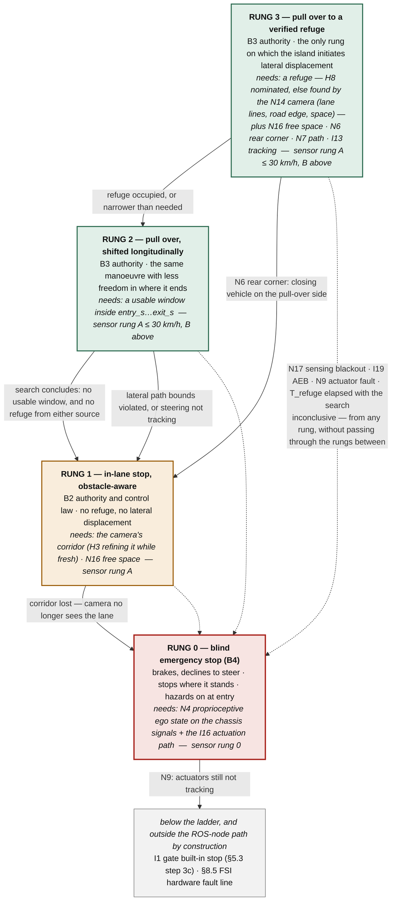

Three things are worth reading off the drawing rather than the table.

**The solid edges only ever go down, and each one is a *loss*.** Rung 3 → 2 gives up the chosen
stopping place but keeps the manoeuvre; 2 → 1 gives up leaving the running lane; 1 → 0 gives up
knowing what is ahead <mark>— which, since [D8](#1-inputs-already-fixed-by-the-wg), is losing the camera</mark>. Nothing in the ladder moves upward, and no rung requires anything the rung
above it did not already have. That is what makes attempting rung 3 acceptable: the cost of failing
at it is bounded by what is underneath, and what is underneath is always strictly simpler.

**The dashed edges are the ones that do not walk down the ladder.** A sensing blackout, an
[`I19`](#41-migration-list) AEB event or an [`N9`](#61-supervision-state-and-fallback) actuator fault reaches rung 0 *from wherever the vehicle is*, without
passing through the rungs in between — because each of them removes the precondition of every rung
above the floor at once. An implementation that walks the ladder one rung at a time under those
conditions is wrong, and §5.3 makes the same point about step 3b from the other direction.

**The floor is shared with a different ladder.** Rung 0 is [B4](#b4--emergency-stop-when-the-island-is-blind), and it is also rung 0 of the
*sensor* ladder in [§9.4](#94-minimal-deployable-configurations) — the configuration with no exteroceptive sensor at all <mark>— the configuration every island is effectively in once its camera is lost, whatever else it still carries</mark>. The two ladders measure
different things, the manoeuvre and the sensor set, and they meet at exactly one place. That
coincidence is not accidental: the floor of the manoeuvre ladder is defined as the manoeuvre that
survives the floor of the sensor ladder.

### 6.4 ODD degradation on weather and visibility

This is a **different trigger class** from everything above, and the difference drives the design.

| | HPC failure (§6.3) | ODD exit — weather / visibility |
| :-- | :-- | :-- |
| Standard | ISO 26262 — something malfunctioned | **ISO 21448 / SOTIF** — nothing malfunctioned |
| HPC state | Dead, hung, or lying | **Healthy and correct by its own lights** |
| Time constant | Milliseconds | Seconds to minutes |
| Correct first response | Seize authority | **Constrain, and let the HPC act** |
| Who should pull over | The island, because the HPC cannot | **The HPC, because it has the map** |

The last row is the important inversion. When visibility collapses, the *best* outcome is that the HPC
executes a planned, comfortable, legal pull-over while it still can. The island's job is to **demand
that, then verify compliance within a deadline**, and to fall back to its own cruder manoeuvre only if
the HPC does not act. Seizing authority first would replace a good pull-over with a worse one.

#### Why the island must detect this independently

An island that only reads the HPC's self-reported perception confidence cannot detect the case that
matters: **the HPC is confidently wrong.** That is the central SOTIF failure mode, and no amount of
health monitoring reaches it. The only thing that does is an independent sensing channel that degrades
*differently*. This is the strongest argument for the [D7](#1-inputs-already-fixed-by-the-wg) sensor set — stronger than the fallback
argument.

#### Detection: concrete signals, no learning required

| Signal | Sensor | <mark>[D8](#1-inputs-already-fixed-by-the-wg) rank</mark> | Indicates |
| :-- | :-- | :-- | :-- |
| Contrast / MTF collapse; sky-to-scene luminance ratio; flare area; drop and blur detection | camera | <mark>1</mark> | Fog, glare, low sun, dirty or wet lens |
| Lane-detection continuity and confidence | camera | <mark>1</mark> | Markings obscured by snow, water film, wear |
| <mark>**Radar-vs-camera detection divergence** — radar reports targets the camera cannot confirm at the same range</mark> | <mark>radar + camera</mark> | <mark>2</mark> | <mark>**Visibility collapse, measured by physical diversity rather than self-report**</mark> |
| Longitudinal slip ratio vs. commanded acceleration | wheel speed + IMU <mark>(chassis ESC below rank 4)</mark> | <mark>4</mark> | **Low friction — ice, standing water** |
| Yaw-rate vs. steering-angle model residual | IMU + steering | <mark>4</mark> | Reduced lateral grip |
| Max return range collapse; intensity drop; dense near-range returns | 2D lidar | <mark>5 — optional</mark> | Fog, heavy rain, spray, snow |
| Multi-echo / dual-return ratio rise | 2D lidar | <mark>5 — optional</mark> | Airborne particulates |
| Radar-vs-lidar detection divergence | radar + lidar | <mark>5 — optional</mark> | Visibility collapse — <mark>a second, independent instance of the test above, where a lidar is fitted</mark> |
| Wiper state, exterior temperature, rain sensor | vehicle CAN | — | Cheap corroboration |

<mark>The radar-versus-camera divergence test is the one to build first, because it uses the two
highest-ranked sensors and is therefore available on every island from rung B up.</mark> It is a *physical*
diversity argument: radar penetrates what <mark>optics do</mark> not, so a persistent disagreement between them at
the same range **is** reduced visibility. Nothing about it depends on a model of the weather. <mark>Where a
2D lidar is fitted, radar-versus-lidar is the same argument a second time; it may tighten the verdict,
and its absence never loosens it.</mark>

Friction matters as much as visibility and is usually forgotten. It bounds achievable deceleration,
which sets stopping distance, which sets both the speed limit below and the refuge window in §6.3.

#### The node

| # | Node | Purpose | Tier | Rate |
| :-- | :-- | :-- | :-- | :-- |
| **N19** | `si_odd_monitor` | Environmental ODD verdict: visibility range estimate, precipitation class, surface-friction estimate, ambient-light class, and the resulting speed ceiling and ODD margin. Applies asymmetric hysteresis. Promoted from the phase-2 option noted in §6.1. <mark>Also raises the **ODD switch demand** — `odd_satisfiable = false` with the failed dimension and the `T_odd` budget — and runs the two-part acceptance test on the answer: the domain [`H4`](#7-new-nodes-to-add-on-the-hpc) declares must lie inside the measured envelope, *and* the vehicle's measured behaviour must converge on that domain's bounds within `T_odd`. It declares `T_odd` per situation rather than as a constant, from the rate at which the margin is falling ([B1](#b1--degrade-the-ads-when-the-odd-cannot-be-held)). It also supplies the `v_max` term of [B2](#b2--keep-the-vehicle-in-its-lane-after-loss-of-the-hpc)'s `v_hold` ramp.</mark> | [T1s](#22-criticality-tiers-on-the-island) | 2–5 Hz |

[`N17`](#62-island-safety-sensing) and [`N19`](#64-odd-degradation-on-weather-and-visibility) answer different questions and must not be merged:

- **`N17 si_sensor_health` — "is my sensor working?"** A device question. Blockage, dirt, frame rate,
  internal fault. Its answer is a per-source validity flag, and its escalation path is the **fault
  manager**: a blinded sensor is a *fault*.
- **`N19 si_odd_monitor` — "is the world outside my operating envelope?"** An environment question.
  Its answer is an ODD verdict with a margin, and its escalation path is the **graded degradation
  ladder** below: reduced visibility is not a fault.

#### The speed law

The island's speed ceiling is closed-form, auditable, and derived from two measured quantities rather
than a lookup table:

```text
v_max = sqrt( 2 · a_brake · (d_visible − d_margin) )

  d_visible  measured sensing range, min over the active modalities    (N19)
             — always including the camera, the one modality every island has
  a_brake    achievable deceleration, bounded by the friction estimate (N19)
  d_margin   reaction and actuation margin at the current speed
```

*You may drive only as fast as you can stop within what you can see.* Worked example: `d_visible` 30 m
in fog, `a_brake` 3 m/s² on a wet surface, `d_margin` 5 m → `v_max` = 12.2 m/s ≈ 44 km/h. Both inputs
are measured on the island, so the limit is defensible without trusting the HPC.

#### The graded degradation ladder

| ODD margin | Island action | Mechanism | Deadline for HPC compliance |
| :-- | :-- | :-- | :-- |
| Nominal | none | — | — |
| **Marginal** | Notify. Publish the reduced verdict; the HPC re-plans conservatively | `OddVerdict` advisory + `SafetyEnvelopeCommand` mode `ALLOW` | — |
| <mark>**Unsatisfiable**</mark> | <mark>**Demand an ODD switch.** Declare the current domain unsatisfiable; require the HPC to move to one it can meet. The island names no target</mark> | <mark>`OddVerdict` with `odd_satisfiable = false`, the failed dimension, and the `T_odd` budget</mark> | <mark>`T_ack` = 2 s to declare a new domain or declare exhaustion; `T_odd` = 10 s to satisfy it</mark> |
| **Degraded** | Restrict. Hard speed cap from the law above; enlarge margins <mark>— held underneath the switch, not instead of it</mark> | `SafetyEnvelopeCommand` mode `CONSTRAIN`, `speed_limit = v_max` | 3 s to reach compliance |
| **Beyond ODD, HPC compliant** | Request MRM. Ask the HPC to pull over *while it still can* | mode `MRM` + refuge request | 10 s to begin, 60 s to complete |
| **Beyond ODD, HPC non-compliant** | Take authority — island pull-over per §6.3 | [`I7`](#41-migration-list) → [`N18`](#63-pull-over-mrm-after-hpc-loss) | — |

**Compliance supervision is the load-bearing mechanism.** The island issues a constraint, then watches
whether actual speed and behaviour converge on it within the declared deadline. *Non-compliance is
itself a fault*, raised to [`N8`](#61-supervision-state-and-fallback) — and it is a fault the island can detect without any HPC cooperation,
using only vehicle status it already receives.

#### The ODD switch demand, and what the island verifies

<mark>The **Unsatisfiable** rung is the one that changes the character of the ladder. Every other rung
constrains a *quantity*; this one demands a change of *domain*. The vehicle is being driven under a set
of assumptions — sensing range, friction, lighting, road class — which the island now measures to be
false, and the remedy is not to drive the same way more slowly but to drive under a different set of
assumptions that the measurements do support.</mark>

<mark>The island does not name that set. It holds no catalogue of the HPC's operating domains, no model of
which L4 behaviours each of them admits, and no means of choosing between them — all three are planning,
which [R4](#21-partitioning-rules) and [R5](#21-partitioning-rules) keep off the island. What it holds
is the *measurement*, and a measurement is enough to reject an answer without being able to produce
one:</mark>

| <mark>Step</mark> | <mark>Who</mark> | <mark>What crosses the link</mark> |
| :-- | :-- | :-- |
| <mark>1. Declare unsatisfiable</mark> | <mark>island, [`N19`](#64-odd-degradation-on-weather-and-visibility)</mark> | <mark>`OddVerdict.odd_satisfiable = false` + the measured envelope + the failed dimension + the `T_odd` budget</mark> |
| <mark>2. Select a domain</mark> | <mark>HPC</mark> | <mark>nothing — this is planning, and it happens entirely on the HPC</mark> |
| <mark>3. Declare the new active domain</mark> | <mark>HPC, [`H4`](#7-new-nodes-to-add-on-the-hpc)</mark> | <mark>`OddStatus.active_odd` + its bounds + `odd_switch_state`, within `T_ack`</mark> |
| <mark>4. Verify the declaration</mark> | <mark>island, [`N19`](#64-odd-degradation-on-weather-and-visibility)</mark> | <mark>nothing — the bounds are compared against the island's own envelope</mark> |
| <mark>5. Verify the behaviour</mark> | <mark>island, [`N2`](#61-supervision-state-and-fallback)/[`N19`](#64-odd-degradation-on-weather-and-visibility)</mark> | <mark>nothing — measured speed, acceleration and curvature are compared against the declared bounds, within `T_odd`</mark> |
| <mark>6. Accept, and release the cap</mark> | <mark>island, [`N3`](#61-supervision-state-and-fallback)</mark> | <mark>`SafetyEnvelopeCommand` mode returns to `ALLOW`; `OddVerdict` carries the accepted domain</mark> |

<mark>**Steps 4 and 5 are separate on purpose.** A declaration the island can check against its own
measurements catches an HPC that reports a domain it *could not* be in. Checking the vehicle's
behaviour afterwards catches an HPC that reports a domain it *is not* in — a different failure, and the
more dangerous one, because the declaration is plausible. A domain that passes step 4 and fails step 5
is recorded by [`N11`](#61-supervision-state-and-fallback) as a SOTIF event under the same rule as verdict disagreement below:
it is evidence about the HPC that no other mechanism produces.</mark>

<mark>**The cap does not come off for the declaration.** It comes off for the behaviour. Between steps 1 and
6 the vehicle is held at `v_max` by the `CONSTRAIN` rung regardless of what the HPC has declared, so a
false declaration buys the HPC no speed — only time, and only `T_odd` of it.</mark>

<mark>**Exhaustion is a valid answer.** If the HPC declares at step 3 that none of its domains is
satisfiable, the ladder moves straight to **Request MRM** — an HPC-executed pull-over, with the map and
the traffic law available to it, which is strictly better than the island-executed one under
[B3](#b3--pull-over-if-the-odd-continues-to-fail). `T_odd` is not run out on an HPC that answered honestly.</mark>

#### Hysteresis, and why it is asymmetric

Weather flickers; a vehicle that oscillates between speed limits is both uncomfortable and unsafe.
[`N19`](#64-odd-degradation-on-weather-and-visibility) degrades on ~2 s of consistent evidence and recovers only after ~30 s of clear evidence, with a
margin band between the thresholds. **Degrade fast, recover slowly.** Recovery must additionally
require that the HPC's own ODD verdict agrees.

#### Verdict arbitration

The HPC also publishes an ODD verdict ([`H4`](#7-new-nodes-to-add-on-the-hpc)). Two rules:

1. **The more restrictive verdict binds.** Either domain may restrict; neither may relax the other.
2. **Disagreement is itself a signal.** HPC says in-ODD, island says out-of-ODD → that is precisely the
   confidently-wrong case. It binds to the island's verdict, and it is recorded by [`N11`](#61-supervision-state-and-fallback) as a SOTIF
   event for field monitoring, because it is evidence about the HPC's perception that no other
   mechanism produces.

#### Where the two features meet

Fallback availability and environmental ODD are not independent. If [`N18`](#63-pull-over-mrm-after-hpc-loss) reports
`pull_over_available = false` — a tunnel, a barriered section, no shoulder — **and** [`N19`](#64-odd-degradation-on-weather-and-visibility) reports
falling visibility, then the vehicle is entering a stretch where the degraded fallback is *in-lane stop
on a road it cannot see*. Neither signal alone justifies much; together they justify a substantially
tighter speed ceiling, or declining to enter the section at all.

[`N19`](#64-odd-degradation-on-weather-and-visibility) therefore takes `pull_over_available` as an input and applies a reduction factor to `v_max` when
it is false. This is the concrete payoff of making fallback capability observable in §6.3.

---

### 6.5 Remote command and control link and local control port

<mark>*New by [D9](#1-inputs-already-fixed-by-the-wg). Their detailed design is proposed in [§6.6](#66-detailed-design-of-b5-and-b6); these three nodes stay outside the counts of §4 and
§9.4 until the WG accepts it.*</mark>

<mark>The island carries its own path to the remote command and control centre (RCC), and its own port
for a local joystick, so that a person can drive the vehicle when the HPC cannot — [B5](#b5--tele-operation-from-the-remote-command-centre) from the RCC on
streamed island sensing, [B6](#b6--manual-joystick-control-without-streamed-sensing) from beside the vehicle on none.</mark>

| # | Node | Purpose | Tier | Rate |
| :-- | :-- | :-- | :-- | :-- |
| <mark>**N21**</mark> | <mark>`si_rcc_link`</mark> | <mark>**The communication module's island end.** Owns the cellular modem and the RCC session: mutual authentication, heartbeat, measured round-trip latency and stream age, and the E2E check of every remote command before it reaches [`I1`](#41-migration-list)'s remote source. Declares the link lost on `T_link`, which is [B5](#b5--tele-operation-from-the-remote-command-centre)'s exit to the in-lane stop or [B4](#b4--emergency-stop-when-the-island-is-blind). Also carries the RCC's status uplink — island state, fault summary, a remote-assistance request after [B3](#b3--pull-over-if-the-odd-continues-to-fail) or [B4](#b4--emergency-stop-when-the-island-is-blind)</mark> | <mark>[T1](#22-criticality-tiers-on-the-island) for the command and liveness path · [T3](#22-criticality-tiers-on-the-island) for the status uplink</mark> | <mark>50 Hz commands · 10 Hz heartbeat</mark> |
| <mark>**N22**</mark> | <mark>`si_teleop_streamer`</mark> | <mark>[B5](#b5--tele-operation-from-the-remote-command-centre)'s **sensor stream**. Compresses the forward camera to a bounded bit rate and packs radar tracks, ultrasonic clearances where fitted and [`N4`](#61-supervision-state-and-fallback)'s ego state alongside, with the capture timestamps the RCC needs to show their age. Reads the sensors through the same ingest as [`N14`](#62-island-safety-sensing), [`N6`](#61-supervision-state-and-fallback) and [`N15`](#62-island-safety-sensing); never writes to them</mark> | <mark>[T3](#22-criticality-tiers-on-the-island), in its own partition, below P2</mark> | <mark>10–30 Hz video · 20 Hz tracks</mark> |
| <mark>**N23**</mark> | <mark>`si_local_control`</mark> | <mark>**The local control port** for [B6](#b6--manual-joystick-control-without-streamed-sensing): the wired joystick input and the short-range radio receiver. Pairing, dead-man, link heartbeat, and the creep limit `v_local`; publishes the **local** command source into [`I1`](#41-migration-list), which outranks the remote one, and requests the stop on release or on `T_local`</mark> | <mark>[T1](#22-criticality-tiers-on-the-island)</mark> | <mark>50 Hz</mark> |

<mark>**The streamer is the heaviest load on the island and the least critical**, which is the combination
the partitioning exists to handle. Video compression must not take time from P0–P2, so [`N22`](#65-remote-command-and-control-link-and-local-control-port) runs in
a partition of its own below safety sensing; when it overruns, the stream degrades and [B5](#b5--tele-operation-from-the-remote-command-centre)'s
latency monitor sees it — the island does not. Where the island SoC cannot carry the encoder at all,
the open alternative is a hardware encoder in the modem module, fed the camera directly
(open decision 19(d)).</mark>

<mark>**[`N21`](#65-remote-command-and-control-link-and-local-control-port) terminates the RCC link on the island, not on the HPC.** A tele-operation path that ran through
the HPC would fail with it, which is exactly when [B5](#b5--tele-operation-from-the-remote-command-centre) is wanted. The HPC may still use its own link for
fleet services; what crosses [`N21`](#65-remote-command-and-control-link-and-local-control-port) is only what [B5](#b5--tele-operation-from-the-remote-command-centre) and the RCC's view of the island need.</mark>

### 6.6 Detailed design of B5 and B6

<mark>This section turns the two declarations of [D9](#1-inputs-already-fixed-by-the-wg) into a design the WG can review. It covers how each
behaviour starts, what the person may command, how fast the vehicle may go, how the island notices a
failing link or an absent operator, and how it stops. It is written for **stage 1**: both behaviours
start only from a standstill. Taking over a moving vehicle, and a path-based remote-assistance mode,
are left for stage 2 (open decisions 19 and 20). Everything here reuses the island's existing command
path: the gate [`I1`](#41-migration-list), validation by [`I8`](#41-migration-list) and [`N10`](#61-supervision-state-and-fallback), and the stop operators [`I6`](#41-migration-list) and [`I5`](#41-migration-list). The only
additions are the three nodes of §6.5 and the interface in [§8.6](#86-the-rcc-link-and-the-local-control-port).</mark>

#### Principles both behaviours follow

1. <mark>**The person decides, the island bounds.** Every remote or local command passes through [`I8`](#41-migration-list) and
   [`N10`](#61-supervision-state-and-fallback) and the gate's rate limits, like any other command source. AEB [`I19`](#41-migration-list), the near-field guard
   [`I20`](#41-migration-list) and actuator supervision [`N9`](#61-supervision-state-and-fallback) stay armed, and no command can override them.</mark>
2. <mark>**A silent link means stop, never "keep going".** Each command is valid for a short, fixed time.
   When commands stop arriving, the island first brings the speed setpoint to zero, then takes
   authority back and stops.</mark>
3. <mark>**Stopping uses the paths that already exist.** [B5](#b5--tele-operation-from-the-remote-command-centre) falls back to the in-lane stop if the camera
   still sees the lane, and to [B4](#b4--emergency-stop-when-the-island-is-blind) if it does not. That is the same test every other downward edge in
   §3.2 applies. [B6](#b6--manual-joystick-control-without-streamed-sensing) stops at once through [`I6`](#41-migration-list) and [`I5`](#41-migration-list).</mark>
4. <mark>**Local presence beats remote presence.** An operator standing at the vehicle outranks a driver at
   the RCC. The gate's source ranking already encodes this (§10.4).</mark>

#### B5 — remote driving from the RCC

<mark>**What the remote driver sends.** A steering-angle setpoint and a signed speed setpoint at 50 Hz, plus
a gear request, the indicators, the hazard lamps and the horn. Every command carries a dead-man flag
and a **frame stamp**: the island's capture time of the newest video frame the driver had on screen when
the command was issued. [`N21`](#65-remote-command-and-control-link-and-local-control-port) checks each command (see below), turns it into an Autoware `Control`
message and publishes it as the gate's **remote** source. The command is a *setpoint*, not a pedal
position: [`I1`](#41-migration-list) applies its own rate limits, and [`I8`](#41-migration-list) and [`N10`](#61-supervision-state-and-fallback) validate it, exactly as they do for
the HPC's commands.</mark>

<mark>**The frame-stamp echo.** The island and the RCC do not share a clock. They do not need to: the frame
stamp is a time the island itself wrote, so [`N21`](#65-remote-command-and-control-link-and-local-control-port) can compute</mark>

> <mark>*command age* = island time now − frame stamp echoed in the command</mark>

<mark>on its own clock alone. That one number covers the whole loop the safety argument depends on:
capture, encoding, the uplink, display, the driver's reaction, and the downlink. [`N21`](#65-remote-command-and-control-link-and-local-control-port) checks it on
every command, so the island knows how old the picture was that each command was decided on.</mark>

<mark>**Session state.** A **[B5](#b5--tele-operation-from-the-remote-command-centre)** session has six states. [`N3`](#61-supervision-state-and-fallback) owns the transitions; [`N21`](#65-remote-command-and-control-link-and-local-control-port) supplies the
evidence for each of them.</mark>

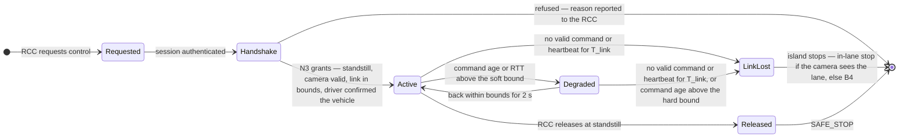

- <mark>**Requested → Handshake.** The RCC opens an authenticated session on [`N21`](#65-remote-command-and-control-link-and-local-control-port). The request names the
  vehicle and the operator.</mark>
- <mark>**Handshake → Active.** [`N3`](#61-supervision-state-and-fallback) grants control only when all the grant conditions below hold. On the
  grant, [`I2`](#41-migration-list) and [`I3`](#41-migration-list) switch the command mode to `REMOTE`. The brake stays applied until the first
  valid command arrives with the dead-man held.</mark>
- <mark>**Degraded.** The link still works but is slow. The island cuts the speed limit `v_teleop` (below)
  and tells the RCC why. It does not stop: a slow link is a reason to drive slower, not a reason to
  strand the vehicle.</mark>
- <mark>**LinkLost.** No valid command or heartbeat for `T_link`, or a command whose age exceeds the hard
  bound. The island takes authority back and stops: the in-lane stop through [`N7`](#61-supervision-state-and-fallback) and [`I13`](#41-migration-list) if the
  camera still sees the lane, [B4](#b4--emergency-stop-when-the-island-is-blind) if it does not.</mark>
- <mark>**Released.** The RCC releases control at standstill. [`I5`](#41-migration-list) secures the vehicle, gear P, and the
  island is in `SAFE_STOP`.</mark>

<mark>**The grant conditions.** [`N3`](#61-supervision-state-and-fallback) grants **[B5](#b5--tele-operation-from-the-remote-command-centre)** only when all of these hold:</mark>

- <mark>the vehicle is at standstill (stage 1);</mark>
- <mark>[`N17`](#62-island-safety-sensing) holds the camera valid;</mark>
- <mark>the round-trip time over the last 2 s is within the bound, and the stream is up and fresh;</mark>
- <mark>no **[B6](#b6--manual-joystick-control-without-streamed-sensing)** session is active;</mark>
- <mark>the remote driver has confirmed the vehicle's identity, shown on the stream as an overlay that the
  island generates.</mark>

<mark>**Checks on every remote command.** [`N21`](#65-remote-command-and-control-link-and-local-control-port) drops any command that fails one of the following, and
counts the drops. A run of drops longer than `T_link` is a link loss.</mark>

| <mark>Check</mark> | <mark>Bound (proposal)</mark> | <mark>On failure</mark> |
| :-- | :-- | :-- |
| <mark>Session ID, sequence number, MAC and CRC (profile SI-E2E/R, §8.6)</mark> | <mark>exact; replay window 64</mark> | <mark>drop, and raise a security event to [`N8`](#61-supervision-state-and-fallback)</mark> |
| <mark>Dead-man held</mark> | <mark>every command</mark> | <mark>speed setpoint to zero; brake held</mark> |
| <mark>Command validity</mark> | <mark>100 ms per command</mark> | <mark>setpoint decays to zero speed; then `T_link`</mark> |
| <mark>Command age (frame-stamp echo)</mark> | <mark>soft 600 ms · hard 1.0 s</mark> | <mark>soft: Degraded, `v_teleop` cut · hard: LinkLost</mark> |
| <mark>Heartbeat</mark> | <mark>10 Hz; `T_link` = 300 ms</mark> | <mark>LinkLost</mark> |
| <mark>Steering and speed range</mark> | <mark>within `v_teleop` and the vehicle's limits</mark> | <mark>clamp, and report it to the RCC</mark> |

<mark>**How fast — `v_teleop`.** The vehicle must be able to stop inside the free road ahead, counting
everything that happens before the remote driver's braking reaches the wheels:</mark>

> <mark>`v_teleop` = min( `v_cap`, `v_vis` ), where `v_vis` solves
> `v · t_loop + v² / (2 · a_tele) = d_free − 2 m`</mark>

- <mark>`t_loop` is the measured command age plus the island and actuator time. As a design value it is
  1.8 s: 0.23 s from capture to display, 1.2 s driver reaction, 0.12 s downlink, 0.04 s through the
  island (§9.2) and 0.2 s actuator response.</mark>
- <mark>`a_tele` = 3 m/s² is a firm stop, not an emergency one.</mark>
- <mark>`d_free` is the free distance ahead that the island itself has verified: [`N16`](#62-island-safety-sensing)'s free-space range,
  capped at the range at which the camera stream can still show an obstacle. The driver is never
  allowed to drive faster than the island can confirm is clear.</mark>
- <mark>`v_cap` is **20 km/h** for stage 1.</mark>

| <mark>`d_free`</mark> | <mark>10 m</mark> | <mark>15 m</mark> | <mark>20 m</mark> | <mark>30 m</mark> | <mark>40 m</mark> |
| :-- | :-- | :-- | :-- | :-- | :-- |
| <mark>`v_vis` at `t_loop` = 1.8 s</mark> | <mark>12 km/h</mark> | <mark>18 km/h</mark> | <mark>23 km/h</mark> | <mark>31 km/h</mark> | <mark>38 km/h</mark> |

<mark>[`N21`](#65-remote-command-and-control-link-and-local-control-port) recomputes `v_teleop` at 10 Hz from the *measured* command age, so a slow link lowers the speed
automatically. The limit falls at no more than 2 m/s² and rises only after 2 s of stable link. The two
branches of §9.5 differ here only through `d_free`. On Least-Cost, the camera and the 2D lidar confirm
about 15–20 m, which gives roughly 18–23 km/h, and the vehicle drives **forward only**. On
Maximum-Safety, `v_cap` binds, and the rear radars allow reversing at creep speed.</mark>

<mark>**What the remote driver sees.** [`N22`](#65-remote-command-and-control-link-and-local-control-port) streams the forward camera, compressed to a bounded bit rate:
about 2 Mbit/s on Least-Cost, where the camera encodes it, and up to 6 Mbit/s on Maximum-Safety. Each
frame carries its capture stamp. [`N22`](#65-remote-command-and-control-link-and-local-control-port) also sends radar tracks and ultrasonic clearances where fitted,
[`N4`](#61-supervision-state-and-fallback)'s ego state, the granted `v_teleop`, and which island guards are armed. The vehicle-identity
overlay and the `v_teleop` readout are generated by the island, not by the RCC, so the driver sees what
the island will enforce.</mark>

<mark>**Reaction budget.** Link loss is detected after `T_link` = 300 ms. The decision and the stop command
take 40 ms more (§9.2). From 20 km/h, stopping at `a_tele` then takes about 7 m in total, inside the
free range `v_teleop` was computed for. An obstacle the island sees itself is handled faster still,
by [`I19`](#41-migration-list), whatever the link is doing.</mark>

<mark>**Leaving B5.** The normal exit is release at standstill into `SAFE_STOP`. **[B5](#b5--tele-operation-from-the-remote-command-centre)** may also hand the
drive back to the ADS, but only from `SAFE_STOP` and only with all of these:
- the RCC requests it;
- [`N2`](#61-supervision-state-and-fallback) has re-qualified the HPC over the same confirmation window as **[B2](#b2--keep-the-vehicle-in-its-lane-after-loss-of-the-hpc)**'s hand-back (open decision
  14);
- [`N19`](#64-odd-degradation-on-weather-and-visibility) reports the ODD satisfiable, and [`H4`](#7-new-nodes-to-add-on-the-hpc) has declared an `active_odd`.</mark>

<mark>The island then engages `AUTONOMOUS` through the normal Autoware path. Without this edge, every remote
recovery would end the drive cycle, including one that followed a transient fault (open decision
19(c)).</mark>

#### B6 — joystick control at the vehicle

<mark>**The device.** A handheld joystick controller of the kind used for cableless control of machinery. It
has proportional steering and speed controls, a forward / neutral / reverse selector, horn and hazards,
and two safety controls:
- a **three-position enabling switch**, the dead-man: commands count only while it is held in the
  middle position;
- a latching **emergency-stop** button.</mark>

<mark>The controller connects to [`N23`](#65-remote-command-and-control-link-and-local-control-port) either **by cable**, on a CAN FD connector on the vehicle, or
**through a radio receiver** plugged into the same connector. So [`N23`](#65-remote-command-and-control-link-and-local-control-port) sees one interface whichever is
used. The radio controller and receiver should follow IEC 62745 (cableless control of machinery),
which requires a stop on loss of communication and a defined pairing procedure. Its stop functions
should meet PL d or the equivalent.</mark>

<mark>**Pairing and entry.**
- Pairing needs physical presence: a button or key switch on the vehicle, pressed while the vehicle
  is at standstill.
- Only one device is paired at a time, and pairing ends when control is released.
- **[B6](#b6--manual-joystick-control-without-streamed-sensing)** starts when the paired device's enabling switch is held and [`N3`](#61-supervision-state-and-fallback) grants `LOCAL`.
- If a **[B5](#b5--tele-operation-from-the-remote-command-centre)** session is active, the local request **pre-empts** it. If the vehicle is moving under
  **[B5](#b5--tele-operation-from-the-remote-command-centre)**, the island first stops it, then grants `LOCAL` at standstill.</mark>

<mark>**What the operator commands.** A steering setpoint and a speed setpoint, at 50 Hz on the SI-E2E/B
profile, which fits CAN FD:
- speed limited to `v_local` = **5 km/h** forward and **3 km/h** in reverse;
- acceleration limited to 0.5 m/s², and the steering rate limited.</mark>

<mark>**[B6](#b6--manual-joystick-control-without-streamed-sensing)** reverses on the operator's eyes alone, on both branches. Any island sensors still valid keep
[`I19`](#41-migration-list) and [`I20`](#41-migration-list) armed, but **[B6](#b6--manual-joystick-control-without-streamed-sensing)** requires none of them: it runs at rung 0.</mark>

<mark>**When the island stops.** The island stops at once, at the emergency rate through [`I6`](#41-migration-list), then [`I5`](#41-migration-list)
secures:
- the enabling switch is released, or squeezed through to its third position;
- the emergency-stop button is pressed;
- the local link is silent for `T_local` = **200 ms**.</mark>

<mark>From 5 km/h that stop is about 0.85 m including all latencies; from 3 km/h in reverse, about 0.45 m.
The emergency-stop button should also be **wired directly to the actuator gateway's stop input**, in
the same way as the §8.5 FSI fault line, so that the stop does not depend on island software. That is a
Part-2 hardware item.</mark>

<mark>**Leaving B6.** The operator releases control at standstill, and the island goes to `SAFE_STOP`.
**[B6](#b6--manual-joystick-control-without-streamed-sensing)** never hands the drive back to the ADS. A vehicle recovered by hand is checked by a person before
it is automated again.</mark>

#### Where the new nodes run

| <mark>Node</mark> | <mark>Partition (§9.1)</mark> | <mark>Why</mark> |
| :-- | :-- | :-- |
| <mark>[`N21`](#65-remote-command-and-control-link-and-local-control-port) command and liveness path</mark> | <mark>**P1**, 50 Hz</mark> | <mark>It feeds a command source and supervises a link whose loss triggers a stop</mark> |
| <mark>[`N21`](#65-remote-command-and-control-link-and-local-control-port) status uplink</mark> | <mark>**P4**</mark> | <mark>Telemetry; it may be shed first</mark> |
| <mark>[`N22`](#65-remote-command-and-control-link-and-local-control-port) streamer</mark> | <mark>**P3s**, a new band just below P3</mark> | <mark>The heaviest load and the least critical. It must never take time from P0–P2, and during **[B5](#b5--tele-operation-from-the-remote-command-centre)** the P3 nominal controller is idle anyway. On the X5H it runs on the application cluster (§9.5)</mark> |
| <mark>[`N23`](#65-remote-command-and-control-link-and-local-control-port) local control</mark> | <mark>**P1**, 50 Hz</mark> | <mark>Same reasoning as [`N21`](#65-remote-command-and-control-link-and-local-control-port)'s command path</mark> |

#### Failure modes and what the island does

| <mark>Failure</mark> | <mark>Detected by</mark> | <mark>Island response</mark> |
| :-- | :-- | :-- |
| <mark>Cellular link drops</mark> | <mark>[`N21`](#65-remote-command-and-control-link-and-local-control-port): `T_link`</mark> | <mark>LinkLost: in-lane stop, or **[B4](#b4--emergency-stop-when-the-island-is-blind)** without the camera</mark> |
| <mark>Link slows down, or video freezes at the RCC</mark> | <mark>[`N21`](#65-remote-command-and-control-link-and-local-control-port): command age (frame-stamp echo)</mark> | <mark>Degraded: `v_teleop` cut; LinkLost above the hard bound</mark> |
| <mark>Replayed, forged or corrupted command</mark> | <mark>[`N21`](#65-remote-command-and-control-link-and-local-control-port): SI-E2E/R checks</mark> | <mark>Command dropped, security event to [`N8`](#61-supervision-state-and-fallback); repeated drops are a link loss</mark> |
| <mark>Remote driver lets go or is incapacitated</mark> | <mark>dead-man flag</mark> | <mark>Speed setpoint to zero, brake held</mark> |
| <mark>Driver steers toward an obstacle</mark> | <mark>[`I19`](#41-migration-list), [`I20`](#41-migration-list), [`N10`](#61-supervision-state-and-fallback)</mark> | <mark>Braked or vetoed whatever the command says</mark> |
| <mark>Camera lost during **[B5](#b5--tele-operation-from-the-remote-command-centre)**</mark> | <mark>[`N17`](#62-island-safety-sensing)</mark> | <mark>**[B4](#b4--emergency-stop-when-the-island-is-blind)**: the driver is no longer shown a validated picture</mark> |
| <mark>Two RCC sessions request the same vehicle</mark> | <mark>[`N21`](#65-remote-command-and-control-link-and-local-control-port): one session at a time</mark> | <mark>The second request is refused</mark> |
| <mark>Local operator arrives during **[B5](#b5--tele-operation-from-the-remote-command-centre)**</mark> | <mark>[`N23`](#65-remote-command-and-control-link-and-local-control-port)</mark> | <mark>**[B6](#b6--manual-joystick-control-without-streamed-sensing)** pre-empts: stop first, then `LOCAL`</mark> |
| <mark>Joystick radio drops</mark> | <mark>[`N23`](#65-remote-command-and-control-link-and-local-control-port): `T_local`</mark> | <mark>Immediate stop, [`I6`](#41-migration-list) then [`I5`](#41-migration-list)</mark> |
| <mark>Joystick enabling switch released, or emergency stop pressed</mark> | <mark>[`N23`](#65-remote-command-and-control-link-and-local-control-port), plus the hardwired stop</mark> | <mark>Immediate stop</mark> |
| <mark>Actuators not tracking, in either behaviour</mark> | <mark>[`N9`](#61-supervision-state-and-fallback)</mark> | <mark>**[B4](#b4--emergency-stop-when-the-island-is-blind)**</mark> |

<mark>These rows join the Part-4 fault-injection matrix of §12.
</mark>

---

## 7. New nodes to add on the HPC

The HPC side needs nodes whose only job is to make the interface narrow, typed and rate-limited ([R5](#21-partitioning-rules)).
Without them, "connect Autoware to the island" means publishing the full ROS graph over TSN.

| # | Node | Purpose | Rate |
| :-- | :-- | :-- | :-- |
| **H1** | `si_bridge_hpc` | In-house E2E egress/ingress counterpart of [N1](#61-supervision-state-and-fallback) (§8.4). Wraps each safety payload with Data ID, sequence counter, CRC, length and gPTP timestamp; enforces the publication rate; is the *only* HPC node permitted to write to the island link. | per-interface |
| **H2** | `hpc_capability_reporter` | Condenses `diagnostic_graph_aggregator` / `hazard_status_converter` / `pipeline_latency_monitor` output into a **fixed-size capability vector** (perception OK, localization OK, planning OK, per-pipeline latency margin, confidence floor) plus a self-test summary. Replaces free-form diagnostics on the link. | 10 Hz |
| **H3** | `hpc_corridor_publisher` | Emits a compact drivable-corridor strip (left/right boundary polylines, fixed point count) around the current trajectory, derived from the Lanelet2 map. This is the map, reduced to what the island can hold — enabling [N5](#61-supervision-state-and-fallback) and [N7](#61-supervision-state-and-fallback) without shipping the map. | 10 Hz |
| **H4** | `hpc_odd_reporter` | ODD and geofence validity, weather/visibility class, unmapped-area and roadworks flags — as a small enumerated status, not raw sensor data. <mark>Also carries the HPC's **declared active operating domain** and its bounds — speed ceiling, required sensing range, assumed friction — plus an `odd_switch_state` enum (`STEADY` / `SWITCHING` / `EXHAUSTED`). This is the HPC's half of the [B1](#b1--degrade-the-ads-when-the-odd-cannot-be-held) exchange: the island demands a switch, and this is the node that answers within `T_ack`. The bounds are what the island verifies against its own envelope, so they must be the domain's *declared* limits, not the vehicle's current state.</mark> | 10 Hz |
| **H5** | `hpc_trajectory_conditioner` | Resamples and bounds the planned trajectory to the island's fixed-capacity message (**250 points**, as already enforced in the nano-ros port), guarantees monotonic timestamps, fills per-point velocity/acceleration, and rejects malformed trajectories *before* they are transmitted. | 10 Hz |
| **H6** | `hpc_island_state_client` | Subscribes to island state and MRM state; republishes into `/system/fail_safe/mrm_state` and the AD API so that operator UI, logging and `command_mode_decider` see the island's verdict. Closes the loop for graded reaction steps 1–2. | 10 Hz |
| **H7** | `hpc_heartbeat` | Deterministic, minimal heartbeat with a rolling self-test result. Kept separate from [H2](#7-new-nodes-to-add-on-the-hpc) so that it can be given the highest RT priority and the shortest code path. | 50–100 Hz |
| **H8** | `hpc_refuge_publisher` | Streams the rolling, map-validated and law-checked **pull-over refuge** defined in §6.3, plus the explicit "no refuge available" declaration when it cannot honour the coverage guarantee. This is the node that makes <mark>a *lawful*</mark> island pull-over possible at all <mark>— the island's own detection ([`N18`](#63-pull-over-mrm-after-hpc-loss)) can find clear space without it, but only as an `EMERGENCY_ONLY` stop</mark>. | 2 Hz |
| **H9** | `hpc_shadow_control_monitor` *(optional)* | Runs the same controller configuration on the HPC and compares against the island's echoed command; flags divergence. **Field-monitoring and validation only — no safety authority.** | 50 Hz |

---

## 8. The interface contract

Deliberately narrow: 11 signals in — ten required and one optional — and 9 out. Every row is
end-to-end protected (§8.4) and rate-declared.

### 8.1 HPC → Island (TSN/Ethernet, DDS or SOME/IP binding under nano-ros)

| Signal | Topic | Type | Rate | Age limit | Protection |
| :-- | :-- | :-- | :-- | :-- | :-- |
| Trajectory (≤250 pts) | `/planning/scenario_planning/trajectory` | `autoware_planning_msgs/Trajectory` | 10 Hz | 300 ms | SI-E2E/A |
| Drivable corridor *(preferred source)* | `/si/in/corridor` | *new* `SafetyCorridor` | 10 Hz | 300 ms | SI-E2E/A |
| Kinematic state (reference) | `/localization/kinematic_state` | `nav_msgs/Odometry` | 50 Hz | 60 ms | SI-E2E/A |
| Acceleration (reference) | `/localization/acceleration` | `geometry_msgs/AccelWithCovarianceStamped` | 50 Hz | 60 ms | SI-E2E/A |
| Operation mode state | `/api/operation_mode/state` | `autoware_adapi_v1_msgs/OperationModeState` | 10 Hz + on change | 300 ms | SI-E2E/A |
| Capability vector | `/si/in/capability` | *new* `HpcCapability` | 10 Hz | 300 ms | SI-E2E/B |
| ODD status <mark>+ declared active domain</mark> | `/si/in/odd_status` | *new* `OddStatus` <mark>(geofence validity, weather class, roadworks flags, **`active_odd` with its speed / sensing-range / friction bounds**, `odd_switch_state`)</mark> | 10 Hz | 300 ms | SI-E2E/B |
| Heartbeat + self-test | `/si/in/heartbeat` | *new* `HpcHeartbeat` | 100 Hz | **20 ms** | SI-E2E/B |
| **Pull-over refuge** | `/si/in/refuge` | *new* `PullOverRefuge` | 2 Hz | 2 s | SI-E2E/A |
| Auxiliary commands | `/control/command/{gear,turn_indicators,hazard_lights}_cmd` | `autoware_vehicle_msgs/*` | 10 Hz | 300 ms | SI-E2E/A |
| **Object list** *(optional — [§3.5](#35-optional-enrichment-the-hpc-object-list))* | `/perception/object_recognition/objects` | `autoware_perception_msgs/PredictedObjects`, truncated to a bounded digest at [`N20`](#62-island-safety-sensing) | 10 Hz | 300 ms | SI-E2E/B |

Under [D7](#1-inputs-already-fixed-by-the-wg), **every input on this table is now degradable.** Each has an island-local substitute:

| HPC input | Island substitute when it is stale or absent |
| :-- | :-- |
| Kinematic state, acceleration | [`N4`](#61-supervision-state-and-fallback) dead reckoning — the island cross-checks the HPC estimate against it and, on divergence or loss, uses [N4](#61-supervision-state-and-fallback) alone |
| Drivable corridor | [`N14`](#62-island-safety-sensing) <mark>camera</mark> lane boundaries <mark>— and nothing below them: with no camera corridor the island enters [B4](#b4--emergency-stop-when-the-island-is-blind)</mark> |
| Pull-over refuge | The last refuge whose `validity_distance_m` still covers the stopping distance; <mark>then [`N18`](#63-pull-over-mrm-after-hpc-loss)'s **island-detected** `EMERGENCY_ONLY` clearance, searched for at most `T_refuge`</mark>; then in-lane stop |
| Trajectory | The buffered last-valid trajectory, then [`N7`](#61-supervision-state-and-fallback)'s generated MRM profile |
| Capability vector, ODD status | [`N2`](#61-supervision-state-and-fallback) liveness verdict and [`N17`](#62-island-safety-sensing) island sensor health. <mark>After HPC loss, the road class of the last valid `active_odd` is latched for [B2](#b2--keep-the-vehicle-in-its-lane-after-loss-of-the-hpc)'s `v_odd`; with none valid, the most restrictive class.</mark> <mark>A silent `active_odd` is not a satisfied one: silence past `T_ack` is exactly the [B1](#b1--degrade-the-ads-when-the-odd-cannot-be-held) timeout, and escalates by §3.2's takeover rule rather than being substituted for</mark> |
| Object list *(optional)* | [`N16`](#62-island-safety-sensing)'s own perceived obstacles; then nothing at all. It is the one row whose substitute is *absence* — [§3.5](#35-optional-enrichment-the-hpc-object-list) is written so that losing it costs information, not capability |

That is the mechanism that lets [I9](#41-migration-list)–[I13](#41-migration-list), [I19](#41-migration-list) and [I20](#41-migration-list) keep running after HPC loss. **No row on this table
is a hard dependency of the safety core** — and the last row is not a dependency of anything at all.

### 8.2 Island → HPC

| Signal | Topic | Type | Rate |
| :-- | :-- | :-- | :-- |
| Island safety state | `/si/out/state` | *new* `IslandState` (mode — including `LANE_KEEP_HOLD` for [B2](#b2--keep-the-vehicle-in-its-lane-after-loss-of-the-hpc) <mark>and `EMERGENCY_STOP` for [B4](#b4--emergency-stop-when-the-island-is-blind)</mark> — fault code, authority holder, corridor source in use <mark>*or the blackout flag when there is none*</mark>, lateral deviation, remaining hold budget `T_hold` <mark>, the latched ODD class and its `v_odd`, the current `v_hold` and the `v_entry` the ramp is aimed at</mark>) | 50 Hz |
| Safety world state | `/si/out/safety_world` | *new* `SafetyWorldState` (nearest in-path obstacle range and range-rate, TTC, free-space distance, perceived corridor, per-sensor validity) | 20 Hz |
| Island sensor health | `/si/out/sensor_health` | *new* `IslandSensorHealth` (per-sensor availability, blockage, degradation cause <mark>, and which [D8](#1-inputs-already-fixed-by-the-wg) ranks are fitted — the island's sensor rung</mark>) | 5 Hz |
| **Island ODD verdict** <mark>+ switch demand</mark> | `/si/out/odd_verdict` | *new* `OddVerdict` (visibility range, precipitation class, friction estimate, ambient light, derived `v_max`, ODD margin <mark>, **`odd_satisfiable`**, the failed ODD dimension, the remaining `T_odd` budget, and the accepted domain once there is one</mark>) | 2–5 Hz |
| **Fallback availability** | `/si/out/fallback_availability` | *new* `FallbackAvailability` (`pull_over_available`, reason, distance to next refuge <mark>, and `refuge_source` — `HPC_NOMINATED` or `ISLAND_DETECTED` — so that the HPC and the operator can tell a lawful refuge from a clearance</mark>) | 2 Hz |
| MRM state | `/system/fail_safe/mrm_state` | `autoware_adapi_v1_msgs/MrmState` | 10 Hz + on change |
| Constraint / veto vector | `/si/out/constraints` | *new* `SafetyEnvelopeCommand` (accel limit, curvature limit, speed limit, mode: ALLOW / CONSTRAIN / MRM) | 50 Hz |
| Executed control command (echo) | `/control/command/control_cmd` | `autoware_control_msgs/Control` | 50 Hz |
| Vehicle status | `/vehicle/status/{velocity,steering,gear,control_mode}_status` | `autoware_vehicle_msgs/*` | 50–100 Hz |

`SafetyEnvelopeCommand` is the mechanism for graded-reaction steps 1 and 2: the island constrains the
HPC rather than seizing control, and only escalates when the HPC fails to comply within a declared
number of cycles.

`SafetyWorldState` is **advisory in this direction**. The HPC may use it to cross-validate its own
perception — a radar track the island sees and the HPC does not is a strong SOTIF signal — and [`H9`](#7-new-nodes-to-add-on-the-hpc) is
the natural consumer. It must never become an input the HPC's nominal pipeline depends on, or the
independence argument runs backwards.

### 8.3 Island → actuator gateway

CAN FD (or deterministic Ethernet) at **100 Hz**, protection profile **SI-E2E/B**, carrying steering, acceleration
/ braking, gear, hazard lamps and the MRM flag, with actuator feedback returned on the same bus for
[N9](#61-supervision-state-and-fallback). This path shares nothing with the HPC link ([R6](#21-partitioning-rules), and RFC design principle 3).

### 8.4 In-house safety-message protection

[D6](#1-inputs-already-fixed-by-the-wg) originally named AUTOSAR E2E. The WG has since scoped this design as **Autoware in-house**, so
AUTOSAR is out. The *obligation* does not go with it: it comes from the communication threat analysis
in EN 50159 and ISO 26262-6, and it is unchanged by the choice of implementation.

**What every safety-relevant message must still let the receiver detect:**

| Threat | Detected by |
| :-- | :-- |
| Corruption | CRC over header and payload |
| Unintended repetition | Sequence counter |
| Incorrect sequence, reordering | Sequence counter |
| Loss | Sequence counter gap |
| Unacceptable delay, staleness | gPTP timestamp against a per-signal age limit |
| Insertion, masquerade | Data ID bound to the interface |
| Addressing error, wrong interface | Data ID |
| Truncation, malformed payload | Length field |

**Two profiles are enough for the HPC link and the vehicle bus** <mark>— the RCC link, an open network, adds a third, SI-E2E/R ([§8.6](#86-the-rcc-link-and-the-local-control-port))</mark>:

| | **SI-E2E/A** — Ethernet, variable length | **SI-E2E/B** — compact status and CAN FD |
| :-- | :-- | :-- |
| Used for | Trajectory, corridor, refuge, odometry, acceleration, mode, auxiliary commands | Heartbeat, capability vector, ODD status, actuator commands and feedback |
| Data ID | 16-bit | 8-bit |
| Sequence counter | 8-bit | 4-bit |
| Length | 16-bit | implicit (fixed) |
| Timestamp | 64-bit gPTP | 32-bit ms |
| CRC | CRC-32 over header + payload | CRC-8 |
| Overhead | 17 bytes | 6 bytes |

[`N1`](#61-supervision-state-and-fallback) verifies on ingress, [`H1`](#7-new-nodes-to-add-on-the-hpc) applies on egress, and **a verification failure is a safety event
raised to [`N8`](#61-supervision-state-and-fallback), never a middleware exception**. That rule is what actually matters, and it is
independent of which profile carries it.

nano-ros already lists an E2E safety protocol with CRC and an EN 50159 mapping in its evaluation
checklist. **The first task in Part 3 is to determine whether that covers SI-E2E/A and /B outright**,
in which case the island inherits it rather than implementing it — the preferable outcome, since it
comes with the middleware's own verification evidence.

### 8.5 On-SoC FSI → Island

SPI plus a discrete `SOC_ERROR` GPIO carrying hardware faults, watchdog expiry and failover triggers,
bypassing Linux and the TSN switch entirely. Consumed by [N8](#61-supervision-state-and-fallback) as a highest-priority fault source. When
the HPC is an Orin/Thor-class part, this is the sub-millisecond detection path; the TSN heartbeat
(20 ms age limit) is the vehicle-level-independent one.

### 8.6 The RCC link and the local control port

<mark>Two interfaces cross the island boundary that are not the HPC link: the cellular session to the RCC,
which ends at [`N21`](#65-remote-command-and-control-link-and-local-control-port), and the local control port, which ends at [`N23`](#65-remote-command-and-control-link-and-local-control-port). Both carry commands into the gate,
so both carry the same end-to-end protection as §8.4. The RCC link needs more than that.</mark>

<mark>**RCC → island (into [`N21`](#65-remote-command-and-control-link-and-local-control-port)).**</mark>

| <mark>Signal</mark> | <mark>Topic</mark> | <mark>Type</mark> | <mark>Rate</mark> | <mark>Age limit</mark> | <mark>Protection</mark> |
| :-- | :-- | :-- | :-- | :-- | :-- |
| <mark>Session control</mark> | <mark>`/si/rcc/session`</mark> | <mark>*new* `RccSessionControl` (request / confirm vehicle / release, operator ID, vehicle ID echo)</mark> | <mark>on event + 1 Hz</mark> | <mark>1 s</mark> | <mark>SI-E2E/R</mark> |
| <mark>Remote drive command</mark> | <mark>`/si/rcc/drive_cmd`</mark> | <mark>*new* `RemoteDriveCommand` (steering angle, signed speed setpoint, gear, dead-man, indicators / hazards / horn, **frame stamp**)</mark> | <mark>50 Hz</mark> | <mark>100 ms per command; command age ≤ 1.0 s</mark> | <mark>SI-E2E/R</mark> |
| <mark>RCC heartbeat</mark> | <mark>`/si/rcc/heartbeat`</mark> | <mark>*new* `RccHeartbeat` (echo of the island's last ping, for the round-trip time)</mark> | <mark>10 Hz</mark> | <mark>`T_link` = 300 ms</mark> | <mark>SI-E2E/R</mark> |

<mark>**Island → RCC (out of [`N21`](#65-remote-command-and-control-link-and-local-control-port), with [`N22`](#65-remote-command-and-control-link-and-local-control-port)'s stream).**</mark>

| <mark>Signal</mark> | <mark>Topic</mark> | <mark>Type</mark> | <mark>Rate</mark> | <mark>Protection</mark> |
| :-- | :-- | :-- | :-- | :-- |
| <mark>Video</mark> | <mark>media channel</mark> | <mark>H.264 / H.265, a capture stamp on every frame; ≈ 2 Mbit/s (Least-Cost) to ≤ 6 Mbit/s (Maximum-Safety)</mark> | <mark>10–30 Hz</mark> | <mark>SRTP; the frame stamp is checked at the RCC and echoed back</mark> |
| <mark>Tele-operation telemetry</mark> | <mark>`/si/rcc/telemetry`</mark> | <mark>*new* `TeleopTelemetry` (radar tracks, ultrasonic clearances, [`N4`](#61-supervision-state-and-fallback) ego state, granted `v_teleop`, guards armed)</mark> | <mark>20 Hz</mark> | <mark>SI-E2E/R</mark> |
| <mark>Link state</mark> | <mark>`/si/rcc/link_state`</mark> | <mark>*new* `RccLinkState` (round-trip time, command age, stream age, `v_teleop` and why it was cut)</mark> | <mark>10 Hz</mark> | <mark>SI-E2E/R</mark> |
| <mark>Island status and assistance request</mark> | <mark>`/si/rcc/status`</mark> | <mark>*new* `IslandStatusSummary` (island mode, fault summary, MRM outcome, refuge source, GNSS position, assistance request after **[B3](#b3--pull-over-if-the-odd-continues-to-fail)** or **[B4](#b4--emergency-stop-when-the-island-is-blind)**)</mark> | <mark>1 Hz + on change</mark> | <mark>SI-E2E/R</mark> |

<mark>**Local port ↔ [`N23`](#65-remote-command-and-control-link-and-local-control-port)** (CAN FD, by cable or through the radio receiver).</mark>

| <mark>Signal</mark> | <mark>Direction</mark> | <mark>Content</mark> | <mark>Rate</mark> | <mark>Age limit</mark> | <mark>Protection</mark> |
| :-- | :-- | :-- | :-- | :-- | :-- |
| <mark>Local drive command</mark> | <mark>device → island</mark> | <mark>steering setpoint, speed setpoint, F / N / R, enabling-switch position, emergency-stop state, horn / hazards</mark> | <mark>50 Hz</mark> | <mark>`T_local` = 200 ms</mark> | <mark>SI-E2E/B</mark> |
| <mark>Device status</mark> | <mark>device → island</mark> | <mark>paired device ID, battery, radio signal strength</mark> | <mark>5 Hz</mark> | <mark>1 s</mark> | <mark>SI-E2E/B</mark> |
| <mark>Island feedback</mark> | <mark>island → device</mark> | <mark>mode granted, speed, fault, `v_local`</mark> | <mark>5 Hz</mark> | <mark>—</mark> | <mark>SI-E2E/B</mark> |

<mark>**Why the RCC link needs a third profile.** The HPC link and the local port run on closed networks. A
cellular link is an **open** network in the sense of EN 50159: anyone who can reach it can try to
inject a message, and a CRC is not a defence against an attacker who can compute one. So the RCC link
carries **SI-E2E/R**, which splits the job in two:</mark>

|  | <mark>**SI-E2E/R** — RCC link</mark> |
| :-- | :-- |
| <mark>Safety part — the same threats as §8.4</mark> | <mark>Data ID 16-bit · sequence counter **32-bit**, with a 64-message replay window · length 16-bit · CRC-32</mark> |
| <mark>Age</mark> | <mark>The **frame-stamp echo**. It is measured on the island's own clock, so no shared time base is needed</mark> |
| <mark>Session</mark> | <mark>Session ID 32-bit, bound to one authenticated operator and one vehicle</mark> |
| <mark>Security part — masquerade and tampering</mark> | <mark>A message authentication code from the secure channel: TLS 1.3 or DTLS 1.3, mutually authenticated. The keys are held in the island processor's hardware security module</mark> |
| <mark>Overhead</mark> | <mark>≈ 27 bytes, plus the channel's</mark> |

<mark>A message that fails the security part is a **security** event; one that fails the safety part is a
**safety** event. [`N21`](#65-remote-command-and-control-link-and-local-control-port) raises both to [`N8`](#61-supervision-state-and-fallback), and repeated failures of either kind count as a link loss.
Commands and telemetry travel over the authenticated session. Video travels on its own SRTP media
channel, because it is the bulk of the traffic and its integrity matters less than its age, which the
frame-stamp echo checks anyway.
</mark>

---

## 9. Execution partitions, timing, and middleware realisation

### 9.1 Execution partitions

Thirty-odd nodes do not mean thirty-odd threads. Following the declarative RT-configuration approach
already demonstrated (contract facts → priority bands, `chain_aware` mapper), the island is organised
as five executors with fixed priority bands:

| Partition | Nodes | Period | Priority band |
| :-- | :-- | :-- | :-- |
| **P0 — Safety core** | [I1](#41-migration-list), [I2](#41-migration-list), [I3](#41-migration-list), [I5](#41-migration-list), [I6](#41-migration-list), [I7](#41-migration-list), [I16](#41-migration-list), [N1](#61-supervision-state-and-fallback), [N2](#61-supervision-state-and-fallback), [N3](#61-supervision-state-and-fallback), [N4](#61-supervision-state-and-fallback), [N8](#61-supervision-state-and-fallback) | 10 ms (100 Hz) | 1 — highest |
| **P1 — Supervision + fallback control** | [I8](#41-migration-list), [I13](#41-migration-list), [N5](#61-supervision-state-and-fallback), [N7](#61-supervision-state-and-fallback), [N9](#61-supervision-state-and-fallback), [N10](#61-supervision-state-and-fallback), [N12](#61-supervision-state-and-fallback), [N18](#63-pull-over-mrm-after-hpc-loss) <mark>· [N21](#65-remote-command-and-control-link-and-local-control-port) command path, [N23](#65-remote-command-and-control-link-and-local-control-port) *([§6.6](#66-detailed-design-of-b5-and-b6))*</mark> | 20 ms (50 Hz) | 2 |
| **P2 — Safety sensing** | [I19](#41-migration-list), [I20](#41-migration-list), [N6](#61-supervision-state-and-fallback), [N13](#62-island-safety-sensing), [N14](#62-island-safety-sensing), [N15](#62-island-safety-sensing), [N16](#62-island-safety-sensing), [N17](#62-island-safety-sensing), [N19](#64-odd-degradation-on-weather-and-visibility), [N20](#62-island-safety-sensing) *(optional)* | 20–50 ms (20–50 Hz) | 3 |
| **P3 — Nominal control** | [I9](#41-migration-list), [I10](#41-migration-list), [I11](#41-migration-list), [I12](#41-migration-list), [I14](#41-migration-list), [I15](#41-migration-list) | 20–30 ms (33–50 Hz) | 4 |
| <mark>**P3s — Tele-operation streaming**</mark> | <mark>[N22](#65-remote-command-and-control-link-and-local-control-port) *([§6.6](#66-detailed-design-of-b5-and-b6))*</mark> | <mark>33–100 ms (10–30 Hz)</mark> | <mark>4b — below P3; idle outside [B5](#b5--tele-operation-from-the-remote-command-centre)</mark> |
| **P4 — Non-real-time** | [N11](#61-supervision-state-and-fallback), telemetry egress <mark>· [N21](#65-remote-command-and-control-link-and-local-control-port) status uplink</mark> | 100–1000 ms | 5 — lowest |

The priority order encodes the degradation strategy, and it is deliberate that **the QM nominal
controller sits below ASIL-B sensing.** Under overload the island sheds the expensive MPC first: the
cheap ASIL-B fallback controller in P1 takes over within one cycle, which is exactly what the two-tier
design in §4.2 exists to make possible. Shedding sensing instead would silently downgrade an
obstacle-aware MRM to a blind one — the worse outcome. P4 is shed before anything else.

**P0 must complete without P2 or P3.** This is the property the measured failover already exhibits —
control cadence held at a 9.96 ms mean period through a full Linux outage — and it is the property the
timing analysis in Part 2 must *prove* rather than observe. The corollary from §2.2 is that P0 reads
P2's output only through an age-checked snapshot, and never blocks on it.

**Sizing note.** P2 is the new load introduced by [D7](#1-inputs-already-fixed-by-the-wg), and it is the partition most likely to force a
larger MCU than the current S32Z-class target. <mark>Camera processing — lane, road-edge and lateral
free-space extraction — is now the dominant and unavoidable part of it, since the camera is the one
mandatory sensor; 2D-lidar occupancy adds to it only where a lidar is fitted. Both are</mark> bounded, but not free. If open decision 8 resolves toward a certified smart camera that emits lane and
object lists directly, [N14](#62-island-safety-sensing) collapses to a bus parser and P2's worst case drops sharply — an argument
for that option beyond the certification one.

### 9.2 Preliminary fault-reaction budget

To be reconciled with the FTTI in Part 2.

| Stage | Budget |
| :-- | :-- |
| Detection — heartbeat/deadline miss ([N2](#61-supervision-state-and-fallback)) | ≤ 30 ms (3 missed 100 Hz heartbeats) |
| Detection — FSI hardware fault line | ≤ 1 ms |
| Decision — [N8](#61-supervision-state-and-fallback) → [N3](#61-supervision-state-and-fallback) → [I2](#41-migration-list)/[I3](#41-migration-list) | ≤ 20 ms (2 cycles) |
| Command — [I1](#41-migration-list) → [I16](#41-migration-list) → CAN FD | ≤ 20 ms |
| **Island reaction total** | **≤ 70 ms** |
| Actuator response | vehicle-specific |

The 500 ms watchdog used in the current evaluation island is a coarse outer bound; the 30 ms
heartbeat detection above is the target for the production interface, with the 500 ms watchdog
retained as the independent backstop.

### 9.3 Middleware realisation on nano-ros

nano-ros is a `no_std` **Rust** ROS 2 client library for bare-metal and RTOS targets, with zenoh-pico,
XRCE-DDS and Cyclone DDS as selectable RMW backends. Four of its properties do real work for this
allocation, and one is a live design decision.

| nano-ros property | What it buys the allocation |
| :-- | :-- |
| `no_std` Rust; `alloc`/`std` are opt-in features | Satisfies [D5](#1-inputs-already-fixed-by-the-wg)'s "memory safe" requirement **at the language level**, not by coding convention. |
| **148 Kani** bounded-model-checking harnesses + **83 Verus** deductive proofs over CDR serialization, scheduling and protocol correctness | Reusable verification evidence for the *middleware element* of the ISO 26262 argument — normally the hardest part of a ROS-based safety case to construct. |
| Cyclone DDS backend **wire-compatible with stock ROS 2 RTPS** | The HPC↔island link needs no bridge and no type adaptation. Already demonstrated against unmodified Humble Autoware. |
| Declarative RMW / domain / topology selection (`system.toml` + launch XML → generated entry) | RMW and topology are **configuration, not code**. The decision below can be revisited without touching node source. |
| Verified targets: Zephyr, FreeRTOS, NuttX, ThreadX, bare-metal Cortex-M3 / ESP32-C3 | Covers the S32Z-class production target and the FVP/QEMU evaluation path already in use. |
| Pub/sub, **services**, actions and parameters all complete | `mrm_handler` → MRM operators uses `tier4_system_msgs/srv/OperateMrm`. The service path exists — but see risk 1 below. |

#### The allocation-policy decision

Per-RMW allocation behaviour differs, and it lands directly on [**R4**](#21-partitioning-rules):

| RMW backend | Allocation behaviour | Fit for the [T0](#22-criticality-tiers-on-the-island) partition |
| :-- | :-- | :-- |
| **XRCE-DDS** | Allocates **only at entity setup** | Best — fully static after init |
| **Zenoh / zenoh-pico** | Requires an allocator; a bump allocator suffices on bare metal | Acceptable with a pre-sized bump arena |
| **Cyclone DDS** | Allocates **per message** | Admissible only with a pre-sized pool and bounded queue depth |

The existing port uses Cyclone DDS for wire compatibility, and bounds that per-message allocation with
`KEEP_LAST` depth 1 on every controller input plus fixed-capacity sequences (the 250-point trajectory
bound). nano-ros ships `scripts/rmw-alloc-sites.py`, which reports **every allocation site** — that makes
the bound *auditable rather than asserted*, and its report should become a standing review artefact for
the [T0](#22-criticality-tiers-on-the-island) partition.

**Recommendation:** keep Cyclone DDS on the [`N1`](#61-supervision-state-and-fallback)/[`H1`](#7-new-nodes-to-add-on-the-hpc) boundary, where wire compatibility with stock
Autoware is the entire point, and treat the intra-island transport for P0 as open decision 7 (§11).

#### Integration risks carried from the middleware

1. **The service path is not yet exercised in the ASI port.** `mrm_handler` ↔ MRM operators
   (`OperateMrm`) and the rejected-command reporting path both use services. Complete in nano-ros,
   listed as remaining validation work in the port. **Make this a phase-1 exit criterion.**
2. **Some Cyclone DDS embedded action paths are still in progress.** No node in this allocation uses
   ROS actions — keep it that way for the island, and prefer services or state topics if a future
   node is tempted.
3. **Execution-model exceptions.** Bare-metal deferred dispatch and Zephyr's component shape are
   flagged as exceptions in the nano-ros scheduling wiring matrix. The P0/P1/P2 priority bands in §9.1
   must be checked against that matrix for the chosen target *before* Part 2's timing analysis.
4. **E2E.** nano-ros lists an E2E safety protocol (E2E CRC, EN 50159 mapping) in its evaluation
   checklist. With AUTOSAR now out of scope (§8.4), the question is simply whether that built-in
   protocol satisfies `SI-E2E/A` and `/B` directly. If it does, [`N1`](#61-supervision-state-and-fallback)/[`H1`](#7-new-nodes-to-add-on-the-hpc) become thin adapters rather
   than protocol implementations, and the island inherits the middleware's own verification evidence
   — **the outcome to aim for.**


### 9.4 Minimal deployable configurations

The full allocation is 18 migrated Autoware nodes plus 19 new ones. That is the *target*. This section
answers a narrower question: **what is the smallest island that can pull the vehicle over after the
HPC dies?**

#### Minimal sensor set

The set is a ladder, not a single answer, because it depends on the declared ODD. It has a floor —
rung 0 — which is not a deployable configuration but the state the island degrades *into* when its
<mark>sensors are lost. Listing it makes the point that [B4](#b4--emergency-stop-when-the-island-is-blind) exists precisely so that the ladder cannot
run out from under the design.</mark>

| Rung | Sensors | Sufficient for |
| :-- | :-- | :-- |
| <mark>**0 — the floor**</mark> | <mark>chassis signals only — wheel speed, steering report, ESC yaw rate and acceleration; **no exteroceptive sensor**, or none the design may rely on: an island whose camera is lost is here, whatever else it still carries</mark> | <mark>[B4](#b4--emergency-stop-when-the-island-is-blind) and nothing else: a blind emergency stop in the running lane. Not a configuration anyone deploys — it is what rungs A–E degrade to, and the reason [B4](#b4--emergency-stop-when-the-island-is-blind) carries no precondition</mark> |
| <mark>**A — irreducible**</mark> | <mark>**forward camera** · chassis signals</mark> | <mark>[B2](#b2--keep-the-vehicle-in-its-lane-after-loss-of-the-hpc) at the city-road `v_odd` (~30 km/h); [B3](#b3--pull-over-if-the-odd-continues-to-fail) at or below ~30 km/h, the camera finding both the lane lines and the pull-over space, with a long indicator dwell and a very low lateral rate standing in for rear-corner radar; fair weather. **This is what the NTU golf-cart prototype can start with.**</mark> |
| <mark>**B — design point**</mark> | <mark>+ forward radar · rear-corner radar on the pull-over side</mark> | <mark>A credible L4 ODD: the highway `v_odd` (~60 km/h) for [B2](#b2--keep-the-vehicle-in-its-lane-after-loss-of-the-hpc), [B3](#b3--pull-over-if-the-odd-continues-to-fail) above ~30 km/h, weather robustness, closing speed on traffic ahead, awareness of the lateral space the manoeuvre crosses — and the radar-versus-camera visibility test that makes [B1](#b1--degrade-the-ads-when-the-odd-cannot-be-held) possible</mark> |
| <mark>**C — near-field**</mark> | <mark>+ ultrasonic array</mark> | <mark>Near-field clearance for the final metres of [B3](#b3--pull-over-if-the-odd-continues-to-fail): the stop may end tight to the kerb rather than within the shoulder; standstill and creep release; [`I20`](#41-migration-list) collision_detector runs ([`N15`](#62-island-safety-sensing) → `PointCloud2`)</mark> |
| <mark>**D — full**</mark> | <mark>+ island IMU / GNSS</mark> | <mark>A dynamics channel independent of the chassis bus; the friction dimension of §6.4; GNSS corroboration of the ODD class `v_odd` is set from</mark> |
| <mark>**E — enriched**</mark> | <mark>+ 2D lidar — *optional*</mark> | <mark>A second free-space channel and physical-edge confirmation for the camera's refuge; radar-versus-lidar visibility as a second instance. **Adds confidence, never capability**: nothing in [B1](#b1--degrade-the-ads-when-the-odd-cannot-be-held)–[B4](#b4--emergency-stop-when-the-island-is-blind) requires it</mark> |

Reasoning behind each, <mark>in the order [D8](#1-inputs-already-fixed-by-the-wg) ranks them</mark>:

| Sensor | Verdict | Why |
| :-- | :-- | :-- |
| <mark>**Forward camera**</mark> | <mark>**Mandatory, and the one that cannot be dropped**</mark> | <mark>Every behaviour above [B4](#b4--emergency-stop-when-the-island-is-blind) is a question about the *lane*: [B2](#b2--keep-the-vehicle-in-its-lane-after-loss-of-the-hpc) must hold it, [B3](#b3--pull-over-if-the-odd-continues-to-fail) must find the space beside it and cross its outer line, and §6.4 must judge whether it can still be seen. The camera is the only island sensor that sees lane lines at all, and with classical road-edge and free-space extraction it also sees the pull-over space. Its loss is, by definition, [B4](#b4--emergency-stop-when-the-island-is-blind).</mark> |
| <mark>**Chassis signals**</mark> | <mark>**Always present — not an island sensor**</mark> | <mark>Without [`N4`](#61-supervision-state-and-fallback) there is no ego state after HPC loss and nothing to track a path against. Wheel speed, steering report and the ESC yaw rate and acceleration are on every vehicle's bus; they are what rung 0 stands on.</mark> |
| **Rear-corner radar, pull-over side** | **Mandatory above ~30 km/h** | The manoeuvre crosses lateral traffic space <mark>a forward camera cannot see</mark>. Cheap, weather-robust, CAN FD — the same part production blind-spot systems use. Below ~30 km/h it can be traded for a long indicator dwell and a very low lateral rate. |
| **Forward radar** | <mark>**Ranked second; mandatory for the highway class and once weather is in the ODD**</mark> | The only forward channel that survives fog, heavy rain and darkness — exactly the conditions in which the MRM is most likely to be needed. <mark>It supplies the range that lifts `v_max` to the highway `v_odd`, the point cloud [`I19`](#41-migration-list) runs on when no lidar is fitted, and</mark> half of the §6.4 visibility test. |
| **Ultrasonic array** | <mark>**Ranked third**</mark> | Required if the manoeuvre must terminate tight to a kerb, or if standstill-release safety is claimed. Droppable if "stop within the shoulder" is the accepted terminal condition <mark>— which is what rungs A and B accept. Cheap, short-range and blind beyond ~5 m, it buys a terminal condition, not speed: it is the only island sensor that sees the kerb, a bollard or a pedestrian in the last metre beside the vehicle, where the camera's view and radar's resolution both run out.</mark> |
| <mark>**Island IMU / GNSS**</mark> | <mark>**Ranked fourth — recommended**</mark> | <mark>Gives [`N4`](#61-supervision-state-and-fallback) a channel that does not share the chassis bus, and gives §6.4 a friction estimate it can claim margin on. GNSS corroborates the road class behind `v_odd`, downward only. Droppable: below rung D the chassis ESC signals stand in, with less independence and less margin.</mark> |
| <mark>**2D lidar**</mark> | <mark>**Optional**</mark> | <mark>Measures free space and the physical edge directly, and would confirm the camera's refuge well. But a behaviour written against an optional sensor is not deployable on the islands that lack it, so the lidar may only *confirm or disqualify* — never qualify a refuge or supply a corridor.</mark> |

> <mark>**The ranking settles the sensor set, and it inverts the previous one.** Earlier revisions made the
> 2D lidar irreducible and the camera conditional. [D8](#1-inputs-already-fixed-by-the-wg) reverses that, and the behaviours follow: the
> lane [B2](#b2--keep-the-vehicle-in-its-lane-after-loss-of-the-hpc) holds and the space [B3](#b3--pull-over-if-the-odd-continues-to-fail) pulls into are both found by the camera, the visibility test of
> §6.4 is radar-versus-camera, and [B4](#b4--emergency-stop-when-the-island-is-blind) is defined as the loss of the camera. Every lower rung adds speed,
> or ODD width — rung B the highway class, rung C a tight-to-kerb end, rung D friction margin — and rung E adds only confidence.</mark>

#### Minimal node set — 21 mandatory

| Group | Nodes | Count |
| :-- | :-- | :-- |
| **Authority and state** | [`I1`](#41-migration-list) gate · [`I2`](#41-migration-list) decider · [`I3`](#41-migration-list) switcher · [`I7`](#41-migration-list) mrm_handler · [`N2`](#61-supervision-state-and-fallback) hpc_supervisor · [`N3`](#61-supervision-state-and-fallback) state_machine · [`N8`](#61-supervision-state-and-fallback) fault_manager | 7 |
| **Ingress, ego state, actuation** | [`N1`](#61-supervision-state-and-fallback) gateway · [`N4`](#61-supervision-state-and-fallback) vehicle_state_estimator · [`I16`](#41-migration-list) vehicle interface | 3 |
| **MRM behaviours** | [`N18`](#63-pull-over-mrm-after-hpc-loss) pull_over_manager · [`I6`](#41-migration-list) mrm_emergency_stop_operator *(abort)* · [`I5`](#41-migration-list) stop_mode_operator *(terminal stop + auto-park)* | 3 |
| **Fallback control** | [`N7`](#61-supervision-state-and-fallback) mrm_planner *(bounded Trajectory)* · [`I13`](#41-migration-list) pure_pursuit | 2 |
| **Sensing** | <mark>[`N14`](#62-island-safety-sensing) vision_guard</mark> · [`N6`](#61-supervision-state-and-fallback) radar_guard · [`N16`](#62-island-safety-sensing) safety_world_model · [`N17`](#62-island-safety-sensing) sensor_health · [`I19`](#41-migration-list) autonomous_emergency_braking | 5 |
| **Execution assurance** | [`N9`](#61-supervision-state-and-fallback) actuator_supervisor | 1 |

<mark>Of those 21, the subset that [B4](#b4--emergency-stop-when-the-island-is-blind) alone requires is small and worth naming, because it is the part
of the island that must keep working when everything else has stopped being trustworthy:
[`N4`](#61-supervision-state-and-fallback) ego state · [`N3`](#61-supervision-state-and-fallback) state machine ·
[`N8`](#61-supervision-state-and-fallback) fault manager · [`N17`](#62-island-safety-sensing) sensor health (to *declare* the blackout) ·
[`I7`](#41-migration-list) mrm_handler · [`I6`](#41-migration-list) emergency-stop operator ·
[`I1`](#41-migration-list) gate · [`I16`](#41-migration-list) vehicle interface · [`I5`](#41-migration-list) to secure at standstill —
**nine nodes, none of which consume an exteroceptive topic.** That is the property to hold on to: the
[B4](#b4--emergency-stop-when-the-island-is-blind) path shares no input with the sensing chain whose failure triggers it.</mark>

**Recommended additions (+3): [`I9`](#41-migration-list) + [`I12`](#41-migration-list) + [`I11`](#41-migration-list).** The MRM needs a longitudinal law. Reusing
Autoware's PID longitudinal controller — which means keeping the follower node and its plugin base —
is preferable to writing one, for the same provenance reason the whole design rests on. **Note that
`I10 mpc_lateral_controller` is *not* in this set:** the pull-over MRM does not need the MPC. That is
the two-tier argument of §4.2 arriving at its conclusion.

So: **21 mandatory, 24 as recommended, against 37 in the full design.**

The [§3.5](#35-optional-enrichment-the-hpc-object-list) object option adds **one node and zero mandatory ones**: [`N20`](#62-island-safety-sensing) sits outside all three
counts, and the nine-node [B4](#b4--emergency-stop-when-the-island-is-blind) path above is unchanged by it. That is the arithmetic test the
option was designed to pass.

#### What is deliberately excluded, and the risk accepted

A minimal set is only useful if the omissions are argued rather than overlooked.

| Excluded | Why it is safe to omit *for MRM execution* | Risk accepted |
| :-- | :-- | :-- |
| [`I10`](#41-migration-list) mpc_lateral_controller | Nominal comfort controller. The MRM tracks a bounded path with pure pursuit. | Ride quality during the manoeuvre. Irrelevant. |
| [`I8`](#41-migration-list) control_validator, [`N10`](#61-supervision-state-and-fallback) envelope_monitor | [`N7`](#61-supervision-state-and-fallback) applies hard lateral-acceleration, steering-rate and jerk bounds at generation time. | Loss of the **guardian** role — the island can still fall back, but can no longer veto a *healthy* HPC. Restores in phase 2. |
| [`N5`](#61-supervision-state-and-fallback) corridor_monitor | Pull-over deliberately leaves the lane; lane-departure checking must be suppressed during the manoeuvre in any case. | No lateral containment check during nominal driving. |
| [`N12`](#61-supervision-state-and-fallback) time_quality_monitor | After HPC loss the gPTP master may be gone. The island runs on its local clock and age checks become local. | Cross-domain freshness claims are unavailable. Acceptable, since by then there is no cross-domain traffic. |
| [`N11`](#61-supervision-state-and-fallback) event_recorder | Not needed to *execute*. | **Graded-reaction step 4 (audit) is unmet.** Required before any pilot, not before a bench demo. |
| [`I14`](#41-migration-list) shift_decider | [`I5`](#41-migration-list)'s `enable_auto_parking` covers the gear-P transition. | none |
| [`I15`](#41-migration-list) raw_vehicle_cmd_converter | Only needed for vehicles with pedal/torque interfaces. **Not needed on the NTU golf cart**, whose interface is steering angle + velocity. | Vehicle-specific; re-add per platform. |
| <mark>[`N13`](#62-island-safety-sensing) scan_guard,</mark> [`I20`](#41-migration-list) collision_detector, [`N15`](#62-island-safety-sensing) proximity_guard | <mark>Rungs A and B have no ultrasonic ([D8](#1-inputs-already-fixed-by-the-wg) ranks it third, below the design point) and no 2D lidar (optional). [`I19`](#41-migration-list) runs on [`N6`](#61-supervision-state-and-fallback)'s radar point cloud instead.</mark> | No near-field guard for the final metres and standstill release <mark>, and no second free-space channel behind the camera's refuge</mark>. Pair with the "stop within the shoulder" terminal condition. |
| <mark>— *(no exclusion)*</mark> | <mark>[B4](#b4--emergency-stop-when-the-island-is-blind) is unaffected by every row above: it consumes no exteroceptive topic.</mark> | <mark>none — which is the point of declaring it. Each omission narrows what the island can *do*, never what it can *stop doing*.</mark> |
| [`N20`](#62-island-safety-sensing) object_digest | Optional by construction ([§3.5](#35-optional-enrichment-the-hpc-object-list)). It enriches [B1](#b1--degrade-the-ads-when-the-odd-cannot-be-held)–[B4](#b4--emergency-stop-when-the-island-is-blind) and gates none of them. | The island loses the HPC self-consistency veto and the conservative object term. **No capability is lost** — which is the test the option was designed to pass. |
| [`N19`](#64-odd-degradation-on-weather-and-visibility) odd_monitor | Not required to execute an MRM. | The §6.4 feature is simply absent. |

### 9.5 Two design branches: Least-Cost and Maximum-Safety

<mark>[D10](#1-inputs-already-fixed-by-the-wg) carries the design in two branches. They share everything in §§3–8: the six behaviours, the node
set, the interface contract and the state machine. What differs is the hardware fitted to the island:
which [D8](#1-inputs-already-fixed-by-the-wg) sensors, and which processor. Because a behaviour may *require* only the camera, both
branches deliver all six behaviours. What changes from branch to branch is the speed, the ODD and the
evidence each behaviour can claim. This section states those adjustments. Where a behaviour's row in
§3.1 names a sensor that a branch does not carry, the branch's adjustment below takes precedence.</mark>

#### Hardware of each branch

|  | <mark>**Least-Cost**</mark> | <mark>**Maximum-Safety**</mark> |
| :-- | :-- | :-- |
| <mark>**Intent**</mark> | <mark>The cheapest island that still delivers all six behaviours, using low-cost sensors only</mark> | <mark>As much sensing as the island's processor can carry</mark> |
| <mark>**Forward camera** (rank 1)</mark> | <mark>1 — low-resolution mono, on 100BASE-T1 automotive Ethernet</mark> | <mark>1 — on GMSL / CSI-2, at a higher resolution than Least-Cost</mark> |
| <mark>**Radar** (rank 2)</mark> | <mark>**none**</mark> | <mark>**4** — two at the front corners, with overlapping forward fields, and one at each rear corner</mark> |
| <mark>**Ultrasonic** (rank 3)</mark> | <mark>5</mark> | <mark>5</mark> |
| <mark>**IMU / GNSS** (rank 4)</mark> | <mark>1</mark> | <mark>1</mark> |
| <mark>**2D lidar** (rank 5, optional)</mark> | <mark>**1**</mark> | <mark>none</mark> |
| <mark>**Processor**</mark> | <mark>One of NXP **S32Z2**, Infineon **AURIX TC4x** (TriBoard), ST **Stellar** (evaluation board)</mark> | <mark>Renesas **R-Car X5H**</mark> |
| <mark>**Sensor rung** (§9.4)</mark> | <mark>Off the ladder: rungs A, C, D and E **without B**. No radar, so neither the highway class nor rear-corner awareness is available</mark> | <mark>Rung D, with corner radar on **both** sides rather than only the pull-over side</mark> |
| <mark>**Island ODD it can claim**</mark> | <mark>City-road class, about 30 km/h fallback speed, **fair weather**</mark> | <mark>Highway class (about 60 km/h fallback speed) and city-road class, **weather included**</mark> |

<mark>Two placement proposals apply to both branches. Both are open decision 21(c).</mark>

- <mark>**The five ultrasonic sensors:** three across the front bumper, and two on the pull-over (kerb) side,
  one forward and one rearward of the wheelbase. The front three guard creep and the end of
  [B3](#b3--pull-over-if-the-odd-continues-to-fail); the side pair watches the lateral strip that the
  vehicle moves into.</mark>
- <mark>**"Two radars at the front"** is read as two corner units, not one long-range unit plus one corner
  unit. Two corner units give two independent forward range channels, which §6.4's visibility test
  can cross-check, together with cut-in coverage. If the WG means one long-range forward unit, the
  highway case gains range and loses the second instance (open decision 23(a)).</mark>

#### Why Least-Cost is a city-road branch

<mark>Without radar, Least-Cost's forward range comes from the camera and the 2D lidar. A low-cost
single-plane scanner reaches a few tens of metres on dark targets, less in rain. The table below sets
that against the distance the island needs in order to stop for an obstacle. The figures assume
0.5 s from detection to brake, including the §9.2 budget, and 4 m/s² of obstacle braking.</mark>

| <mark>Speed</mark> | <mark>Distance to stop for an obstacle</mark> | <mark>Low-cost 2D lidar (≈ 20–30 m)</mark> | <mark>Front radar (≥ 70 m)</mark> |
| :-- | :-- | :-- | :-- |
| <mark>30 km/h</mark> | <mark>≈ 13 m</mark> | <mark>**sufficient**</mark> | <mark>sufficient</mark> |
| <mark>60 km/h</mark> | <mark>≈ 43 m</mark> | <mark>**insufficient**</mark> | <mark>sufficient</mark> |
| <mark>100 km/h</mark> | <mark>≈ 110 m</mark> | <mark>insufficient</mark> | <mark>sufficient for a long-range unit</mark> |

<mark>So the Least-Cost island can stand behind a fallback speed of about 30 km/h and no more. That caps the
**vehicle's** ODD, not only the island's. [B2](#b2--keep-the-vehicle-in-its-lane-after-loss-of-the-hpc)
must reach `v_odd` inside its hold window. From 50 km/h to 30 km/h at 2 m/s² takes 2.8 s, which fits.
From 100 km/h to 30 km/h takes 9.7 s and 176 m, which overruns an 8 s window before the HPC has had any
time to recover. **A Least-Cost vehicle should therefore have an ODD limited to roads of about 50 km/h
or less**: shuttles, campuses, city roads, and the NTU golf cart.</mark>

<mark>Weather sets the same limit from a second direction. The camera and the 2D lidar both lose range in
fog, heavy rain and spray, and they lose it together. The island can therefore *detect* that
visibility has failed, but it cannot *measure* how far it can still see, so it cannot back a
reduced-visibility domain. The Least-Cost island ODD excludes fog and heavy rain (open decision 22).</mark>

#### Behaviours on each branch

|  | <mark>**Least-Cost**</mark> | <mark>**Maximum-Safety**</mark> |
| :-- | :-- | :-- |
| <mark>[B1](#b1--degrade-the-ads-when-the-odd-cannot-be-held) **— ODD switch**</mark> | <mark>**Narrowed.** The island can verify only a target domain inside its own envelope: city-road class, fair weather. Visibility is estimated by the camera contrast test plus a **lidar-versus-camera** divergence test in place of radar-versus-camera. Because those two sensors fail together, the test can show that visibility has been lost but cannot confirm that a degraded domain is still satisfiable. If the HPC declares a domain the island cannot verify, such as fog at reduced speed, that declaration fails verification, `T_odd` runs out, and the successor is chosen as in §3.2. Friction is verified on the island IMU (rung D)</mark> | <mark>**Full.** Two **radar-versus-camera** instances, one per front radar, so that a single radar fault cannot mask a loss of visibility. Highway-class and reduced-visibility domains can be verified, because radar still measures range in fog. Friction is verified on the island IMU</mark> |
| <mark>[B2](#b2--keep-the-vehicle-in-its-lane-after-loss-of-the-hpc) **— lane hold**</mark> | <mark>`v_odd` is **city-road class only** (about 30 km/h); there is no highway class to fall to (see above). The corridor comes from the camera; the lidar may narrow it but never create it. AEB ([`I19`](#41-migration-list)) runs on [`N13`](#62-island-safety-sensing)'s lidar `PointCloud2`. With no rear-facing sensor, the descent runs on the fixed fallback profile (≤ 2 m/s²) with hazard lamps on at entry. `T_hold` is 8–15 s; the 2.8 s descent leaves most of the window to the HPC</mark> | <mark>Highway `v_odd` (about 60 km/h) is reachable, because the front radars supply the range. The **rear radars watch closing traffic during the descent**, the most exposed part of the hold (100 to 60 km/h is 5.6 s and 124 m). It is proposed that they may choose the descent rate within a declared band but never push the arrival at `v_odd` past its deadline, and an obstacle ahead always overrides (open decision 23(c)). The front-corner radars add cut-ins to [`N16`](#62-island-safety-sensing) as hazards. AEB runs on [`N6`](#61-supervision-state-and-fallback)</mark> |
| <mark>[B3](#b3--pull-over-if-the-odd-continues-to-fail) **— pull over**</mark> | <mark>**Always at or below about 30 km/h**, which is rung A's regime (`v_entry` is already at or below `v_odd`). The camera finds the refuge. With no rear-corner radar, the manoeuvre relies on a long indicator dwell and a very low lateral rate, and the **side ultrasonic pair** watches the strip being entered: it may disqualify the space and abort the manoeuvre, never approve one. The lidar confirms the physical edge. The ultrasonics allow a tight-to-kerb end. The vehicle pulls over to the **instrumented side only**</mark> | <mark>Above 30 km/h, up to the highway `v_entry`. **Rear-corner radar on both sides**, so a refuge [`H8`](#7-new-nodes-to-add-on-the-hpc) nominates on either side can be used; an island-detected refuge stays on the kerb side (open decision 23(b)). The front-corner radars check that the space ahead is free (for example, no vehicle already stopped on the shoulder). The ultrasonics allow a tight-to-kerb end on the kerb side</mark> |
| <mark>[B4](#b4--emergency-stop-when-the-island-is-blind) **— emergency stop**</mark> | <mark>**Unchanged**: the trigger is the loss of the camera. A lidar that is still working keeps [`I19`](#41-migration-list) armed and may steepen the ramp for a target in path, and nothing else. The ultrasonics guard the final metre</mark> | <mark>**Unchanged.** Radars that are still working keep [`I19`](#41-migration-list) armed and may steepen the ramp. **The rear radars do not soften [B4](#b4--emergency-stop-when-the-island-is-blind)**: a surviving sensor may only make [B4](#b4--emergency-stop-when-the-island-is-blind) more conservative (§3.5), and braking less hard because of a vehicle behind is not more conservative</mark> |
| <mark>[B5](#b5--tele-operation-from-the-remote-command-centre) **— tele-operation**</mark> | <mark>The stream is the camera (required), plus the lidar scan and ultrasonic clearances; there are no radar tracks. **Forward driving only**: nothing on the island looks backwards, so reversing under [B5](#b5--tele-operation-from-the-remote-command-centre) is not permitted. The video is encoded **in the camera**, as a second stream that [`N22`](#65-remote-command-and-control-link-and-local-control-port) forwards together with the island's metadata, because none of the three microcontrollers is offered with a hardware video encoder. `v_teleop` is lower, because the picture is low resolution</mark> | <mark>The stream is the camera plus **all four radars' tracks**, giving the remote driver all-round awareness, plus ultrasonic clearances. **Reversing at creep speed is permitted** on the rear radars, with the last metre unguarded within the radars' minimum range. The video is encoded on the X5H's application cluster, physically separate from the safety cluster</mark> |
| <mark>[B6](#b6--manual-joystick-control-without-streamed-sensing) **— joystick**</mark> | <mark>Unchanged (rung 0). The front ultrasonics guard forward creep; reversing relies on the operator's eyes alone</mark> | <mark>Unchanged (rung 0). The radars and ultrasonics stay armed as guards in both directions</mark> |

#### Node set on each branch

| <mark>Node</mark> | <mark>**Least-Cost**</mark> | <mark>**Maximum-Safety**</mark> |
| :-- | :-- | :-- |
| <mark>[`N6`](#61-supervision-state-and-fallback) radar_guard</mark> | <mark>**absent**</mark> | <mark>present, four radars (front pair, rear pair)</mark> |
| <mark>[`N13`](#62-island-safety-sensing) scan_guard</mark> | <mark>**present**: the AEB channel, and a confirming channel for the corridor and the refuge</mark> | <mark>absent</mark> |
| <mark>[`N14`](#62-island-safety-sensing) vision_guard</mark> | <mark>Ethernet camera, low resolution</mark> | <mark>GMSL / CSI-2 camera, higher resolution</mark> |
| <mark>[`N15`](#62-island-safety-sensing) proximity_guard, [`I20`](#41-migration-list)</mark> | <mark>present</mark> | <mark>present</mark> |
| <mark>[`N19`](#64-odd-degradation-on-weather-and-visibility) odd_monitor</mark> | <mark>camera contrast + lidar-versus-camera; fair weather only</mark> | <mark>camera contrast + two radar-versus-camera instances</mark> |
| <mark>[`I19`](#41-migration-list) AEB input</mark> | <mark>[`N13`](#62-island-safety-sensing) lidar</mark> | <mark>[`N6`](#61-supervision-state-and-fallback) radar</mark> |
| <mark>[`N22`](#65-remote-command-and-control-link-and-local-control-port) teleop_streamer</mark> | <mark>forwards the camera's own encoded stream</mark> | <mark>encodes on the application cluster</mark> |
| <mark>**The §9.4 minimum of 21**</mark> | <mark>21, with [`N13`](#62-island-safety-sensing) in place of [`N6`](#61-supervision-state-and-fallback)</mark> | <mark>21 as listed</mark> |

<mark>The nine-node [B4](#b4--emergency-stop-when-the-island-is-blind) path is the same on both branches. It consumes no exteroceptive topic, so the choice of sensors cannot affect it.</mark>

#### Processing load and where it runs

<mark>The load is dominated by one node. The table is an order-of-magnitude estimate for sizing, assuming
about 80 operations per pixel for classical lane, road-edge and free-space extraction (inverse
perspective mapping, gradient, line fitting, column scan). Part 2 replaces these figures with
measurements.</mark>

| <mark>Workload</mark> | <mark>Least-Cost</mark> | <mark>Maximum-Safety</mark> |
| :-- | :-- | :-- |
| <mark>[`N14`](#62-island-safety-sensing) camera, classical</mark> | <mark>640 × 400 mono, 15 Hz → **≈ 0.3 Gop/s**</mark> | <mark>≈ 1.3 MP, 20 Hz → **≈ 2 Gop/s**</mark> |
| <mark>[`N13`](#62-island-safety-sensing) lidar, ~1080 points at 40 Hz</mark> | <mark>≈ 5 Mop/s</mark> | <mark>—</mark> |
| <mark>[`N6`](#61-supervision-state-and-fallback) radar, 4 × 64 tracks at 20 Hz</mark> | <mark>—</mark> | <mark>< 10 Mop/s</mark> |
| <mark>[`N15`](#62-island-safety-sensing), [`N16`](#62-island-safety-sensing), [`N17`](#62-island-safety-sensing), [`N19`](#64-odd-degradation-on-weather-and-visibility)</mark> | <mark>tens of Mop/s</mark> | <mark>tens of Mop/s</mark> |
| <mark>Camera ingest</mark> | <mark>raw ≈ 31 Mbit/s over 100BASE-T1</mark> | <mark>serial link into the SoC's camera input</mark> |
| <mark>B5 video encoding</mark> | <mark>in the camera</mark> | <mark>hardware codec on the SoC (to be confirmed for X5H)</mark> |

<mark>**Least-Cost: what the three microcontrollers can carry.** On every candidate, P0 and P1 run on
lockstep cores. The question is where [`N14`](#62-island-safety-sensing)'s pixel work runs.</mark>

| <mark>Candidate</mark> | <mark>Published resources</mark> | <mark>Where [`N14`](#62-island-safety-sensing) runs</mark> | <mark>Verdict</mark> |
| :-- | :-- | :-- | :-- |
| <mark>**NXP S32Z2**</mark> | <mark>8 × Cortex-R52 at up to 1 GHz with Neon, configurable as lockstep or split clusters; a 25 GFLOPS DSP/ML processor; 19 MB on-chip SRAM; LPDDR4</mark> | <mark>Pixel stages on the DSP or on Neon; line fitting on an R52 core. Uses well under one core-equivalent</mark> | <mark>**Recommended.** The most headroom, and already the S32Z-class target nano-ros is verified for (§9.3)</mark> |
| <mark>**Infineon AURIX TC4x**</mark> | <mark>Up to 6 × TriCore 1.8 at 500 MHz with lockstep; on TC4Dx, a PPU (an ARC EV71 vector DSP); 10 MB SRAM</mark> | <mark>On the **PPU**. Without it, 0.3 Gop/s takes most of one scalar core</mark> | <mark>Acceptable **with the PPU**. The safety integrity of the PPU path still has to be argued</mark> |
| <mark>**ST Stellar** (SR6P)</mark> | <mark>Cortex-R52+ cores at 400–500 MHz, depending on the part; no vector accelerator in the published material</mark> | <mark>On an R52+ core, near saturation</mark> | <mark>The tightest. Pair it with a **certified smart camera** (open decision 8(b)), so that [`N14`](#62-island-safety-sensing) becomes a bus parser</mark> |

<mark>A MIPI CSI-2 receiver was not found in the published material for any of the three. A GMSL camera
would therefore need a bridge, so the Least-Cost branch specifies an automotive Ethernet camera
instead (open decision 21(b)). The frame buffers, about 1 MB for raw, rectified and gradient images,
fit in on-chip SRAM on all three.</mark>

<mark>**Maximum-Safety: what the X5H changes.** The X5H's published resources are 6 × Cortex-R52 in dual
lockstep (over 60k DMIPS, ASIL D), 32 × Cortex-A720AE (over 1,000k DMIPS), an NPU of up to 400 TOPS,
and a GPU. For this island, processing capacity stops being the limit, and the two-tier split of §4.2
maps directly onto the hardware:</mark>

| <mark>X5H cluster</mark> | <mark>Hosts</mark> |
| :-- | :-- |
| <mark>**Cortex-R52, lockstep (ASIL D)**</mark> | <mark>P0, P1 and P2: the whole safety chain, including [`N14`](#62-island-safety-sensing) at the higher resolution (≈ 2 Gop/s, within reach of two of the six cores with Neon), [`N6`](#61-supervision-state-and-fallback) for four radars, and [`N15`](#62-island-safety-sensing)–[`N17`](#62-island-safety-sensing), [`N19`](#64-odd-degradation-on-weather-and-visibility), [`I19`](#41-migration-list) and [`I20`](#41-migration-list)</mark> |
| <mark>**Cortex-A720AE (application)**</mark> | <mark>P3, the QM nominal controller (MPC), bounded by the ASIL-D gate [`I1`](#41-migration-list) on the R52 cluster, which is exactly §4.2's two tiers; P4 and [`N11`](#61-supervision-state-and-fallback); [`N21`](#65-remote-command-and-control-link-and-local-control-port) and [`N22`](#65-remote-command-and-control-link-and-local-control-port), which §6.5 already wanted in a separate low partition</mark> |
| <mark>**NPU**</mark> | <mark>Unused by the branch definition. A learned detector would be admissible only under §3.5's conservative-only rule (it may add a hazard, never create a corridor or a validity flag), and §6.2's selection principle (processable without a neural network) still governs the safety chain</mark> |

<mark>With capacity no longer binding, the limits on Maximum-Safety are elsewhere:</mark>

- <mark>**The safety cluster's share.** Everything that decides runs on the six R52 cores.</mark>
- <mark>**I/O.** Four radars need four CAN FD channels.</mark>
- <mark>**Independence.** The island must not use the same SoC family as the HPC, because a shared
  silicon or software defect is exactly the common cause that [R7](#21-partitioning-rules) exists to
  avoid. Freedom from interference between the two clusters has to be argued in Part 4 (open
  decision 23(d)).</mark>
- <mark>**Optional additions.** If headroom is to be spent, the first candidate is camera resolution and
  frame rate, which extends lane-detection range and so raises `v_corridor`. The second is the
  optional 2D lidar (rung E), which adds confidence but no capability.</mark>

> <mark>**What separates the two branches is a single sensor class.** Every Least-Cost restriction above
> (city class only, fair weather only, B3 at or below 30 km/h on one side, no reversing under B5)
> follows from having no radar, not from the microcontroller. One forward radar is the cheapest
> addition that would change the most: it restores the highway range, weather robustness and §6.4's
> radar-versus-camera test. That makes it the first upgrade to price if Least-Cost proves too narrow
> (open decision 22).
</mark>

---

## 10. Diagrams

### 10.1 Node allocation across the two domains

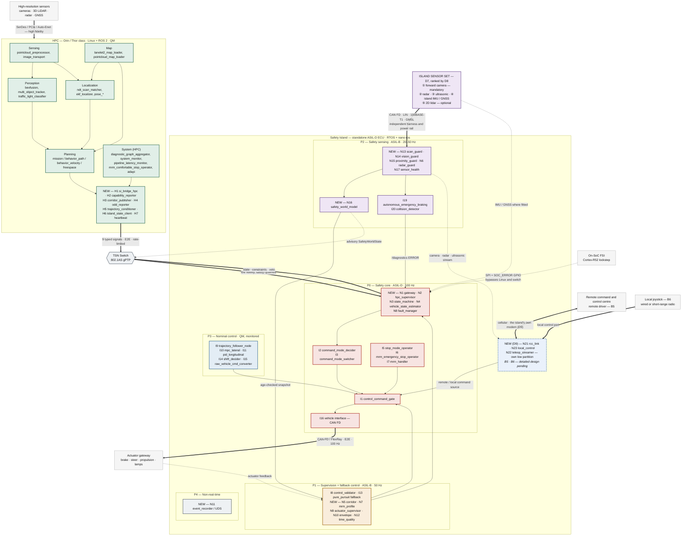

Purple is the sensing chain added by [D7](#1-inputs-already-fixed-by-the-wg). Two sensor sets, two harnesses, two power rails: the vehicle
is perceived twice, at very different resolutions, by two domains that share no failure mode. The only
paths that survive HPC loss are those originating inside the island boundary — and after [D7](#1-inputs-already-fixed-by-the-wg) that now
includes a view of the road ahead.

<mark>The dashed blue box is [D9](#1-inputs-already-fixed-by-the-wg)'s communication module and local control port (§6.5). It is drawn inside the island
boundary on purpose: the remote driver of [B5](#b5--tele-operation-from-the-remote-command-centre) and the operator of [B6](#b6--manual-joystick-control-without-streamed-sensing) reach the gate without passing
through the HPC, so both survive its loss. It is dashed because its detailed design is pending.</mark>

### 10.2 The island sensing chain

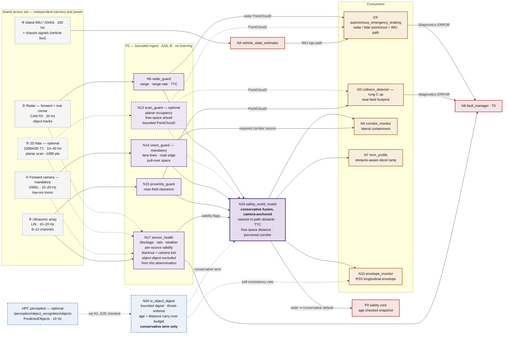

<mark>Solid boxes and edges are the ranked sensors; dashed ones exist only where [D8](#1-inputs-already-fixed-by-the-wg)'s optional 2D lidar is
fitted. The ultrasonic array, ranked third, is solid but arrives at rung C: it adds [`N15`](#62-island-safety-sensing)'s near-field clearance and lets
`autoware_collision_detector` run on its `PointCloud2`. Read the solid part alone and it is still complete: the camera feeds the corridor
and the lateral free space, radar feeds the in-path range and — as a `PointCloud2` from
[`N6`](#61-supervision-state-and-fallback) — `autoware_autonomous_emergency_braking`, unmodified.</mark> Where a 2D lidar is fitted,
[`N13`](#62-island-safety-sensing) adds a bounded `PointCloud2` to the same migrated nodes, *and* feeds [`N16`](#62-island-safety-sensing) for the fused world state that the
supervision tier consumes <mark>— as a confirming source only</mark>. The safety core reads [`N16`](#62-island-safety-sensing) only through an age-checked snapshot, so a stall
anywhere in this diagram degrades the MRM to blind deceleration rather than blocking it.

The two blue dash-outlined boxes are [§3.5](#35-optional-enrichment-the-hpc-object-list)'s option, drawn that way because they may simply not be there.
Note what is **absent**: there is no edge from the digest to [`N17`](#62-island-safety-sensing), and its box says so. The digest
is excluded by construction from the blackout determination, so a live HPC publishing objects can never
hide the fact that the island itself has gone blind. Note also which consumers it *does* reach —
[`N16`](#62-island-safety-sensing), where it can only add a hazard, and `N10`, where it powers the self-consistency veto.
It reaches no node on the P0 path at all.

### 10.3 Failover sequence — HPC loss during autonomous driving

```mermaid
sequenceDiagram
    autonumber
    participant HPC as HPC (planning)
    participant N1 as N1 si_safety_gateway
    participant N2 as N2 si_hpc_supervisor
    participant N8 as N8 si_fault_manager
    participant N3 as N3 si_state_machine
    participant N16 as N16 safety_world_model
    participant N17 as N17 si_sensor_health
    participant CTRL as I9-I11 follower (P3)
    participant FB as I13 + N7 fallback (P1)
    participant GATE as I1 command gate (T0)
    participant ACT as Actuator gateway

    rect rgb(225,239,232)
    Note over HPC,ACT: Nominal — ADS_ACTIVE
    HPC->>N1: trajectory 10 Hz, heartbeat 100 Hz (E2E)
    N1->>CTRL: verified trajectory + reference odometry
    N1->>N2: heartbeat, timestamps
    N16->>N16: island sensors fused, 20 Hz
    CTRL->>GATE: control_cmd 50 Hz
    GATE->>ACT: filtered command 100 Hz
    end

    rect rgb(249,237,220)
    Note over HPC,ACT: t=0 — HPC stops publishing
    HPC--xN1: process hang / power loss
    N2->>N2: heartbeat miss x3 (<=30 ms)
    N2->>N8: HPC_LIVENESS_LOST
    N8->>N3: fault verdict, severity SEVERE
    Note right of N16: island sensors unaffected —<br/>separate harness and power
    end

    rect rgb(247,228,226)
    Note over N3,ACT: t~30 ms — authority transfer, B2 entry
    N3->>N16: corridor valid? (camera valid, N14 lane lines seen; H3 refines while fresh)
    alt corridor valid — B2 admissible
        N3->>GATE: mode = LANE_KEEP_HOLD, source = fallback
        N3->>CTRL: deselect — no restart, output ignored
        N3->>N3: latch ODD class from last H4 active_odd — v_odd 60 highway / 30 city
        N3->>FB: activate, hold budget T_hold (8–15 s)
        FB->>GATE: pure-pursuit on camera lane lines + decel to v_odd, then v_hold
        GATE->>ACT: B2 command, hazard lamps ON
    else camera lost, or no lane lines
        Note over N3,ACT: no corridor — straight to Exit C (B4)
    end
    end

    rect rgb(232,236,244)
    Note over N2,ACT: B2 hold — lane kept on the camera, v_odd then v_hold, T_hold running
    loop every 10 ms, while T_hold not expired
        N16-->>FB: free-space ahead, nearest obstacle, TTC
        alt world state fresh and valid
            FB->>FB: obstacle-aware — bound v_hold on free space
        else world state stale or invalid
            FB->>FB: conservative fixed ramp — blind MRM
        end
        FB->>GATE: lateral + longitudinal step
        GATE->>ACT: command
        ACT-->>FB: actuator feedback, N9 plausibility check
    end
    N2->>N2: watch for heartbeat + valid trajectories
    end

    rect rgb(225,239,232)
    Note over HPC,ACT: Exit A — HPC resumes within T_hold (reversible)
    HPC->>N1: heartbeat + trajectory restored
    N1->>N2: re-qualify over confirmation window
    N2->>N3: HPC_RECOVERY_CONFIRMED
    N3->>FB: deactivate after hand-back
    N3->>CTRL: reselect via I3 smooth transition
    N3->>GATE: mode = ADS_ACTIVE, source = nominal
    Note right of N3: resumes under B1 at CONSTRAIN,<br/>released only per §6.4 hysteresis
    end

    rect rgb(249,237,220)
    Note over N3,ACT: Exit B — T_hold expires, HPC still lost
    N3->>N3: hold budget exhausted
    N3->>N17: camera valid, lane lines seen?
    alt camera sees the lane — B3
        N3->>GATE: mode = MRM_EXECUTE, behaviour = PULL_OVER (B3)
        Note right of N3: N18 searches: H8 refuge, else camera-found space —<br/>none found ⇒ in-lane stop on the camera's corridor
    else camera lost — B4
        Note over N3,ACT: go to Exit C
    end
    N3->>GATE: hazard lamps ON — at entry, not at standstill
    N16-->>GATE: I19 AEB ERROR if collision imminent
    N16-->>FB: I20 near-field clear before standstill release
    FB->>N3: standstill reached
    N3->>GATE: MRM_COMPLETE, SAFE_STOP, gear P
    end

    rect rgb(247,228,226)
    Note over N17,ACT: Exit C — sensing blackout at any point above (B4)
    N17->>N17: camera invalid or lane lines lost, debounced
    N17->>N16: camera validity false — radar etc. cannot lift it
    N16->>N8: SENSING_BLACKOUT (no corridor, no free space)
    N8->>N3: fault verdict, severity CRITICAL
    N3->>GATE: mode = EMERGENCY_STOP, source = I6, hazard lamps ON
    Note right of N3: no guard, no precondition —<br/>reachable from every state above
    GATE->>ACT: I6 emergency ramp a_emg, steering relaxed to straight
    N16--xN3: nothing published — this is the point
    ACT->>N3: standstill
    N3->>GATE: SAFE_STOP, gear P, hazards still on — no exit upward
    end
```

<mark>Exit C is drawn last but is not last in precedence: it can preempt Exits A and B at any moment,
including mid-hand-back. Note what is *absent* from it — no [`N16`](#62-island-safety-sensing) query, no corridor
lookup, no [`N18`](#63-pull-over-mrm-after-hpc-loss) refuge check. [B4](#b4--emergency-stop-when-the-island-is-blind) is the only path in this diagram that
completes without consulting a sensing node, which is what allows it to run when the sensing nodes
are the thing that failed.</mark>

The critical span is detection to authority transfer: three missed heartbeats at 100 Hz, then two
decision cycles. **Nothing in the shaded transfer band reads a topic the HPC produces** <mark>— the ODD class is latched from the last `active_odd` the island had already verified and buffered, not requested from an HPC that is gone, and a missing one selects the most restrictive class</mark> — and the
`alt` branch on world-state validity is the §2.2 staleness rule made explicit. Island perception
improves the outcome; its absence never blocks the transfer.

The exits are the point of the diagram. HPC loss does not commit the vehicle to a terminal
manoeuvre: it commits it to [**B2**](#b2--keep-the-vehicle-in-its-lane-after-loss-of-the-hpc), a bounded lane-keeping hold, from which Exit A returns authority to
a re-qualified HPC and Exit B <mark>forks — to [B3](#b3--pull-over-if-the-odd-continues-to-fail) when the camera still sees the lane, to Exit C ([B4](#b4--emergency-stop-when-the-island-is-blind)) when it does not; there is no third way out of the hold</mark>. <mark>Within the window, the first seconds go to bringing the vehicle down to `v_odd` (§3.1); the rest is the HPC's chance to return.</mark> Note what Exit A does *not* do — it does not accept the
first heartbeat that reappears, and it does not return to `ALLOW`. Note also that the corridor check
sits at [B2](#b2--keep-the-vehicle-in-its-lane-after-loss-of-the-hpc)'s entry, not inside it: an island that cannot see the lane never enters the hold at all —
<mark>it goes to Exit C, which is [B4](#b4--emergency-stop-when-the-island-is-blind), directly.</mark>

### 10.4 Command-source arbitration inside the island

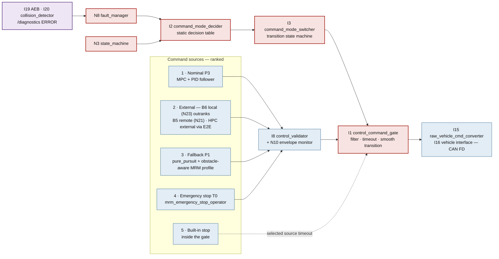

Rank order is fixed at build time. Every source except the gate's own built-in stop passes through
validation; the built-in stop exists precisely because it must work when validation's inputs are gone.
[`I19`](#41-migration-list) and [`I20`](#41-migration-list) do **not** appear as command sources — they are fault sources. Island perception
escalates through the fault manager and the state machine, never straight to the actuators.

### 10.5 Pull-over decision and abort ladder

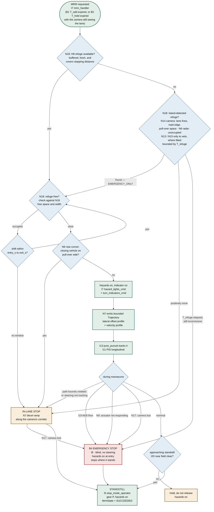

Every branch out of the happy path lands on a *simpler* manoeuvre. Pull-over degrades to in-lane stop,
<mark>in-lane stop degrades to [B4](#b4--emergency-stop-when-the-island-is-blind) emergency stop</mark>, emergency stop degrades to the gate's built-in stop.
The manoeuvre never escalates in complexity under fault — which is what makes attempting the harder
<mark>one acceptable. Note the two edges into [B4](#b4--emergency-stop-when-the-island-is-blind) that do not pass through the pull-over logic at all: a
sensing blackout removes the *precondition* of every box above it at once, so it short-circuits the
ladder rather than descending it.</mark>

<mark>The `SEARCH` box is where the island produces a stopping place of its own rather than verifying one,
and its three outcomes are not interchangeable. **Found** rejoins the ordinary path at `VERIFY` — an
island-detected clearance is verified free exactly as a nominated refuge is, because provenance changes
what may be *claimed* about a refuge, never what must be *checked*. **Positively none** descends one
rung to the in-lane stop, which still has a corridor. **Inconclusive** is the only one that reaches
[B4](#b4--emergency-stop-when-the-island-is-blind), and it does so for the same reason the blackout edge
does: a search that cannot conclude is a statement about the island's own capability.</mark>

### 10.6 ODD degradation ladder

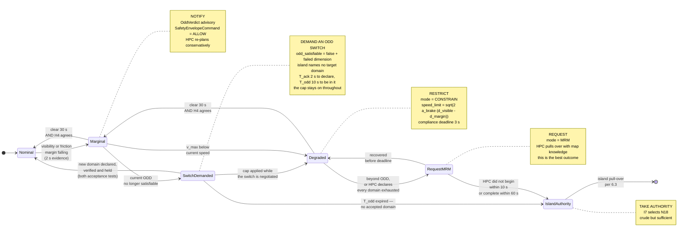

Time runs in seconds here, not milliseconds. The escalation is **deliberately reluctant**: the island
gives the HPC <mark>four</mark> chances to handle its own ODD exit, because a planned pull-over with map knowledge
beats the island's geometric one every time. Only non-compliance — which the island detects from
vehicle status alone, needing no HPC cooperation — moves authority.

<mark>`SwitchDemanded` is the rung that carries the drive forward rather than down. Every other edge in this
diagram either holds the vehicle where it is or moves it closer to a stop; the edge from
`SwitchDemanded` back to `Nominal` is the one that returns the vehicle to normal L4 operation — in a
narrower domain than it left. Note that it returns to `Nominal` and not to `Marginal`: once a domain has
been declared, verified and held, the vehicle is no longer operating outside its envelope. The envelope
changed.</mark>


---

## 11. Open decisions for the WG

These change the allocation and should be settled before Part 2.

1. **Target or legacy command architecture (§4.3).** The recommendation is the target set
   (`control_command_gate` + `command_mode_decider/switcher` + `stop_mode_operator`). This must be
   pinned to a specific Autoware release, because the existing ASI port targets Humble-era interfaces.
2. **Two-tier controller (§4.2).** Does the WG accept a QM-rated MPC bounded by an ASIL-D gate, or
   must the entire control module reach ASIL-B/D? The answer determines whether `autoware_pure_pursuit`
   ([I13](#41-migration-list)) is in scope for phase 1.
3. **Island sensor set ([D7](#1-inputs-already-fixed-by-the-wg), §6.2).** Settled in principle, <mark>and now ranked by [D8](#1-inputs-already-fixed-by-the-wg): camera mandatory, radar
   second, ultrasonic third, IMU / GNSS fourth, 2D lidar optional. What remains is the rung each deployment
   commits to (§9.4) and the mounting — in particular the camera's field of view, which must cover the
   road edge on the pull-over side as well as the lane ahead, because [B3](#b3--pull-over-if-the-odd-continues-to-fail) now finds its space with it.</mark>
   Each sensor added costs P2 budget and a safety manual.
4. **Corridor abstraction ([H3](#7-new-nodes-to-add-on-the-hpc)/[N5](#61-supervision-state-and-fallback)).** With [N14](#62-island-safety-sensing) available the map corridor is no longer the only source,
   so this is now a question of *preference order* rather than necessity. <mark>The proposal is now split by
   who drives: while the HPC drives, map corridor first, cross-checked against the camera; once the
   island drives, the camera is required and the map corridor only refines it. The heading tube is
   withdrawn as a corridor source — its loss-of-lane case is [B4](#b4--emergency-stop-when-the-island-is-blind).</mark> Confirm that ordering, and the age at
   which each source expires.
5. **Message set ownership.** `SafetyCorridor`, `HpcCapability`, `OddStatus`, `HpcHeartbeat`,
   `IslandState`, `SafetyEnvelopeCommand`, `SafetyWorldState`, `IslandSensorHealth`, `PullOverRefuge`,
   `OddVerdict`, `FallbackAvailability` are new. Proposal:
   a single `autoware_safety_island_msgs` package, contributed upstream so both domains generate from
   the same `.msg` sources — as the nano-ros port already does for wire compatibility.
6. **In-house protection profiles (§8.4).** AUTOSAR is out of scope by WG decision, so `SI-E2E/A`
   and `SI-E2E/B` are proposed in its place. Confirm the field widths and the CRC polynomials — and,
   first, whether nano-ros's built-in E2E already covers them, in which case the island inherits the
   middleware's verification evidence instead of writing its own.
7. **Intra-island RMW backend (§9.3).** Cyclone DDS on the HPC boundary is settled by wire
   compatibility. For the [T0](#22-criticality-tiers-on-the-island) partition, XRCE-DDS gives static-after-init allocation, zenoh-pico gives a
   bounded bump arena, Cyclone DDS needs a pre-sized pool. Whether the island runs one backend or two
   is the open question, and it is a `system.toml` decision rather than a code decision.
8. **Camera processing on the island ([N14](#62-island-safety-sensing)).** Two routes. *(a)* Classical CV — inverse perspective
   mapping plus line fitting — which is bounded, auditable, and cheap to certify, but fragile in poor
   lane marking and adverse light. *(b)* A certified automotive smart camera that emits lane and object
   lists over CAN/Ethernet, moving the perception burden and its ASIL evidence to the supplier. **(b) is
   recommended**: it collapses [N14](#62-island-safety-sensing) to a parser, removes learning-based code from the island entirely,
   and buys supplier safety evidence. It costs BOM and vendor lock-in. If the WG prefers (a), the
   island's ODD must be narrowed accordingly. <mark>[D8](#1-inputs-already-fixed-by-the-wg) raises the stakes of this decision: the camera is now
   the one mandatory sensor, and [B3](#b3--pull-over-if-the-odd-continues-to-fail) asks of it more than lane lines — the road edge and the drivable
   space beside the lane. Classical CV does the first well and the second poorly, so (a) would confine
   the island-detected refuge to roads with a marked edge line or a high-contrast kerb. Whichever route,
   the camera's output must include road-edge and lateral free-space fields, not lanes alone.</mark>
9. **Do island sensors also feed the HPC?** The design says no — one-way, sensors to island only, with
   the island forwarding an advisory `SafetyWorldState` upward. Confirm, because the alternative (a tap
   into the HPC's sensing) is tempting for cross-validation and would quietly create the reverse
   dependency the independence argument forbids.
10. **`MrmState` has no pull-over value (§6.3).** `autoware_adapi_v1_msgs/MrmState.behavior` carries
   only `NONE`, `EMERGENCY_STOP` and `COMFORTABLE_STOP`, yet `mrm_handler` already defines a
   `pull_over_manager` slot. Proposal: contribute a `PULL_OVER` value upstream rather than overloading
   `COMFORTABLE_STOP`, which would make the AD API and the operator UI report the wrong manoeuvre.
11. **Can the HPC honour the refuge coverage guarantee (§6.3)?** It must guarantee that the buffered
   refuge set always covers the current worst-case stopping distance, and declare explicitly when it
   cannot. This is a real constraint on the planner, and it should be confirmed with the planning
   maintainers before the interface is fixed.
12. **ODD verdict arbitration (§6.4).** The proposal is that the more restrictive of the HPC's and the
   island's verdict binds, and that disagreement is recorded as a SOTIF event. Confirm — the
   alternative, HPC-wins, removes the only mechanism that catches a confidently-wrong HPC.
13. **Island ODD declaration (§6.4).** The MRM's claimed operating domain — speed ceiling, road
   geometry, weather — is narrower than the vehicle's ODD and must be stated as a first-class
   requirement, not discovered during validation. <mark>[B2](#b2--keep-the-vehicle-in-its-lane-after-loss-of-the-hpc)'s **`v_odd` table** is now part of it: the road
   classes and the safe speed for each — **~60 km/h highway, ~30 km/h city road** are the starting
   proposal — and which class applies when `active_odd` names a domain the table does not list (proposed:
   the most restrictive). The table is per sensor rung, since rung A cannot support the highway value.</mark>
14. **[B2](#b2--keep-the-vehicle-in-its-lane-after-loss-of-the-hpc)'s hold window and the hand-back criteria (§3.1, §3.2).** Three numbers and one policy question,
   and they are the most consequential open items in the behaviour set.
   *(a)* `T_hold` — how long the island may hold the lane awaiting HPC recovery. Too short and every
   transient HPC hiccup becomes a pull-over on a live carriageway; too long and the vehicle loiters
   under a fallback controller with a narrow ODD. <mark>The range is now **8–15 s** (it was 2–5 s), because the
   window must contain the descent to `v_odd` — 5.6 s from 100 to 60 km/h at 2 m/s² — and still leave the
   HPC time to return (§3.1). What remains open is the value per road class within that range, and the
   fallback deceleration (≤ 2 m/s² proposed) used to reach `v_odd`.</mark>
   *(b)* `v_hold` — the constrained speed held during [B2](#b2--keep-the-vehicle-in-its-lane-after-loss-of-the-hpc), from the §6.4 speed law evaluated against the
   *island's* ODD, not the vehicle's, <mark>and capped by `v_odd` (decision 13)</mark> <mark>Now a **ramp** rather than a constant (§3.1): the open numbers are
   the `v_exit(t)` decay shape — linear in time, linear in remaining `T_hold`, or a constant-deceleration
   profile — and `v_entry`, the speed the ramp must land on at `T_hold`. A ramp that is too aggressive
   throws away the hold's whole purpose by stopping the vehicle before the HPC has had its window; one
   that is too gentle leaves [B3](#b3--pull-over-if-the-odd-continues-to-fail) to begin with a deceleration it should have inherited.</mark>
   *(c)* The **recovery confirmation window** — how long a returned HPC must publish valid, in-envelope
   trajectories before [`N2`](#61-supervision-state-and-fallback) will qualify it. It must be long enough that a crashed-and-restarted HPC
   cannot re-acquire authority on its first plausible message.
   *(d)* The policy question: **may a recovered HPC be trusted at all within the same drive cycle?** The
   design says yes, under confirmation and re-entering [B1](#b1--degrade-the-ads-when-the-odd-cannot-be-held) at `CONSTRAIN`, because the alternative —
   treating every transient loss as terminal — makes the vehicle brittle in exactly the scenarios the
   island exists to survive. The conservative alternative (hold, then always pull over) is defensible
   and cheaper to argue for in the safety case. This is a WG decision, not a design one.
15. <mark>**[B4](#b4--emergency-stop-when-the-island-is-blind)'s blackout declaration and stop rate (§3.1, §6.2).** [B4](#b4--emergency-stop-when-the-island-is-blind) is new in version
   20260903 and its parameters are unset. Three numbers and one policy question.
   *(a)* The **blackout debounce** — how long </mark>the camera must be invalid, or the lane lines lost,<mark>
   before [`N17`](#62-island-safety-sensing) declares it. </mark>Since [D8](#1-inputs-already-fixed-by-the-wg) this is a single-sensor debounce, and it is also
   the bridging budget over which [`H3`](#7-new-nodes-to-add-on-the-hpc)'s corridor may carry a camera dropout.<mark> Too short and a tunnel mouth, a spray burst
   from an overtaking truck, or a low-sun frame triggers an emergency stop on a live carriageway; too
   long and the vehicle travels blind. The starting proposal is **3 consecutive [`N16`](#62-island-safety-sensing) cycles**
   (≈ 60–150 ms), bounded additionally by a hard **distance-travelled-blind** cap, because at speed the
   time budget and the distance budget are not the same constraint.
   *(b)* `a_emg` — the emergency deceleration rate. It is **not** AEB's rate: AEB brakes to avoid a
   detected obstacle, whereas [B4](#b4--emergency-stop-when-the-island-is-blind) has no obstacle to stop short of, so following-vehicle risk
   rather than stopping distance is the dominant term.
   *(c)* The **steering-relaxation rate** — how fast the held steering angle is allowed to return
   toward straight while the vehicle decelerates. Zero means the vehicle continues its current arc;
   too fast is a lateral disturbance of its own.
   *(d)* The policy question: **must [B4](#b4--emergency-stop-when-the-island-is-blind) also alert?** Hazard lamps are in the design already.
   Whether a blind stop additionally raises a remote-assistance request, a V2X hazard message, or the
   horn is an operational-concept decision the WG owns, and it interacts with whether the deployment
   assumes a remote operator at all.</mark>
16. **The optional HPC object list ([§3.5](#35-optional-enrichment-the-hpc-object-list), §6.2, §8.1).** New in version 20260903, and the first
   question is whether to take it at all.
   *(a)* **Adopt, or not.** For: the self-consistency veto is the cheapest guardian function in the
   whole design — it needs no island sensor, only [`N10`](#61-supervision-state-and-fallback)/[`I8`](#41-migration-list) and the digest, and it catches the failure
   mode island perception is worst at catching, namely a *healthy* HPC planning through an object it
   has itself just published. Against: it is the first HPC-produced topic the island consumes for
   anything other than supervising the HPC, and every such input is one more argument to make in the
   safety case. **Recommendation: adopt at phase 2, behind the monotone-conservatism rule**, which is
   what makes the argument short.
   *(b)* **The digest bounds** — maximum object count `K_obj`, prediction horizon `H_obj`, and the field
   set. These fix the worst-case message size, and therefore the [R4](#21-partitioning-rules)/[R5](#21-partitioning-rules) argument. Starting proposal:
   the **16 highest-threat objects**, **3 s** of predicted path, and pose, extent, velocity and class
   only.
   *(c)* **The carry-over budget** — how long, and how far, the last valid digest survives HPC silence.
   Two bounds rather than one, for the reason decision 15 gives. Starting proposal: **500 ms or 10 m,
   whichever comes first.**
   *(d)* **The E2E profile.** SI-E2E/B is proposed on the ground that corruption can only cause
   *nuisance* braking, never a missed hazard. If the WG judges nuisance braking at speed to be a hazard
   in its own right, the row moves to SI-E2E/A. This is the sharpest of the four questions, and it is
   the one that tests whether the monotone-conservatism argument is believed.
17. <mark>**The ODD switch exchange ([B1](#b1--degrade-the-ads-when-the-odd-cannot-be-held), §6.4).** [B1](#b1--degrade-the-ads-when-the-odd-cannot-be-held) is now a negotiation rather than a
   constraint, and four things about it are unset.
   *(a)* `T_ack` and `T_odd` — **2 s** to declare a new active domain, **10 s** to be measurably in it,
   are starting proposals only. `T_odd` is additionally bounded from above by `t_margin − t_pullover`
   (§3.1), so what the WG is really fixing is a *ceiling* and a default, not a single number.
   *(b)* **Who owns the ODD catalogue.** The design says the HPC does, and that the island never names a
   target domain — it only rejects answers. That keeps planning off the island ([R4](#21-partitioning-rules),
   [R5](#21-partitioning-rules)) but means the island cannot tell *no satisfiable domain exists* from
   *the HPC failed to find one*. Both route to [B3](#b3--pull-over-if-the-odd-continues-to-fail), so nothing unsafe follows; what is lost is
   diagnostic resolution in the field data.
   *(c)* **What `active_odd`'s bounds must contain** for the island's acceptance test to be meaningful.
   Speed ceiling, required sensing range and assumed friction are proposed because the island measures
   all three. Any bound the island cannot measure is one it cannot verify, and belongs in the message
   only as recorded evidence.
   *(d)* The policy question: **may the vehicle switch domains more than once in a drive cycle?** The
   design does not forbid it, and repeated narrowing is the natural behaviour in worsening weather. The
   conservative alternative — one switch, then [B3](#b3--pull-over-if-the-odd-continues-to-fail) — is easier to argue and materially less
   useful.</mark>
18. <mark>**The island-detected refuge and `T_refuge` ([B3](#b3--pull-over-if-the-odd-continues-to-fail), §6.3).** The island now carries a second
   refuge source, which is the first time it produces a stopping *place* rather than verifying one.
   *(a)* `T_refuge` — **5 s** is proposed, with a distance-travelled-searching cap alongside it for the
   reason decision 15 gives. It is bounded below by how long the sensors need to establish a clearance
   with confidence, and above by the speed the vehicle is still carrying while it searches.
   *(b)* **The clearance criteria** — minimum width, minimum length, maximum lateral displacement,
   and what surface evidence (if any) is required </mark>— all of them now measured by the camera, so each
   needs a stated camera accuracy at the range the search runs at<mark>. The island cannot classify a surface, so
   `surface_class = UNKNOWN` is proposed, which means the criteria must be geometric alone.
   *(c)* **Is an `EMERGENCY_ONLY` clearance acceptable at all?** This is the real question. The island
   cannot tell a hard shoulder from a cycle lane, a bus stop or a driveway, so admitting the source
   means accepting an unlawful stopping place in preference to a stop in a live running lane. The
   design says yes, second in priority and never displacing a nominated refuge, on the ground that a
   stopped vehicle in a running lane is the worse outcome. A WG that disagrees should say so, and the
   consequence is that [B3](#b3--pull-over-if-the-odd-continues-to-fail) degenerates to the in-lane stop whenever [`H8`](#7-new-nodes-to-add-on-the-hpc) is silent.
   *(d)* **Inconclusive versus none.** The design distinguishes a search that *positively determines*
   no refuge exists — which abandons to the in-lane stop, corridor still in hand — from one that runs
   out of `T_refuge` *without a determination*, which goes to [B4](#b4--emergency-stop-when-the-island-is-blind). The distinction is load-bearing
   (§3.1) and it must be implementable: [`N18`](#63-pull-over-mrm-after-hpc-loss) has to be able to say which of the two it
   reached, and a WG that judges that undecidable in practice collapses both to [B4](#b4--emergency-stop-when-the-island-is-blind) and should say
   so explicitly.</mark>
19. <mark>**[B5](#b5--tele-operation-from-the-remote-command-centre) remote driving and the RCC link ([D9](#1-inputs-already-fixed-by-the-wg), [§6.6](#66-detailed-design-of-b5-and-b6), [§8.6](#86-the-rcc-link-and-the-local-control-port)).** The stage-1 design is proposed;
   these items remain.
   *(a)* **Stage 2: taking over a moving vehicle.** Stage 1 enters from standstill only. A moving take-over —
   from [B2](#b2--keep-the-vehicle-in-its-lane-after-loss-of-the-hpc)'s hold, say, so the RCC could avoid a stop altogether — needs its own hand-over protocol and
   puts the remote driver's situational lag on top of the link's.
   *(b)* **Ratify the stage-1 numbers:** `T_link` = 300 ms; a command-age bound of 600 ms soft and 1.0 s hard;
   `v_cap` = 20 km/h; a design loop time of 1.8 s, including 1.2 s of driver reaction; `a_tele` = 3 m/s².
   *(c)* **Re-engaging the ADS from `SAFE_STOP`.** Proposed: allowed, on the RCC's request, once the HPC
   has been re-qualified over [B2](#b2--keep-the-vehicle-in-its-lane-after-loss-of-the-hpc)'s confirmation window and the ODD is satisfiable. Otherwise every
   remote recovery ends the drive cycle, including one that followed a transient fault.
   *(d)* **The module and its keys.** One modem with two SIMs for stage 1, or two modems on two carriers.
   Who owns the certificate authority for operator and vehicle keys. Whether zenoh-pico's TLS transport
   is adequate, or whether [N21](#65-remote-command-and-control-link-and-local-control-port) terminates TLS itself.
   *(e)* **Stage 2: a path-based remote-assistance mode**, in which the driver sends a short path and the
   island's fallback tier ([N7](#61-supervision-state-and-fallback) → [I13](#41-migration-list)) drives it. It tolerates latency far better than
   direct driving, and needs a remote-path input on [N7](#61-supervision-state-and-fallback).
   *(f)* **The RCC's human-factors requirements**, and the operator-to-vehicle ratio: 1 : 1 while [B5](#b5--tele-operation-from-the-remote-command-centre) is
   active is proposed.</mark>
20. <mark>**[B6](#b6--manual-joystick-control-without-streamed-sensing) joystick control ([D9](#1-inputs-already-fixed-by-the-wg), [§6.6](#66-detailed-design-of-b5-and-b6)).** The stage-1 design is proposed; these items remain.
   *(a)* **Entry from motion.** Proposed: never — a moving [B5](#b5--tele-operation-from-the-remote-command-centre) is stopped before `LOCAL` is granted. A
   test-track mode that allows it belongs outside this design.
   *(b)* **Ratify the numbers:** `v_local` = 5 km/h forward and 3 km/h in reverse; 0.5 m/s²;
   `T_local` = 200 ms.
   *(c)* **The device.** Certification of the radio controller to IEC 62745, with its stop functions at
   PL d; the radio band, which differs by region; and where the wired CAN FD port sits on the vehicle.
   *(d)* **The hardwired emergency stop** from the controller's receiver to the actuator gateway, so
   that the stop does not depend on island software. A Part-2 hardware item.</mark>
21. <mark>**Least-Cost hardware ([D10](#1-inputs-already-fixed-by-the-wg), [§9.5](#95-two-design-branches-least-cost-and-maximum-safety)).**
   *(a)* **Which microcontroller.** The recommendation is the **NXP S32Z2**. It has the most headroom for
   [`N14`](#62-island-safety-sensing)'s pixel work (Neon plus a DSP), and it is the S32Z-class target nano-ros is already verified for.
   The **AURIX TC4x** is acceptable in a variant with the PPU, provided the safety integrity of the PPU path
   is argued. The **Stellar** is acceptable only with a certified smart camera (open decision 8(b)).
   *(b)* **The camera interface.** No CSI-2 receiver was found on any of the three, so Least-Cost
   specifies a 100BASE-T1 Ethernet camera: raw low-resolution mono at about 31 Mbit/s, plus an encoded
   second stream for [B5](#b5--tele-operation-from-the-remote-command-centre). This should be confirmed
   against each reference manual.
   *(c)* **Ultrasonic placement, on both branches.** The proposal is three sensors across the front and
   two on the kerb side. The side pair is what lets Least-Cost's [B3](#b3--pull-over-if-the-odd-continues-to-fail) watch the strip it moves into
   without a rear-corner radar.</mark>
22. <mark>**Least-Cost restricts the vehicle's ODD, not only the island's ([§9.5](#95-two-design-branches-least-cost-and-maximum-safety)).** Without radar, the
   island can back a fallback speed of about 30 km/h in fair weather and nothing more. [B2](#b2--keep-the-vehicle-in-its-lane-after-loss-of-the-hpc)'s descent
   to `v_odd` fits inside the 8–15 s window only from about 50 km/h or less. The WG is asked to confirm
   that a Least-Cost vehicle is limited to an ODD of about 50 km/h or less that **excludes fog and heavy
   rain**, or else to price the alternative: a **single forward radar**, the cheapest addition that
   lifts the highway range, weather robustness and §6.4's radar-versus-camera test together.</mark>
23. <mark>**Maximum-Safety details ([§9.5](#95-two-design-branches-least-cost-and-maximum-safety)).**
   *(a)* **"Two front radars"** is read as two front-corner units, which give two independent
   visibility-test instances and cut-in coverage. One long-range unit plus one corner unit would trade
   the second instance for range.
   *(b)* **Pulling over to either side.** Rear-corner radar on both sides makes a refuge [`H8`](#7-new-nodes-to-add-on-the-hpc) nominates
   on the far side usable. The proposal is that the island's own refuge search stays on the kerb side,
   where the ultrasonics are mounted.
   *(c)* **Using the rear radars during [B2](#b2--keep-the-vehicle-in-its-lane-after-loss-of-the-hpc)'s descent.** The proposal is that they may choose the descent
   rate within a declared band, but may never push the arrival at `v_odd` past its deadline, and that an
   obstacle ahead always overrides. They are deliberately *not* allowed to soften
   [B4](#b4--emergency-stop-when-the-island-is-blind).
   *(d)* **Independence of the X5H.** The island must not use the HPC's SoC family ([R7](#21-partitioning-rules), common cause),
   and freedom from interference between the X5H's application cluster and its lockstep R52 cluster
   must be argued in Part 4.</mark>

---

## 12. Next steps

| Part | Content |
| :-- | :-- |
| **2** | Timing and FTTI: worst-case chain latency per interface, fault-reaction budget derivation, RT contract files (`*.contract.yaml` + platform files) for both domains, checked against the nano-ros scheduling wiring matrix for the chosen target. |
| **3** | Interaction specification: full message definitions for `autoware_safety_island_msgs`, per-signal E2E configuration, QoS table, and the complete island state machine with transition guards. |
| **4** | Safety case skeleton: HARA extract, safety goals, ASIL allocation and decomposition argument, independence analysis, and the fault-injection test matrix (HPC hang, link flood, stale trajectory, E2E corruption, actuator non-response, power loss, <mark>**simultaneous blindness of every island sensor — the [B4](#b4--emergency-stop-when-the-island-is-blind) case**</mark> <mark>· loss of the RCC link mid-[B5](#b5--tele-operation-from-the-remote-command-centre) and of the local link mid-[B6](#b6--manual-joystick-control-without-streamed-sensing)</mark> — and, if [§3.5](#35-optional-enrichment-the-hpc-object-list) is adopted, a corrupted or phantom-object digest and a digest that goes silent mid-manoeuvre). |

Implementation sequencing follows the existing port. The current `autoware-safety-island` on nano-ros
already covers [I9](#41-migration-list)–[I12](#41-migration-list).

| Phase | Adds | Capability reached |
| :-- | :-- | :-- |
| **0** — done | [I9](#41-migration-list)–[I12](#41-migration-list) | Trajectory following on the island, closed loop against unmodified Autoware |
| **1** | P0: [I1](#41-migration-list)–[I3](#41-migration-list), [I5](#41-migration-list)–[I7](#41-migration-list), [I16](#41-migration-list), [N1](#61-supervision-state-and-fallback)–[N4](#61-supervision-state-and-fallback), [N8](#61-supervision-state-and-fallback) | **Autonomous fallback.** Authority transfer on HPC loss; blind but bounded MRM |
| **2** | P1: [I8](#41-migration-list), [I13](#41-migration-list), [N5](#61-supervision-state-and-fallback), [N7](#61-supervision-state-and-fallback), [N9](#61-supervision-state-and-fallback), [N10](#61-supervision-state-and-fallback), [N12](#61-supervision-state-and-fallback) | **Guardian role.** Command validation, safety envelope, veto, two-tier control |
| **3** | P2: [I19](#41-migration-list), [I20](#41-migration-list), [N6](#61-supervision-state-and-fallback), [N13](#62-island-safety-sensing)–[N17](#62-island-safety-sensing) + the island sensor harness | **Obstacle-aware MRM** per [D7](#1-inputs-already-fixed-by-the-wg). The island stops for what it can see. |
| **4** | [N18](#63-pull-over-mrm-after-hpc-loss) + [H8](#7-new-nodes-to-add-on-the-hpc) | **Pull-over MRM** (§6.3). The island moves the vehicle out of the running lane. |
| **5** | [N19](#64-odd-degradation-on-weather-and-visibility) | **ODD degradation** (§6.4). Independent visibility and friction verdict, graded restriction of a healthy HPC. |

The minimal configuration in §9.4 cuts across this: **phases 1, 3 and 4 reduced to their mandatory
nodes deliver a pull-over-capable island in 21 nodes**, deferring the phase-2 guardian role. That is
the shortest credible path to a demonstrable L4 fallback, and it is the sequence recommended for the
golf-cart prototype.

The optional [§3.5](#35-optional-enrichment-the-hpc-object-list) object digest ([N20](#62-island-safety-sensing)) can be added at **phase 2**, where it serves [B1](#b1--degrade-the-ads-when-the-odd-cannot-be-held)'s
self-consistency veto with no island sensing at all, or deferred to phase 3 with the rest of the
sensing chain. It is on no phase's critical path, by construction.

Phases 1 and 2 are unchanged by [D7](#1-inputs-already-fixed-by-the-wg) and remain the critical path — [D7](#1-inputs-already-fixed-by-the-wg) improves the *quality* of the
fallback, it does not create it. Phase 3 can proceed in parallel on the sensing side, since [N13](#62-island-safety-sensing)–[N17](#62-island-safety-sensing)
have no dependency on P0 beyond the world-state contract in §2.2.

---

*Sources: [SafetyIsland_RefDesignWG.pdf](SafetyIsland_RefDesignWG.pdf) (Reference Design WG, 2026-08-14); `SaftyIsland_ReferenceDesign.md`;
`This project researches the design of safety islan.md`; `AutowareSW.md`; `autoware_universe` package
inventory, `main` branch, retrieved 2026-08-27; `autoware-safety-island` (branch `nano-ros`, NEWSLab NTU);
AWF progress update 2026-08-20, "Porting the Autoware Safety Island onto nano-ros";
`github.com/NEWSLabNTU/nano-ros`; the nano-ros book, `newslabntu.github.io/nano-ros-book`.*
